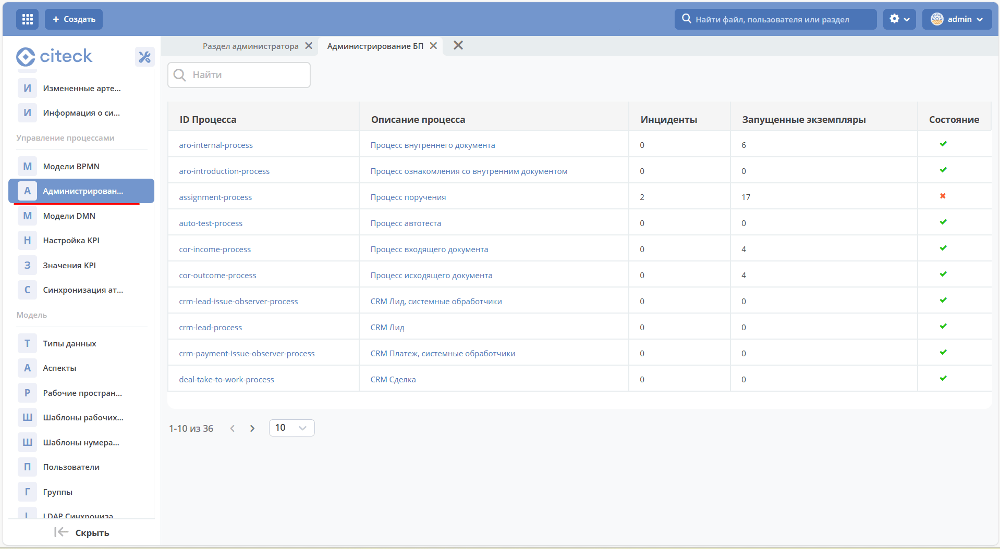
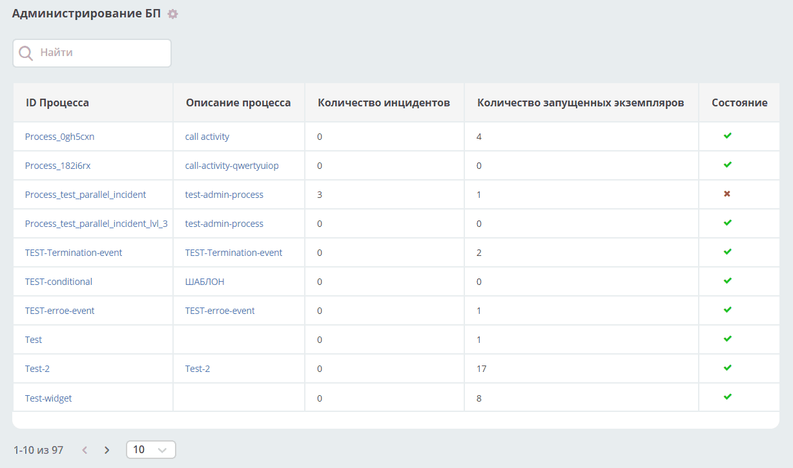
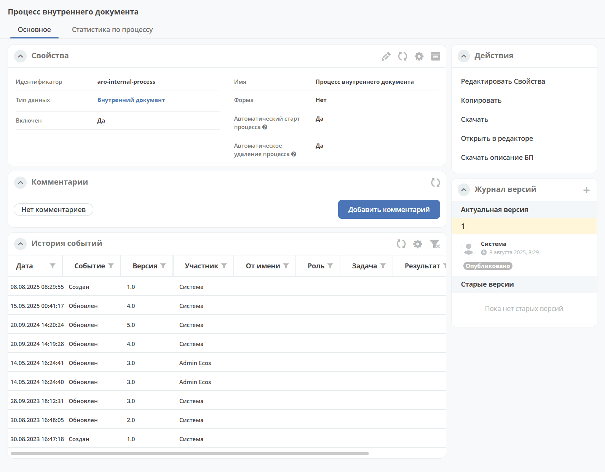
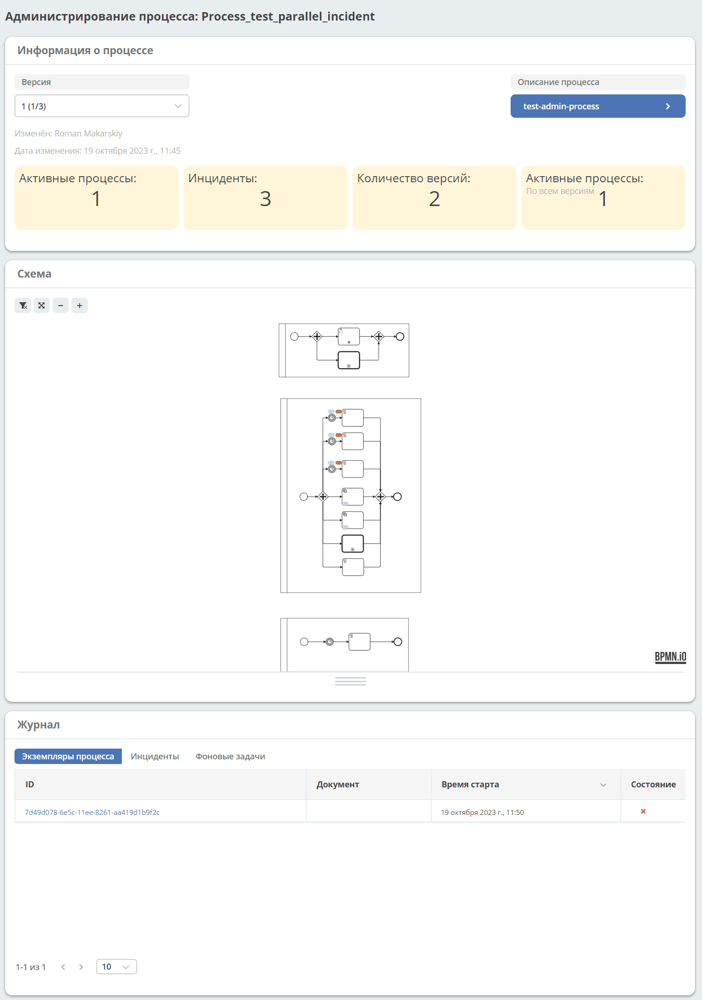
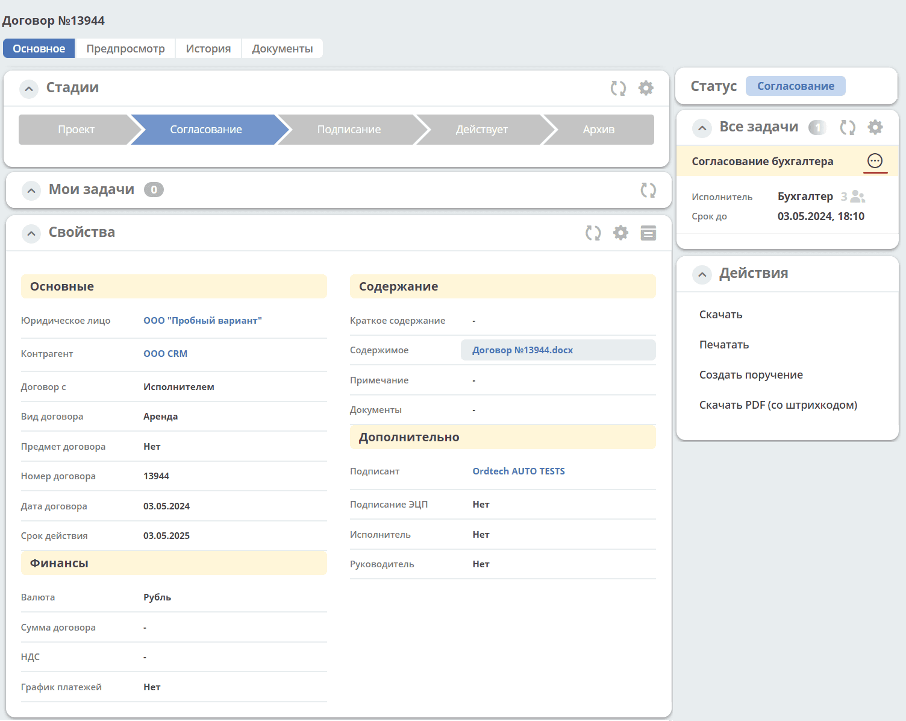
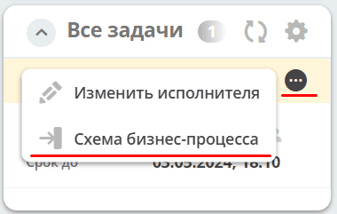
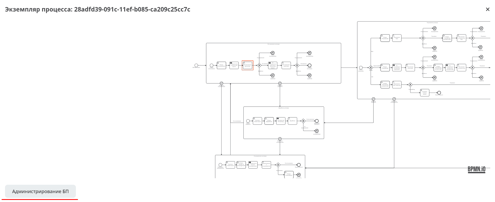

.. _bpmn_admin:

Администрирование бизнес-процессов
====================================================================

.. contents::

Раздел **«Администрирование БП»** позволяет просматривать опубликованные в движок версии бизнес-процессов, наблюдать за их экземплярами, анализировать инциденты и управлять выполнением процессов.

Раздел служит централизованным окном для просмотра и устранения технических ошибок бизнес-процессов. В одном журнале собраны все опубликованные процессы. Для каждого показаны количество инцидентов и запущенных экземпляров по всем версиям и признак наличия инцидентов. По клику на идентификатор процесса открывается список инцидентов версии и схема процесса со счётчиками ошибок на элементах. Для устранения ошибок доступны повторный запуск задания (изменение количества попыток), изменение переменных, миграция токенов (откат, пропуск или повтор шага), приостановка и удаление экземпляра.

**Определение процесса (process definition)** — опубликованная в движок версия схемы. **Экземпляр процесса (process instance)** — отдельный запуск этой версии. Сохранённая в редакторе модель без публикации не создаёт новую версию в движке.

Для переноса запущенных экземпляров с одной опубликованной версии на другую используйте :ref:`миграцию версий <actions_migration>`. Публикация новой версии сама по себе не переносит на неё уже запущенные экземпляры.

Для выбранного экземпляра процесса доступны следующие :ref:`действия <process_instance_actions>`:

    - Приостановить/возобновить экземпляр процесса;
    - Удалить экземпляр процесса;
    - Добавить переменную в экземпляр процесса;
    - Миграция токенов — изменение активных элементов в рамках текущего экземпляра процесса: откат на предыдущий шаг, пропуск ошибочного шага или повторное выполнение шага с сохранением переменных процесса (см. :ref:`Миграция токенов <token_migration>`).

Доступность данных и действий зависит от прав на процесс:

    - ``bpmn-process-instance-read`` — просмотр экземпляров процесса и связанных данных;
    - ``bpmn-process-instance-edit`` — приостановка, возобновление и удаление экземпляров, изменение переменных, комментариев к инцидентам и параметров заданий;
    - ``bpmn-process-instance-migrate`` — миграция токенов и версий. Для миграции версий право необходимо на исходную и целевую версии процесса.

Права проверяются по связанной модели бизнес-процесса. Администратор и системный контекст проходят эти проверки без дополнительных ограничений. Подробнее о настройке доступа см. :ref:`Права доступа к BPMN-процессам <bpmn_permissions>`.

Журнал администрирования БП
----------------------------------

Перейдите в журнал **"Администрирование БП" (Рабочее пространство "Раздел администратора" - Управление процессами)**:

В таблице по умолчанию представлены последние опубликованные версии бизнес-процессов, доступные пользователю по праву ``bpmn-process-instance-read``. Другие опубликованные версии можно выбрать в виджете :ref:`Информация о процессе <process_information>`:

|

.. list-table::
      :widths: 5 10
      :align: center
      :class: tight-table

      * -
           .. image:: _static/admin/adm_3.png
               :width: 20
               :align: center

        - У процесса нет текущих инцидентов ни в одной версии. Это не означает, что все его экземпляры завершены.
      * -
            .. image:: _static/admin/adm_4.png
                :width: 20
                :align: center

        - У процесса есть текущие инциденты хотя бы в одной версии. Их подробности доступны в журнале инцидентов соответствующей версии.

Переход к деталям процесса
----------------------------------

Для перехода к карточке процесса с подробной информацией кликните на **Описание процесса**:

Для перехода к информации об опубликованной версии процесса и её инцидентах кликните на **ID процесса** — откроется дашборд:

Переход к администрированию экземпляра из карточки документа
-----------------------------------------------------------------

Если процесс еще не завершен и по нему есть активные задачи, то в администрирование конкретного :ref:`экземпляра процесса <process_instance>` можно перейти из карточки документа. В виджете **Все задачи** нажмите:

В меню выберите **Схема бизнес-процесса**:

Далее нажмите **Администрирование БП**:

Виджеты
----------------

Рассмотрим каждый виджет подробнее:

.. grid:: 1
   :gutter: 3

   .. grid-item-card:: Информация о процессе
      :link: process_information
      :link-type: ref

      Сводные данные по опубликованной версии: статистика экземпляров и инцидентов, выбор версии, миграция версий, схема и журналы экземпляров, инцидентов и фоновых заданий.

   .. grid-item-card:: Экземпляр процесса
      :link: process_instance
      :link-type: ref

      Данные отдельного запуска: управление состоянием (приостановить, возобновить, удалить), миграция токенов, переменные, вызываемые процессы, инциденты и внешние задачи.

.. toctree::
    :maxdepth: 4
    :hidden:

    admin/process_information
    admin/process_instance
