.. _ecos_bpmn_base_operations:

Базовые операции
================================

.. contents::

В данном разделе описаны базовые операции с бизнес-процессами в ECOS: просмотр списка процессов, управление разделами и категориями, создание, редактирование, сохранение и публикация процессов, а также способы их запуска.

**Модель процесса** описывает схему и её настройки. При запуске по модели создаётся **экземпляр процесса** — отдельное выполнение. Действия с карточкой модели и действия с её экземплярами имеют разное назначение.

Список процессов
----------------

Процессы сгруппированы по разделам и могут быть представлены в виде **плиток** или **списка**:

.. tab-set::

      .. tab-item:: Плитки

            .. image:: _static/03a.png
                  :width: 600
                  :align: center

      .. tab-item:: Список

            .. image:: _static/03b.png
                  :width: 600
                  :align: center

Для просмотра/редактирования процесса наведите курсор мыши на плитку:

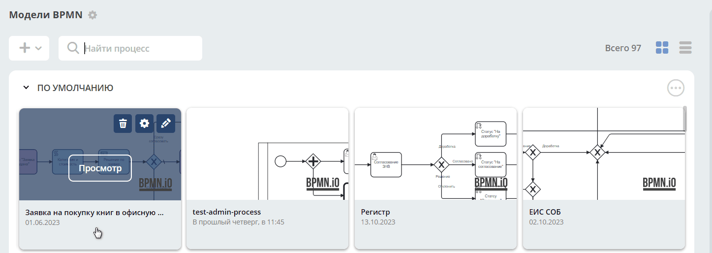

Действия с разделами
~~~~~~~~~~~~~~~~~~~~~~~~~~~~~~~~~~~~~~

Для разделов доступны следующие действия:

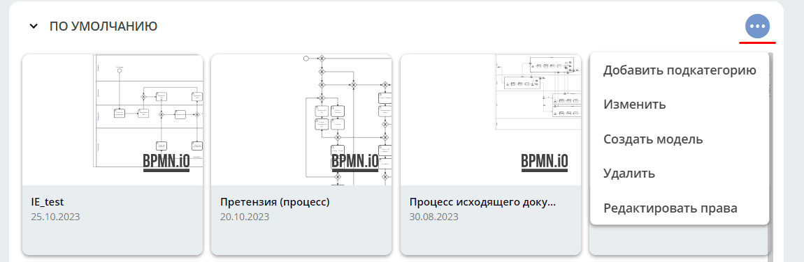

.. grid:: 1
      :gutter: 2

      .. grid-item-card:: Изменить
            :class-header: sd-font-weight-bold

            Переименовать категорию:

            .. image:: _static/category_actions_2.png
                  :width: 500
                  :align: center

      .. grid-item-card:: Создать модель
            :class-header: sd-font-weight-bold

            :ref:`Создание нового бизнес-процесса <new_bp>`

      .. grid-item-card:: Удалить
            :class-header: sd-font-weight-bold

            Удалить категорию

            .. image:: _static/category_actions_3.png
                  :width: 300
                  :align: center

      .. grid-item-card:: Добавить подкатегорию
            :class-header: sd-font-weight-bold

            Создание в категории подкатегории с кодом (при необходимости) и наименованием:

            .. image:: _static/category_actions_1.png
                  :width: 500
                  :align: center

      .. grid-item-card:: Редактировать права
            :class-header: sd-font-weight-bold

            :ref:`Редактирование прав на категорию <bpmn_permissions>`

.. _bp_actions:

Карточка бизнес-процесса
----------------------------------------------

Для созданного процесса доступны следующие опции:

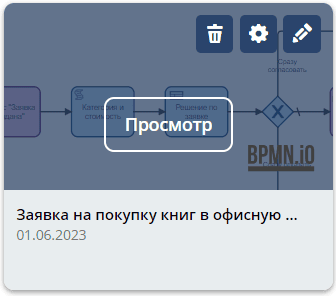

Просмотр
~~~~~~~~~~~~~~~~~~~~~~~~~~~~~~~~~~~~~~

Карточка процесса с виджетами:

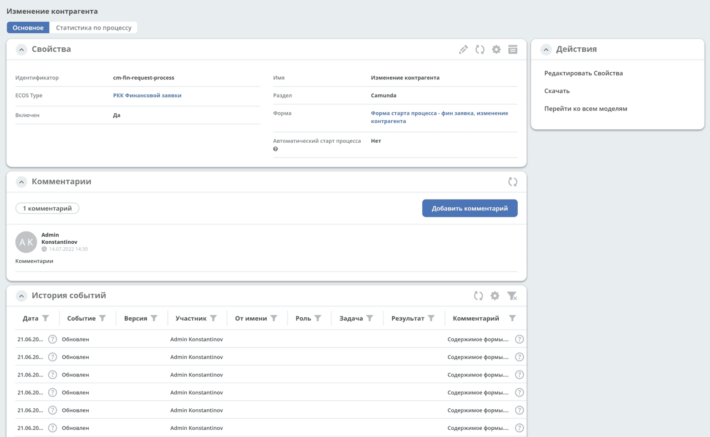

.. list-table::
      :widths: 10 20
      :header-rows: 1
      :align: center
      :class: tight-table

      * - Виджет
        - Описание
      * - :ref:`Статистика процесса <widget_process_statistics>`
        - Визуализирует статистику по бизнес-процессу с отображением тепловой карты (heatmap):

            .. image:: _static/05_1.png
                  :width: 600
                  :align: center

      * - **«Свойства»**
        - Информация о процессе.
      * - :ref:`Комментарии <widget_comments>`
        - Комментарии к бизнес-процессу.
      * - :ref:`История событий <widget_events-history>`
        - Отображение событий бизнес-процесса.
      * - **«Действия»**
        -

            - **Копировать** — копирует данный бизнес-процесс. В открывшейся форме введите новый **Идентификатор** и нажмите **«Подтвердить»**:

                  .. image:: _static/05_3.png
                        :width: 400
                        :align: center

              Создаётся новая модель на основе исходной схемы. В копии флаги **«Включен»** и **«Автоматический старт процесса»** выключены, а **«Автоматическое удаление процесса»** включено. Перед запуском проверьте настройки копии, опубликуйте её и включите.

            - **Скачать** — выгрузить модель процесса в файл BPMN 2.0 XML (стандарт OMG BPMN 2.0, ISO/IEC 19510:2013). Файл содержит описание процесса и его диаграмму; настройки элементов, специфичные для Citeck, хранятся в расширениях BPMN — атрибутах отдельного пространства имён.
            - **Скачать описание БП** — выгрузка модели бизнес-процесса в Excel. Подробнее см. :ref:`ниже <bp_to_excel>`:

                  .. image:: _static/05_2.png
                        :width: 800
                        :align: center

      * - :ref:`Журнал версий <widget_versions_journal_bpmn>`
        - Содержит актуальную и предшествующие версии бизнес-процесса.

Удалить
~~~~~~~~~~~~~~~~~~~~~~~~~~~~~~~~~~~~~~

Удаление модели бизнес-процесса и её ревизий. Требуются права записи; при наличии связанных состояний процесса сервер может отклонить удаление. Это действие не предназначено для отмены исполняемых экземпляров.

Редактировать карточку процесса
~~~~~~~~~~~~~~~~~~~~~~~~~~~~~~~~~~~~~~

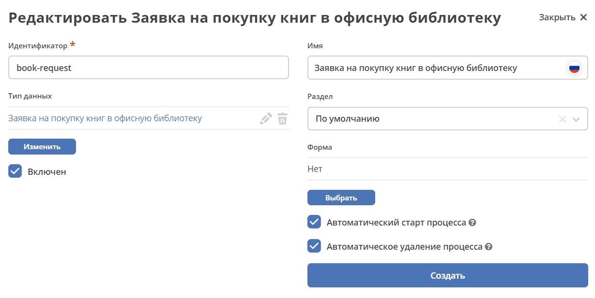

Редактировать бизнес-процесс
~~~~~~~~~~~~~~~~~~~~~~~~~~~~~~~~~~~~~~

Откроется :ref:`конструктор бизнес-процесса <modeller_bp>`:

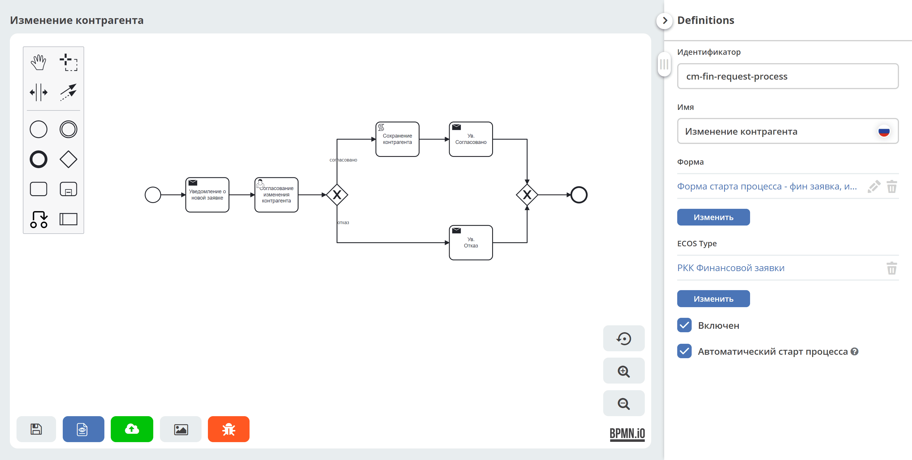

Если при редактировании бизнес-процесса вы переходите в другое рабочее пространство, то необходимо подтвердить действие:

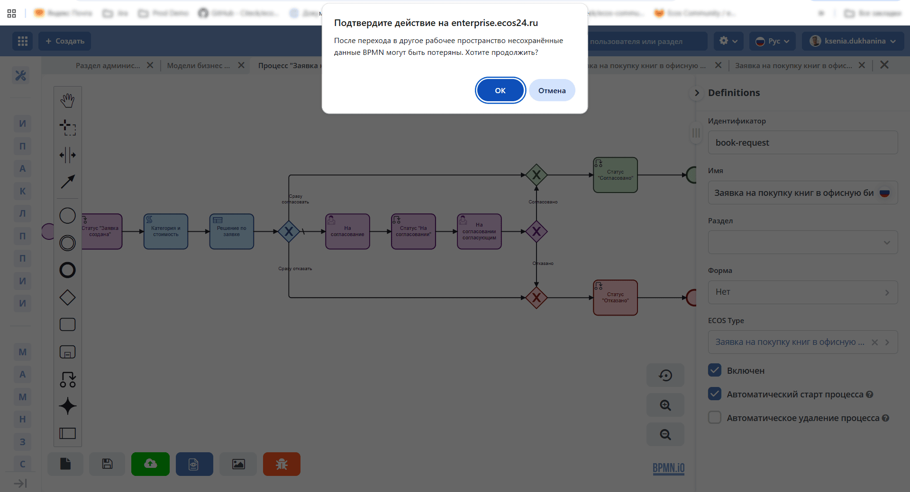

.. _new_bp:

Создание бизнес-процесса
----------------------------------------------

Для создания нового бизнес-процесса перейдите в журнал **"Модели BPMN" (Рабочее пространство "Раздел администратора" - Управление процессами)**:

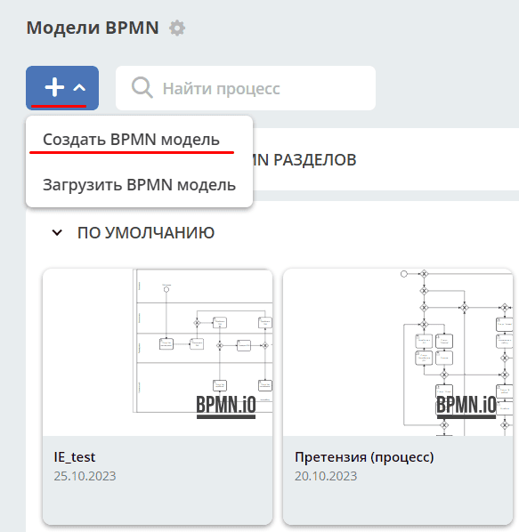

Или в разделе выберите действие:

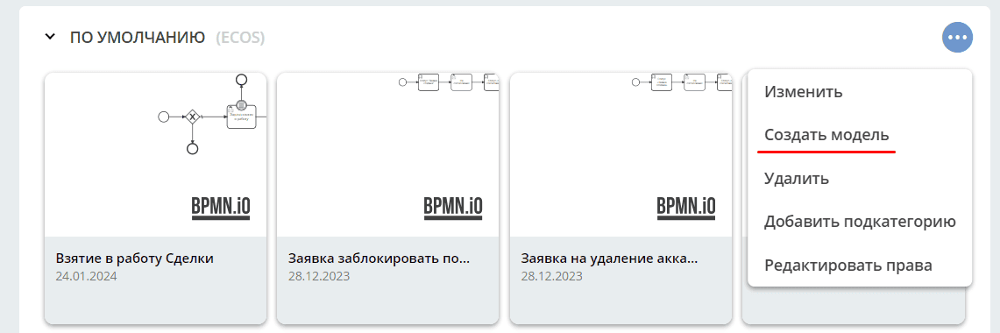

Откроется форма создания карточки процесса:

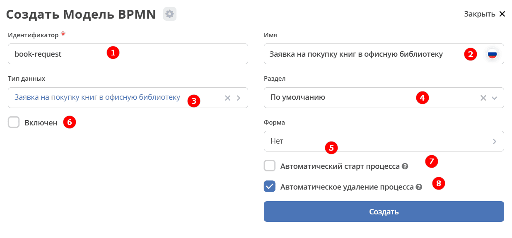

.. list-table:: Описание полей формы
      :widths: 10 20 30
      :header-rows: 1
      :align: center
      :class: tight-table

      * - п/п
        - Наименование
        - Описание
      * - 1
        - **Идентификатор**
        - уникальный идентификатор модели в рабочем пространстве
      * - 2
        - **Имя**
        - наименование создаваемого бизнес-процесса
      * - 3
        - **ECOS Type**
        - тип данных. При привязке к типу данных можно автоматически начинать процесс, если проставлен  чекбокс **(7)**. На форме редактора на основе типа данных будут подтягиваться роли, статусы и т.д.
      * - 4
        - **Раздел**
        - наименование раздела, в котором будет сохранен процесс. Если не заполнять, то сохранение происходит в раздел "По умолчанию".
      * - 5
        - **Форма**
        - указать для запуска (старта) процесса через форму.
      * - 6
        - **Включен**
        - разрешает запуск опубликованного процесса
      * - 7
        - **Автоматический старт процесса**
        - разрешает автостарт при создании документа вне черновика или при его переводе из черновика в обычное состояние. Условия см. :ref:`ниже <new_bp_start>`.
      * - 8
        - **Автоматическое удаление процесса**
        - разрешает удаление исполняемых экземпляров по документу при удалении документа. Модель процесса сохраняется. По умолчанию включено.

.. important::

   Автоматическое удаление обрабатывается для документов-наследников ``user-base``, которые не находятся в черновике. Система выбирает включённую модель по типу документа и его иерархии в рабочем пространстве и проверяет её флаг **«Автоматическое удаление процесса»**. Если он включён, удаляются корневые исполняемые экземпляры с business key, равным ссылке на документ. Это может затронуть несколько процессов одного документа, а не только экземпляры выбранной модели. Операция не удаляет модель и не очищает всю историю завершённых процессов.

.. _save_bp:

Сохранение и публикация процесса
--------------------------------------------------------------

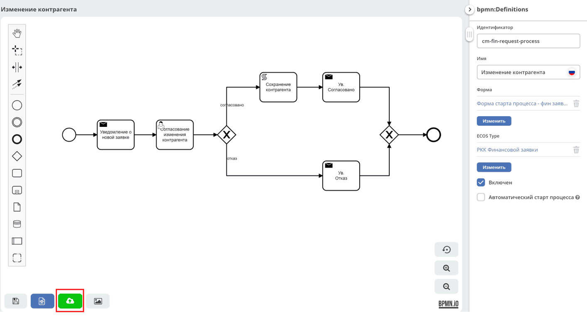

Процесс можно:

.. list-table::
      :widths: 1 3 5
      :align: center
      :class: tight-table

      * - **1** 
        - **Сохранить как черновик** 
        - Сохранение чернового XML без семантической проверки ECOS-модели и преобразования в исполняемую схему Camunda. Корректность XML, права и общие ограничения сохранения проверяются.
      * - **2**
        - **Сохранить** 
        - Проверка ECOS-модели и преобразование в форматы ECOS и Camunda с сохранением определения. Публикация в движок не выполняется.
      * - **3**
        - **Сохранить и опубликовать**
        - Проверка и преобразование модели, сохранение определения и публикация исполняемой схемы в Camunda. На этапе публикации движок выполняет дополнительные проверки; требуются права публикации.

Проверки при сохранении и публикации не гарантируют обнаружение всех логических ошибок и ошибок выражений, возникающих при выполнении процесса.

.. note::

      После изменения схемы опубликуйте её заново, чтобы новые запуски использовали обновлённую схему. Новая ревизия определения может появиться уже при сохранении изменённых данных; публикация отдельно связывает ревизию с исполняемой схемой в движке. Повторное сохранение черновика тем же автором может обновить текущую черновую ревизию.

      Публикация обновлённой схемы сама по себе не переносит на неё уже запущенные экземпляры: для этого используется миграция.

      В виджете :ref:`История событий <widget_events-history>` отображается информация о событиях создания, обновления, публикации бизнес-процесса с указанием автора, времени, комментария и т.д.

      В виджете :ref:`Журнал версий <widget_versions_journal_bpmn>` для версии процесса, которая была опубликована, будет показываться тег **"Опубликовано"**, для процесса, сохраненного как черновик - **"Черновик"**.

.. _new_bp_start:

Способы запуска бизнес-процесса
------------------------------------------------------------

Ниже описаны два основных пользовательских сценария запуска бизнес-процесса:

.. tab-set::

      .. tab-item:: Автоматический запуск БП при создании документа

            Укажите **«ECOS Type»**, включите флаги **«Включен»** и **«Автоматический старт процесса»**, затем опубликуйте схему. Автостарт обрабатывается для документов-наследников ``user-base`` при создании вне черновика или при переводе из черновика в обычное состояние. ID запускаемого процесса в схеме должен совпадать с идентификатором модели.

            Запрос на запуск передаётся в очередь и обрабатывается асинхронно.

      .. tab-item:: Ручной запуск БП через форму

            В описании БП в поле **«Форма»** укажите форму запуска процесса и отдельно :ref:`добавьте процесс в меню <bpmn_start_menu>`. Ручной запуск осуществляется через **«Меню» -> «Создать» (+)**. Для запуска необходимы права на запуск экземпляров выбранного процесса.

Автоматический старт и ручной запуск могут использоваться вместе или отдельно, в зависимости от бизнес-требований. Другие варианты включают запуск через Records API и :ref:`стартовые сигнальные события <signal_start_event>`.

Для описанных сценариев модель должна быть **включена**, а исполняемая схема — **опубликована**.

.. _bp_submit:

Старт процесса при нажатии кнопки «Отправить» (Submit) на форме создания/редактирования документа
~~~~~~~~~~~~~~~~~~~~~~~~~~~~~~~~~~~~~~~~~~~~~~~~~~~~~~~~~~~~~~~~~~~~~~~~~~~~~~~~~~~~~~~~~~~~~~~~~~

Если рекорд сохраняется в состоянии **Черновик**, то есть через сабмит кнопку с состоянием **draft**,

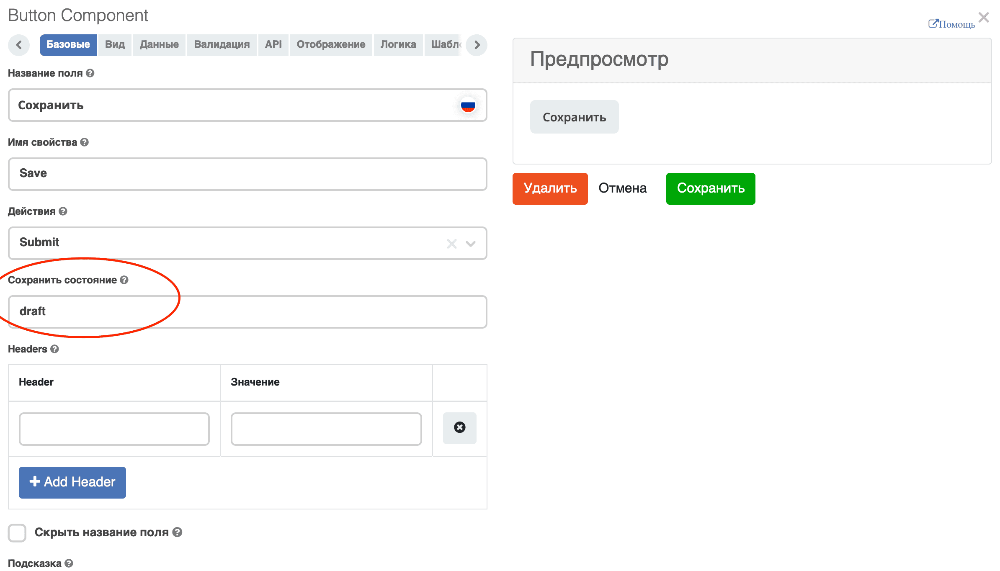

то :ref:`автоматический старт процесса <new_bp_start>` не осуществляется. При выполнении условий автостарта запрос на запуск формируется при создании документа сразу вне черновика либо при переводе документа из черновика в обычное состояние. Обычное редактирование и повторное сохранение уже нечернового документа не запускает процесс через этот механизм. Значение имеет изменение состояния документа, а не само нажатие кнопки Submit.

.. _inherit_bp_start:

Запуск бизнес-процесса у дочерних типов
--------------------------------------------------------------------------

Рассмотрим на примере: имеем тип **А**, у него дочерний тип **А_1**. Во всех случаях для типа **А** настроен БП включенный + автостарт.

.. list-table::
      :widths: 15 15 20
      :header-rows: 1
      :align: center
      :class: tight-table

      * - БП типа **А_1**
        - Условие
        - Результат при создании объекта типа **А_1**
      * - Отсутствует
        - —
        - Стартует БП, настроенный для типа **А**
      * - Выключенный
        - —
        - Стартует БП, настроенный для типа **А**
      * - Включенный
        - Автостарт выключен
        - Старт БП не производится
      * - Включенный
        - Автостарт включен
        - Стартует БП, настроенный для типа **А_1**

.. _bp_to_excel:

Выгрузка БП в виде Excel таблицы
------------------------------------------------------

Для выгрузки в **xlsx** на стенде должны быть установлены действие **«Скачать описание БП»** (``download-xlsx-ecos-bpmn-def-template``), шаблон **ecos-bpmn-def-template** и сервис преобразования документов. Доступные локали и оформление файла определяются установленной поставкой шаблона.

Действие формирует файл на основе сохранённой модели процесса. Отчёт включает поддерживаемые типы элементов с непустым именем или номером и сведения об их связях. Элементы, у которых отсутствуют и имя, и номер, а также неподдерживаемые типы пропускаются. Это описание модели, а не отчёт о выполнении конкретного экземпляра.

Достигается это за счет параметра **bpmn-report**, который мы можем запросить у каждого БП, используя Records API.

.. code-block::

    Records.get('eproc/bpmn-def@meet-process').load('bpmn-report[]?json');

Данный запрос вернет список объектов, сгенерированных на основе элементов в БП.

Более подробное описание объектов, заполняющих список можно найти в **ecos-process**:

.. code-block::

    ru.citeck.ecos.process.domain.bpmnreport.model.ReportElement

.. _bpmn_start_menu:

Настройка меню
----------------------------

Для добавления процесса в меню **«Создать»**:

1.	Перейти в настройку меню, нажав на шестеренку, потом кнопку **«Настроить меню»** справа сверху.

    .. image:: _static/79.png
      :width: 700
      :align: center

2.	Выбрать элемент меню, в котором будет находиться процесс. Навести на элемент и нажать кнопку **«Добавить»**:

    .. image:: _static/80.png
      :width: 600
      :align: center

    .. tab-set::

          .. tab-item:: Способ 1: автоматический запуск

                Выбрать **«Добавить ссылку на создание кейса»**, из списка выбрать необходимый тип данных, нажать **«ОК»**:

                .. image:: _static/81a.png
                      :width: 600
                      :align: center

          .. tab-item:: Способ 2: ручной запуск

                Выбрать **«Запустить бизнес-процесс»**, из списка выбрать необходимый процесс, нажать **«ОК»**.

                .. image:: _static/81b.png
                  :width: 400
                  :align: center

                .. image:: _static/82.png
                  :width: 600
                  :align: center

Добавленный пункт меню:

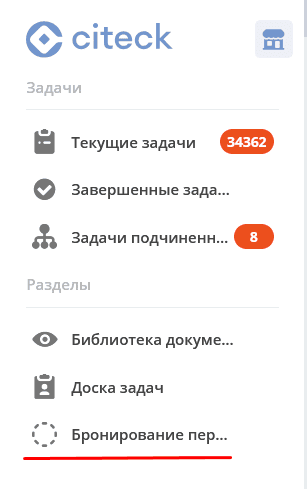

Форма запуска БП:

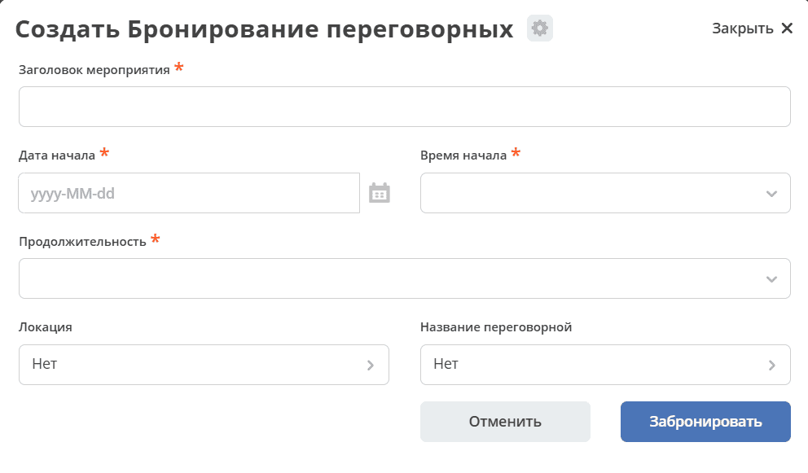

