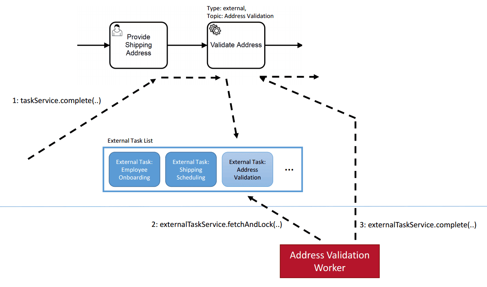

.. _ecos_bpmn_external_task:

Внешние задачи
============================

.. contents::

**Внешние задачи (External Tasks)** — механизм интеграции, позволяющий выполнять сервисные задачи бизнес-процесса во внешних приложениях. Движок создаёт внешние задачи с именем топика, а обработчики (workers) получают и блокируют их через fetch-and-lock, выполняют работу и подтверждают результат через API. Топик здесь — признак для выборки задач, а не очередь с push-доставкой. Обработчики можно масштабировать отдельно от движка и реализовывать на разных технологических стеках.

В разделе описан паттерн внешней задачи, настройка Spring Boot Starter для клиента внешних задач, подписка на топики, конфигурация обработчиков и обработка ошибок.

Паттерн внешняя задача
----------------------

Поток выполнения внешних задач можно концептуально разделить на три этапа, как показано на следующем рисунке:

1. **Process Engine: создание экземпляра внешнего задания.** Когда движок процесса сталкивается с сервисной задачей, которая настроена на внешнюю обработку, он создает экземпляр внешней задачи и добавляет его в список внешних задач. Экземпляр задачи получает топик, который идентифицирует характер задачи, которую необходимо выполнить.
2. **External Worker: получение и блокировка внешних задач.** В какой-то момент в будущем внешний обработчик может получить и заблокировать задания для определенного набора топиков. Чтобы предотвратить одновременное получение одной задачи несколькими обработчиками, задача имеет timestamp-based блокировку, которая устанавливается при получении задачи. Только когда блокировка истекает, другой обработчик может снова получить задание.
3. **External Worker & Process Engine: завершение экземпляра внешней задачи.** Когда внешний обработчик выполнил требуемую задачу, он может подать сигнал движку процесса продолжить выполнение процесса после выполнения сервисной задачи.

.. note:: 
    **Аналогия с пользовательской задачей**

    Внешние задачи концептуально очень похожи на пользовательские задачи. Когда вы впервые пытаетесь понять шаблон внешней задачи, может быть полезно подумать о нем по аналогии с пользовательской задачей: 
    
    Пользовательские задачи создаются движком процесса и добавляются в список задач. Затем движок процесса ждет, пока пользователь-человек запросит список, возьмет задачу на себя и затем выполнит ее. 
    
    Внешние задачи аналогичны: Внешняя задача создается, а затем добавляется в топик. Затем внешнее приложение запрашивает топик и блокирует задачу. После блокировки задачи приложение может работать над ней и завершить ее.

Суть этого паттерна заключается в том, что объекты, выполняющие фактическую работу, 
не зависят от движка процесса и получают задания для обработки путем запроса API движка процесса. 
Это дает следующие преимущества:

.. list-table::
      :widths: 10 25
      :header-rows: 1
      :class: tight-table
      :align: center

      * - Преимущество
        - Описание
      * - **Crossing System Boundaries**
        - Внешний обработчик не обязательно должен работать в том же Java-процессе, на той же машине, в том же кластере или даже на том же континенте, что и движок процесса. Все, что требуется — доступ к API движка процесса (через REST или Java). Благодаря polling-pattern, обработчику не нужно предоставлять какой-либо интерфейс для доступа к движку процесса.
      * - **Crossing Technology Boundaries**
        - Внешний обработчик не обязательно должен быть реализован на Java. Вместо этого можно использовать любую технологию, которая наиболее подходит для выполнения необходимой задачи и может быть использована для доступа к API движка процесса (через REST или Java).
      * - **Specialized Workers**
        - Внешний обработчик не обязательно должен быть приложением общего назначения. Каждый экземпляр внешнего обработчика получает имя топика, определяющее характер выполняемого задания. Обработчики могут опрашивать задания только для тех топиков, над которыми они могут работать.
      * - **Fine-Grained Scaling**
        - При высокой нагрузке, сосредоточенной на обработке сервисных задач, количество внешних обработчиков для соответствующих топиков может быть масштабировано независимо от движка процесса.
      * - **Independent Maintenance**
        - Обработчики можно разворачивать независимо от движка процесса без нарушения работы. Например, если обработчик для определенного топика имеет простой (например, из-за обновления), это не оказывает немедленного воздействия на движок процесса. Выполнение внешних заданий для таких обработчиков происходит плавно: они сохраняются в списке внешних задач до тех пор, пока внешний обработчик не возобновит работу.

Spring Boot Starter для клиента внешних задач
----------------------------------------------

Ecos Spring Boot Starter External Task Client позволяет легко добавить обработчика для внешних задач
в Spring Boot приложение. Для этого необходимо добавить зависимость:

.. code-block:: xml

    <dependency>
        <groupId>ru.citeck.ecos.bpmn</groupId>
        <artifactId>ecos-bpmn-external-task-client-springboot-starter</artifactId>
        <version>2.1.0</version>
    </dependency>

.. note:: 
    Версия ``2.1.0`` приведена как пример зависимости. Версию starter’а, параметры подключения и ограничения развёртывания выбирайте по документации используемой клиентской библиотеки Citeck. Её номер версии не совпадает с номером версии движка Camunda.

    Для стандартного клиента Camunda необходимо обеспечить доступ к REST API движка и настроить аутентификацию. См. `External Task Client <https://docs.camunda.org/manual/7.24/user-guide/ext-client/>`_.

Подписка на топики
~~~~~~~~~~~~~~~~~~

Интерфейс, позволяющий реализовать пользовательскую бизнес-логику и взаимодействовать с Engine, называется `ExternalTaskHandler`. 
Подписка идентифицируется именем топика.

Вы можете подписать клиента на имя топика `processPayment`, определив bean с возвращающим типом `ExternalTaskHandler` и добавив аннотацию на этот bean:

.. code-block:: kotlin

    @ExternalTaskSubscription("processPayment")

Для аннотации требуется как минимум имя топика. 

Для более подвинутой конфигурации можно сослаться на имя топика в файле конфигурации spring-boot, например application.yml, либо определить атрибуты конфигурации через аннотацию:

.. tab-set::

      .. tab-item:: Через application.yml

            .. code-block:: yaml

                ecos.bpm.client:
                    subscriptions:
                        processPayment:
                            process-definition-key: payment_process
                            include-extension-properties: true
                            variable-names: defaultFlow

      .. tab-item:: Через атрибуты аннотации

            .. code-block:: kotlin

                @ExternalTaskSubscription(
                    topicName = "processPayment",
                    processDefinitionKey = "payment_process",
                    includeExtensionProperties = true,
                    variableNames = ["defaultFlow"]
                )

Полный список атрибутов стандартной аннотации Camunda приведён в `Javadocs <https://docs.camunda.org/javadoc/camunda-bpm-platform/7.24/org/camunda/bpm/client/spring/annotation/ExternalTaskSubscription.html>`_.

.. note:: 
    В стандартном starter’е Camunda свойства ``application.yml`` переопределяют соответствующие атрибуты аннотации; используется префикс ``camunda.bpm.client``. В примере выше показан префикс обёртки Citeck ``ecos.bpm.client``. Его поддержку и приоритет настроек сверяйте с используемой версией библиотеки Citeck.

Пример конфигурации обработчика
~~~~~~~~~~~~~~~~~~~~~~~~~~~~~~~

Один обработчик
++++++++++++++++

Вы можете сконфигурировать обработчик следующим образом:

.. code-block:: kotlin

    @Component
    @ExternalTaskSubscription("processPayment")
    class PaymentProcessorWorker : ExternalTaskHandler {

        override fun execute(externalTask: ExternalTask, externalTaskService: ExternalTaskService) {
            // you business logic here
            externalTaskService.complete(externalTask);
        }

    }

Несколько обработчиков в одном классе
+++++++++++++++++++++++++++++++++++++

Если вы хотите определить несколько бинов обработчиков в одном классе конфигурации, вы можете сделать это следующим образом:

.. code-block:: kotlin

    @Configuration
    class PaymentWorker {

        @Bean
        @ExternalTaskSubscription("processPayment")
        fun processPayment(): ExternalTaskHandler {
            return ExternalTaskHandler { externalTask, externalTaskService ->
                // Business logic for payment processing
                externalTaskService.complete(externalTask)
            }
        }

        @Bean
        @ExternalTaskSubscription("cancelPayment")
        fun cancelPayment(): ExternalTaskHandler {
            return ExternalTaskHandler { externalTask, externalTaskService ->
                // Business logic for payment cancellation
                externalTaskService.complete(externalTask)
            }
        }

    }

Обработка ошибок и завершение задачи
~~~~~~~~~~~~~~~~~~~~~~~~~~~~~~~~~~~~

Для манипуляции с задачей используется интерфейс `ExternalTaskService <https://docs.camunda.org/javadoc/camunda-bpm-platform/7.24/org/camunda/bpm/client/task/ExternalTaskService.html>`_.

Для успешного выполнения задачи необходимо вызвать метод `complete` (как в примере выше):

.. code-block:: kotlin

    externalTaskService.complete(externalTask)

Но `happy path` не всегда возможен, правильная обработка ошибок внешних задач очень важна для обеспечения надежности и стабильности выполнения процессов.

Обработка бизнес-ошибок
++++++++++++++++++++++++

В процессе выполнения внешний задачи может возникнуть бизнес-ошибка, которая должна быть обработана в процессе посредством `error event`.

Для выбрасывания бизнес-ошибки необходимо использовать метод `handleBpmnError`:

.. code-block:: kotlin

    @Component
    @ExternalTaskSubscription("processPayment")
    class PaymentProcessorWorker : ExternalTaskHandler {

        override fun execute(externalTask: ExternalTask, externalTaskService: ExternalTaskService) {
            // you business logic here
            externalTaskService.handleBpmnError(externalTask, "error-code", "error-message");
        }

    }

Обработка технических ошибок
++++++++++++++++++++++++++++

Для технической ошибки используйте ``handleFailure``. Обработчик явно передаёт оставшееся число повторов и задержку до следующей попытки. Движок не уменьшает этот счётчик автоматически.

В примере ниже бюджет — **пять исполнений всего**, включая первое. При первой ошибке ``task.retries`` может быть ``null``; после неё остаются четыре повтора. Задержки составляют 1, 2, 3 и 4 минуты. После пятой ошибки устанавливается ``retries = 0`` и создаётся инцидент.

.. code-block:: kotlin

    @Component
    @ExternalTaskSubscription("processPayment")
    class PaymentProcessorWorker(
        private val paymentService: PaymentService
    ) : ExternalTaskHandler {

        companion object RetryPolicy {
            private const val MAX_ATTEMPTS = 5
            private const val ONE_MINUTE = 60_000L
        }

        override fun execute(task: ExternalTask, taskService: ExternalTaskService) {
            try {
                // Сервис должен обеспечивать идемпотентность операции.
                paymentService.processPayment(task)
            } catch (e: Exception) {
                val retriesLeft = ((task.retries ?: MAX_ATTEMPTS) - 1)
                    .coerceAtLeast(0)
                val delayMinutes = (MAX_ATTEMPTS - retriesLeft).coerceAtLeast(1)
                val timeout = if (retriesLeft > 0) ONE_MINUTE * delayMinutes else 0L

                taskService.handleFailure(
                    task,
                    (e.message ?: "External operation failed").take(666),
                    ExceptionUtils.getStackTrace(e),
                    retriesLeft,
                    timeout
                )
                return
            }

            // Ошибка подтверждения обрабатывается отдельно от ошибки операции.
            taskService.complete(task)
        }
    }

При нулевом числе повторов задача остаётся в движке, но не выдаётся обычным fetch-and-lock. После разбора инцидента администратор может увеличить retries. В примере бюджет основан на сохранённом значении задачи; административное изменение retries меняет этот бюджет.

.. important::

    ``PaymentService`` и другие прикладные сервисы в примерах — условные зависимости. Примеры показывают работу с API задачи, а не готовую реализацию платёжной интеграции. Исключение из внешнего вызова может означать потерю ответа после успешной операции. Перед повтором необходимо восстановить её результат или безопасно повторить запрос с тем же ключом идемпотентности.

Аннотация retry в библиотеке Citeck
++++++++++++++++++++++++++++++++++++++++

Библиотека Citeck также предоставляет аннотацию ``ru.citeck.ecos.bpmn.externaltask.impl.retry.ExternalTaskRetry``. Настройки ``retries``, ``retryTimeout`` и ``incrementRetryTimeout``, их значения по умолчанию и перехватываемые исключения следует сверять с версией клиентской библиотеки.

Не совмещайте автоматический и ручной учёт retries без согласованного алгоритма. Проверьте отдельно, перехватывает ли аннотация ошибки ``complete`` и как обрабатывает потерю блокировки: повтор бизнес-операции после ошибки подтверждения не должен создавать новый внешний эффект.

Комбинированная обработка ошибок
++++++++++++++++++++++++++++++++

Бизнес-ошибка — подтверждённый результат, для которого в модели предусмотрена отдельная ветка. Техническая ошибка и исчерпание retries сами по себе не означают, что бизнес-операция отклонена.

Для известного результата «платёж отклонён» можно использовать следующую схему после успешного получения и проверки ответа сервиса:

.. code-block:: kotlin

    // processResult получен идемпотентной операцией или восстановлен по её ключу.
    if (processResult == "DENIED") {
        taskService.handleBpmnError(task, "paymentDenied", "Payment was denied")
        return
    }

    taskService.complete(task)

Для ``paymentDenied`` настройте соответствующий обработчик BPMN-ошибки в процессе. Если результат внешней операции неизвестен, сначала выполните сверку с внешней системой. Не превращайте сетевой сбой или ошибку ``complete`` в ложный бизнес-отказ.

.. note::

    ``task.retries`` — оставшийся бюджет повторов, а не число уже выполненных попыток. Для перехода по бизнес-ветке после исчерпания бюджета нужен явно согласованный бизнес-сценарий; обычно техническое исчерпание обрабатывается инцидентом. Отдельный счётчик выполненных попыток храните явно, если он нужен бизнес-логике.

Подтверждение результата задачи
+++++++++++++++++++++++++++++++

Разделяйте три ситуации: ошибку бизнес-операции, ошибку подтверждения задачи и потерю владения задачей. Если ответ на ``complete`` потерян, задача могла уже завершиться в движке. Последующий ``handleFailure`` или ``handleBpmnError`` может оказаться неприменимым.

При неопределённом результате проверьте состояние задачи и внешней операции. На повторной выдаче используйте прежний ключ операции. Не запускайте внешнее действие заново только потому, что подтверждение не получено.

Рекомендации по реализации обработчиков
----------------------------------------------

Повторная обработка возможна при истечении блокировки, сбое между внешним эффектом и ``complete``, технической ошибке или административном возобновлении задачи. Проектируйте обработчик так, чтобы повтор не создавал второй бизнес-эффект.

Повторы и идемпотентность
~~~~~~~~~~~~~~~~~~~~~~~~~

Паттерн внешних задач допускает повторную доставку (at-least-once), но не гарантирует безусловное выполнение: для него нужны доступный обработчик, действующий процесс и не исчерпанный бюджет повторов. Завершение задачи и внешний эффект не образуют автоматически одну атомарную операцию.

Безопасный протокол обработки включает:

1. **Устойчивый ключ бизнес-операции.** Сохраните его до внешнего вызова и используйте при каждом повторе. Если одна бизнес-операция может повторно возникнуть в другом экземпляре задачи, её ключ не должен зависеть только от ID этой задачи.
2. **Раздельные состояния.** Намерение или ``IN_PROGRESS`` не означает успешного выполнения. ``SUCCEEDED`` устанавливается только после подтверждения результата; отказ и неизвестный исход обрабатываются отдельно.
3. **Дедупликацию на стороне получателя.** Если внешний API поддерживает idempotency key, повтор запроса с тем же ключом должен возвращать результат той же операции. Контракт и срок хранения ключей необходимо учитывать явно.
4. **Восстановление результата.** После таймаута проверьте статус операции по ключу. Если исход установить нельзя, предусмотрите сверку или ручной разбор, а не завершение задачи как успешно выполненной.
5. **Конкурентный повтор.** Два обработчика могут прочитать один и тот же старый статус. Для координации используйте атомарный захват локальной операции и/или дедупликацию внешнего сервиса. Обычная проверка ``if (status == ...)`` не обеспечивает взаимного исключения.

.. warning::

    Отметка «сделано» **до** внешнего вызова может привести к пропуску работы: обработчик упадёт после отметки, а повтор ошибочно завершит задачу. Отметка **после** вызова без восстановления результата также не защищает от повторного эффекта при потере ответа. Локальная отметка намерения сама по себе не обеспечивает идемпотентность внешнего API.

Пример контракта прикладного сервиса:

.. code-block:: kotlin

    // Прикладной код, а не метод Camunda API.
    val operationKey = operations.getOrCreateKey(orderRef, "payment")

    // Восстанавливает результат по ключу или безопасно повторяет запрос с тем же ключом.
    // Метод должен учитывать конкуренцию и не возвращать успех для IN_PROGRESS/UNKNOWN.
    val result = paymentService.executeOrRecover(operationKey, orderRef)

    when (result) {
        "SUCCEEDED" -> taskService.complete(task)
        "DENIED" -> taskService.handleBpmnError(task, "paymentDenied", "Payment was denied")
        else -> {
            // Не подтверждаем успех: требуется сверка и согласованная обработка retry/инцидента.
            taskService.handleFailure(task, "Operation result is unknown", null, 0, 0L)
        }
    }

``operations`` и ``executeOrRecover`` должны быть реализованы прикладным кодом. Пример задаёт требуемый контракт, но не реализует его. Если внешний сервис не поддерживает дедупликацию и проверку результата, одной локальной проверкой нельзя гарантировать отсутствие повторных эффектов.

Блокировка задачи
~~~~~~~~~~~~~~~~~~

Выбирайте ``lockDuration`` с запасом на обработку и подтверждение результата. Для длительной работы продлевайте блокировку через ``extendLock`` до её истечения. Если продление не удалось, другой обработчик может получить задачу, пока первый ещё работает. Учитывайте потерю владения при подтверждении результата и не полагайтесь на lock как на единственную защиту внешнего эффекта.

Слишком большой срок блокировки увеличивает время восстановления после сбоя worker’а. Продление блокировки и идемпотентность решают разные задачи и дополняют друг друга.

Транзакции и внешние эффекты
~~~~~~~~~~~~~~~~~~~~~~~~~~~~~

Внешний обработчик не получает автоматически общую транзакцию с движком и сторонним сервисом. Фактические границы зависят от клиентской библиотеки, транспорта и конфигурации транзакций. Удалённый вызов ``complete`` и локальный Java API не следует считать одинаковыми по распространению transaction context.

Предпочитайте короткие транзакции для согласованного изменения локальных записей. Не удерживайте блокировки базы данных на всё время сетевого вызова. Локальный rollback не отменяет уже выполненную операцию стороннего API.

При использовании транзакций Citeck см. :ref:`Транзакции <ecos-transactions>`. Аннотацию ``RunInTransaction`` или ``TxnContext.doInTxn`` применяйте к конкретному блоку после определения его границ. Не предполагайте, что все records-вызовы всегда независимы или, наоборот, что все приложения участвуют в одном двухфазном коммите.

Вызов ``complete`` может продолжить выполнение процесса до следующей точки ожидания или асинхронной границы. Если обработчик держит блокировки записей, которые нужны продолжению процесса, возможны ожидание, таймаут и откат. Перед включением ``complete`` в транзакционный блок проверьте транспорт, распространение контекста и порядок обращения к данным.

.. note::

    ``asyncAfter`` на сервисной задаче может отделить продолжение процесса в job executor. Он не делает внешний эффект частью локальной транзакции и не устраняет необходимость дедупликации и восстановления неизвестного результата.

Чек-лист обработчика
~~~~~~~~~~~~~~~~~~~~~

.. list-table::
      :widths: 10 25
      :header-rows: 1
      :class: tight-table

      * - Проверка
        - Почему
      * - Используется ли один ключ операции при повторе?
        - Новый ключ может создать второй внешний эффект.
      * - Разделены ли намерение и подтверждённый успех?
        - IN_PROGRESS не доказывает, что работа выполнена.
      * - Что произойдёт при потере ответа после внешнего эффекта?
        - Требуется восстановить результат, а не безусловно повторить действие.
      * - Безопасны ли два одновременных обработчика?
        - Проверка статуса без атомарности не предотвращает гонку.
      * - Продлевается ли блокировка длительной задачи?
        - Истечение lock допускает параллельную обработку.
      * - Согласованы ли retries и задержки?
        - retries — оставшийся бюджет; при нуле нужен разбор инцидента.
      * - Отделены ли ошибки complete от ошибок операции?
        - Потеря подтверждения не означает неуспех внешнего действия.
      * - Определены ли границы транзакций?
        - Долгие блокировки и rollback не защищают внешний API от повторного эффекта.

Дополнительные материалы
----------------------------------------------

1. `External Tasks <https://docs.camunda.org/manual/7.24/user-guide/process-engine/external-tasks/>`_
2. `External Task Client <https://docs.camunda.org/manual/7.24/user-guide/ext-client/>`_
3. `External Task Spring Boot Starter <https://docs.camunda.org/manual/7.24/user-guide/ext-client/spring-boot-starter/>`_
4. `Error Boundary Event <https://docs.camunda.org/manual/7.24/reference/bpmn20/events/error-events/#error-boundary-event>`_
