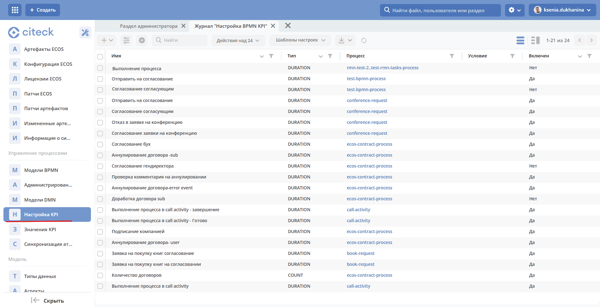
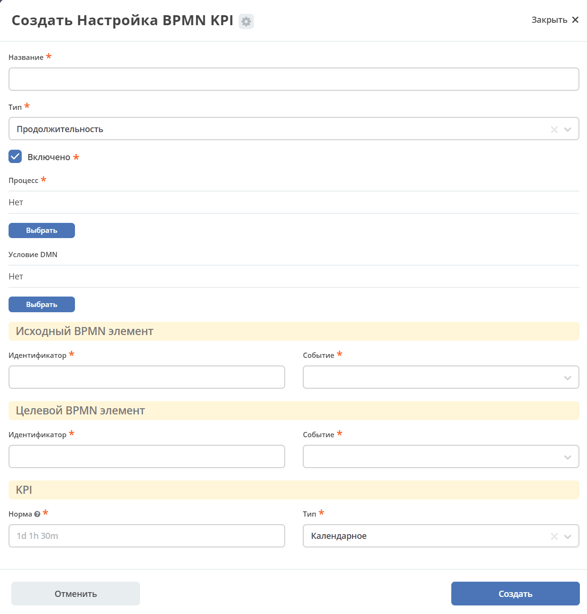
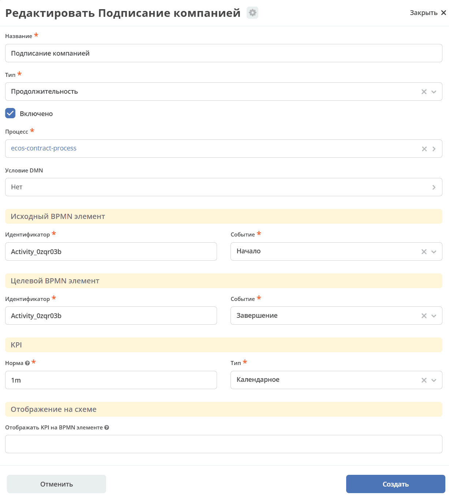
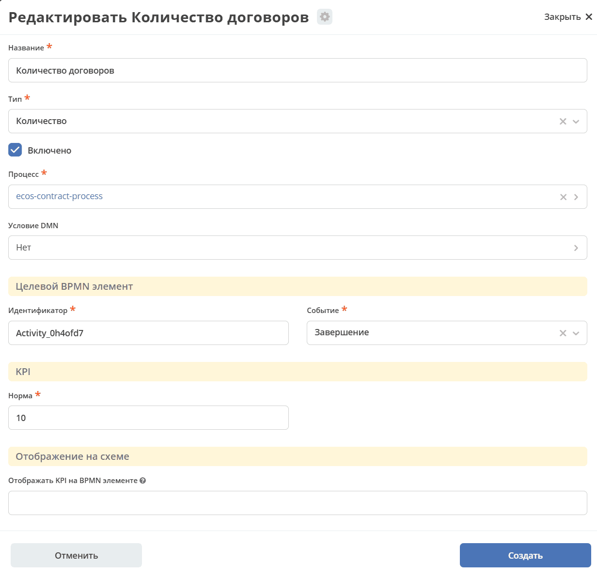
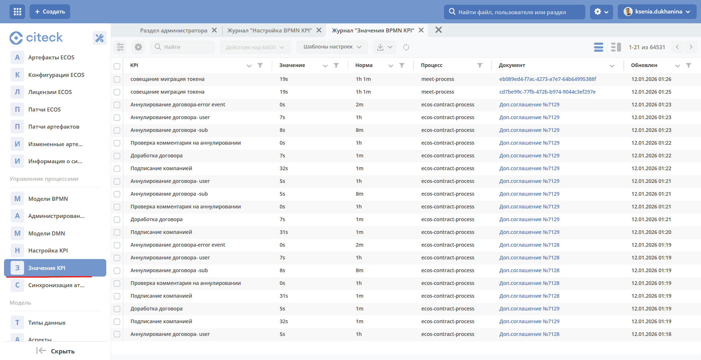
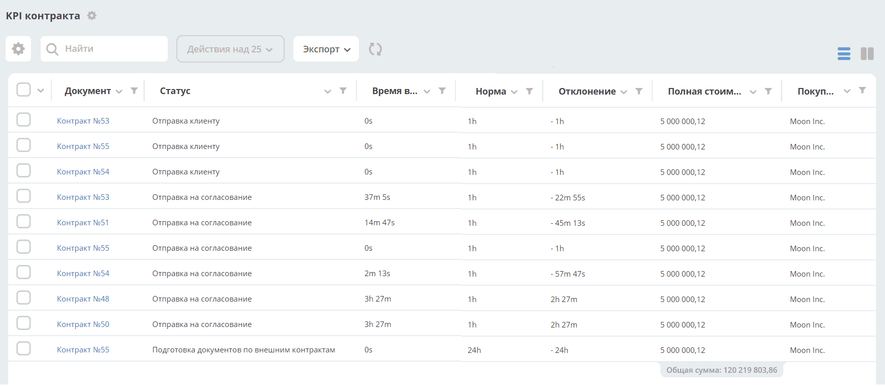

.. _bpmn_kpi:

KPI
====

.. contents::

**KPI (Key Performance Indicators)** в Citeck BPMN — инструмент контроля соответствия хода бизнес-процессов установленным нормативам. Функционал позволяет задавать нормы времени и количественные показатели для элементов процесса, отслеживать отклонения и формировать отчёты.

Поддерживается настройка норм времени на:

    *	выполнение задач,
    *	смену статусов,
    *	выполнение условий (событие, обновление атрибутов).

Для разных параметров документа можно создать отдельные настройки с разными нормами и условиями применения на DMN. Условие выбирает применимые настройки, а не вычисляет саму норму.

Нормы доступны для настройки пользователям с соответствующими правами. Измерения формируются по событиям BPMN-элементов: например, задачи установки статуса или события ожидания условия. Произвольное изменение атрибута документа само по себе не является отдельным триггером KPI.

Значения появляются асинхронно, после обработки событий элементов. KPI сохраняет измерения для сравнения с нормой; сам по себе он не устанавливает срок задачи, не останавливает процесс и не создаёт обработчик просрочки.

Для автоматического расчёта должен быть включён сбор событий BPMN-элементов: ``ecos-process.bpmn.elements.listener.enabled=true``. По умолчанию он включён. Включение настройки KPI само по себе не запускает пересчёт всей истории процесса.

Настройка
----------

Для настройки KPI необходимо перейти в журнал **"Настройка KPI" (Рабочее пространство "Раздел администратора" - Управление процессами)**:

Форма создания:

В форме необходимо указать **Название**, выбрать **Тип (Продолжительность или Количество)**, **Процесс**, **Элементы BPMN** и их **События**, задать **Норму** и включить флаг **«Включен»**. Новая настройка по умолчанию выключена и до включения не применяется.

Настройка KPI привязана к ключу процесса и не ограничена отдельной опубликованной версией. Если идентификаторы элементов сохраняются, настройка может применяться к нескольким версиям этого процесса.

Можно задать условие применения KPI на **DMN**. Входные данные описываются в свойстве схемы решения :ref:`«Модель» <dmn_model>`, базовым рекордом является документ, по которому идет бизнес-процесс. Переменные бизнес-процесса при вычислении условия недоступны.

Условие DMN вычисляется при обработке целевого события по доступным в этот момент данным документа. Снимок атрибутов на момент исходного или целевого BPMN-события для условия не сохраняется. Изменение документа до обработки события может повлиять на применение настройки KPI. При этом продолжительность рассчитывается по временным меткам элементов, а не по времени обработки события.

Если условие DMN не задано, настройка применяется без дополнительной проверки. Для условия рекомендуется решение с одной выходной колонкой типа **Boolean** и однозначным результатом, например с политикой **Unique**.

При вычислении условия используется первое значение первой группы возвращённого результата; имя выходной переменной для выбора условия не используется. Значение приводится к строке и затем к boolean: ``true`` означает применение KPI, пустой результат — неприменение. Остальные значения не объединяются через OR или AND. См. :ref:`результат решения для KPI <dmn_result_kpi>`. Ошибка вычисления DMN не равнозначна результату ``false``.

KPI по продолжительности
~~~~~~~~~~~~~~~~~~~~~~~~~~

KPI по продолжительности позволяет отслеживать время между указанными BPMN элементами (**Исходный** и **Целевой**) в процессе.

.. important::

    Для одного замера исходный и целевой элементы должны находиться в одном экземпляре процесса.

В **Исходном** и **Целевом** элементах BPMN укажите **Идентификатор** (ID элемента бизнес-процесса) и выберите **Событие**: **START** — начало выполнения элемента, **END** — его завершение.

Значение создаётся при выбранном событии целевого элемента. До его наступления текущая длительность постоянно не пересчитывается. Для источника берётся последняя созданная подходящая запись элемента с указанным ID в том же экземпляре процесса. Если источник не найден, возникает ошибка обработки, а не нулевой замер.

.. note::

    Не рекомендуется измерять интервал между START и END одного Multi Instance элемента. При нескольких выполнениях с одним ID источник и цель не сопоставляются по конкретному экземпляру активности. Это ограничение также важно для циклов и параллельных повторений исходного элемента.

Выберите **Тип времени** — календарное или рабочее. Для рабочего времени в текущей реализации используется расписание по умолчанию с ID ``DEFAULT``; выбрать другое расписание в настройке KPI нельзя.

В форме продолжительность указывается в часах и минутах — **h m**. Дни и секунды поле формы не принимает:

.. list-table::
    :header-rows: 1
    :class: tight-table

    * - Формат
      - Расшифровка
    * - 27h 10m
      - 27 часов 10 минут
    * - 24h
      - 24 часа
    * - 1h 15m
      - 1 час 15 минут
    * - 30m
      - 30 минут

Для рабочего времени задавайте число рабочих часов явно: рабочий день не обязательно равен 24 часам.

KPI по количеству
~~~~~~~~~~~~~~~~~

KPI по количеству считает срабатывания выбранного события элемента. Значение накапливается по паре **настройка KPI + процесс**, в том числе между разными экземплярами процесса и документами, без разделения по версиям процесса. Это не отдельный счётчик каждого экземпляра.

В **Целевом BPMN элементе** укажите **Идентификатор** (ID элемента бизнес-процесса) и выберите **Событие**: **START** или **END**. Укажите нормативное количество срабатываний в поле **Норма**.

.. note::

    Периоды накопления и автоматический сброс счётчика за месяц, квартал или год в текущей реализации не применяются. Ссылки на документ и экземпляр в строке COUNT записываются при её создании и не меняются при увеличении значения. Они не описывают все документы и экземпляры, вошедшие в накопленное количество.

Значения KPI
-------------

В журналах администратора выведен общий журнал **Значения KPI**.

Для удобства рекомендуется настроить свой журнал по KPI с нужными фильтрами, группировками, агрегациями.

Для создания своего журнала со значениями KPI можно копировать журнал **Значения KPI** и настроить колонки, как необходимо.

В журнале KPI по продолжительности **Норма** и **Значение** представлены числом миллисекунд: текстовая норма из настройки преобразуется в числовое значение. Для читаемости колонок используйте :ref:`форматтер Duration (Продолжительность) <DurationFormatter>`. Для COUNT значение и норма — числа срабатываний; Duration к ним не применяется.

.. important::

    Колонка **«Норма»** загружается из текущей настройки KPI, а не из снимка на момент замера. Изменение нормы меняет её отображение рядом с ранее записанными значениями. Для сравнения с разными нормативами используйте отдельные настройки KPI. При группировках учитывайте, что COUNT уже содержит накопленное значение по процессу и не является отдельным замером по документу.

.. rubric:: Средняя длительность исполнения экземпляров

Чтобы видеть в интерфейсе среднюю длительность исполнения экземпляров процесса, настройте KPI по продолжительности от стартового события процесса (исходный элемент, событие **START**) до конечного события (целевой элемент, событие **END**). Замер создаётся, когда экземпляр достигает указанного конечного события; если конечных событий в процессе несколько, настройте KPI для каждого. Создайте копию журнала **Значения KPI** и разрешите в ней группировку по колонке **Процесс** — настройка **«Можно ли группировать»** (см. :ref:`Дополнительные настройки колонки <additional_column_settings>`). В этом журнале сгруппируйте значения по процессу и выберите для колонки **Значение** агрегацию **Среднее**. Доступны также **Минимум**, **Максимум** и **Сумма** (см. :ref:`Группировка журнала <journal_group>`).

.. rubric:: Отчёты по достижению контрольных точек

Контрольные точки процесса задаются настройками KPI по продолжительности: исходный элемент — начало процесса или этапа, целевой — элемент, достижение которого контролируется, например задача или событие «Договор подписан». При каждом достижении контрольной точки в журнал **Значения KPI** записывается значение — время от исходного элемента до целевого — вместе с процессом и документом. Рядом со значением в журнале выводится норма из настройки KPI. Отчёт по достижению контрольных точек настраивается в копии этого журнала: колонки с атрибутами документа и отклонением от нормы (см. пример ниже), фильтры по процессу, KPI и дате, группировка по колонкам, для которых она разрешена, агрегации и выгрузка в Excel (см. :ref:`Выгрузка данных журнала <journal_data_export>`). Число прохождений через контрольную точку считает KPI по количеству — накопленным итогом по процессу. Среднее отклонение от нормы в процентах по каждому KPI по продолжительности отображается на схеме процесса (см. :ref:`ниже <bpmn_kpi_scheme>`).

Пример сформированного отчета
~~~~~~~~~~~~~~~~~~~~~~~~~~~~~~

.. _bpmn_kpi_scheme:

Отображение на схеме BPMN
--------------------------

Значения отклонений KPI доступны на схеме BPMN в виджете :ref:`Статистика процесса <widget_process_statistics>`.

По умолчанию KPI отображается у целевого BPMN-элемента. Чтобы отобразить его у другого элемента, укажите его ID в поле ``manualOverrideDisplayKpi`` раздела **«Отображение на схеме»** настройки KPI.
