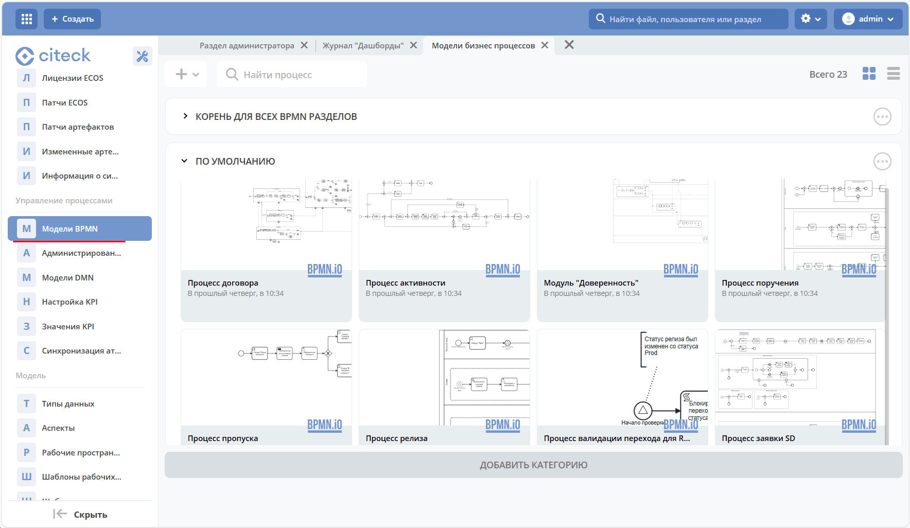
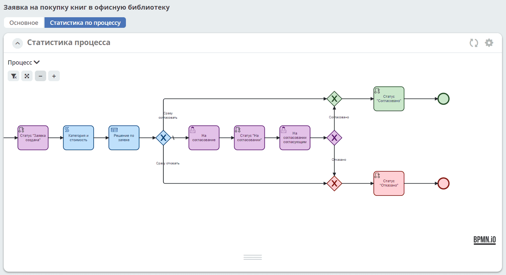
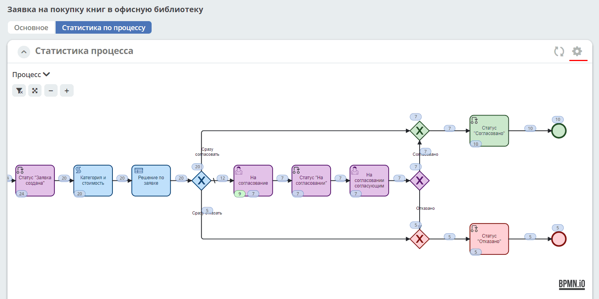

.. _ecos_bpmn:

Общее описание Citeck BPMN
==========================================

.. contents::

**Citeck BPMN** — встроенный инструмент моделирования и исполнения бизнес-процессов на базе стандарта BPMN 2.0. Он позволяет визуально описывать маршрутизацию задач, ветвления, таймеры и интеграции. Типовые процессы можно настроить без написания кода; скрипты и внешние обработчики используются для дополнительной логики и интеграций. Перед запуском схему необходимо проверить, опубликовать и настроить окружение и права доступа.

Для моделирования используется библиотека редактора `bpmn-js <https://bpmn.io/toolkit/bpmn-js/>`_, для исполнения — движок **Camunda 7.24.0** в ``ecos-process 2.38.0-SNAPSHOT``. Платформа поддерживает создание и редактирование схемы, публикацию (деплой), мониторинг запущенных экземпляров и администрирование.

Перейдите в журнал **"Модели BPMN" (Рабочее пространство "Раздел администратора" - Управление процессами)**:

Права на описание процессов
----------------------------

Права назначаются на разделы и конкретные модели процессов. Ниже показаны поставляемые назначения группам в **ROOT** для глобальных BPMN-разделов. Это не полный итоговый доступ к любой модели: он также зависит от явных настроек, прав модели и правил рабочего пространства.

.. list-table::
      :widths: 20 20 10 10 10 10
      :align: center
      :header-rows: 1
      :class: tight-table

      * - Право / Роль/ Группа
        - Описание
        - Администратор БП
        - Менеджер БП
        - Разработчик БП
        - Читатель БП
      * -
        -
        - **bp-administrator**
        - **bp-manager**
        - **bp-developer**
        - **bp-viewer**
      * - Право на чтение (read)
        - Просмотр раздела и всех процессов в нем
        -
            .. image:: _static/plus.png
                  :width: 10
                  :align: center

        -
            .. image:: _static/plus.png
                  :width: 10
                  :align: center
        -
            .. image:: _static/plus.png
                  :width: 10
                  :align: center

        -
            .. image:: _static/plus.png
                  :width: 10
                  :align: center
      * - Право на изменение (write)
        - Редактирование раздела и процессов в нем
        -
            .. image:: _static/plus.png
                  :width: 10
                  :align: center

        -
            .. image:: _static/minus.png
                  :width: 10
                  :align: center
        -
            .. image:: _static/minus.png
                  :width: 10
                  :align: center

        -
            .. image:: _static/minus.png
                  :width: 10
                  :align: center
      * - Редактирование процессов в разделе
        - Редактирование процессов в разделе
        -
            .. image:: _static/plus.png
                  :width: 10
                  :align: center

        -
            .. image:: _static/minus.png
                  :width: 10
                  :align: center
        -
            .. image:: _static/minus.png
                  :width: 10
                  :align: center

        -
            .. image:: _static/minus.png
                  :width: 10
                  :align: center
      * - Деплой процесса
        - :ref:`Публикация моделей процессов <save_bp>`
        -
            .. image:: _static/plus.png
                  :width: 10
                  :align: center

        -
            .. image:: _static/minus.png
                  :width: 10
                  :align: center
        -
            .. image:: _static/plus.png
                  :width: 10
                  :align: center

        -
            .. image:: _static/minus.png
                  :width: 10
                  :align: center
      * - Просмотр отчета
        - :ref:`Просмотр статистики по процессу <widget_process_statistics>`
        -
            .. image:: _static/plus.png
                  :width: 10
                  :align: center

        -
            .. image:: _static/plus.png
                  :width: 10
                  :align: center
        -
            .. image:: _static/plus.png
                  :width: 10
                  :align: center

        -
            .. image:: _static/minus.png
                  :width: 10
                  :align: center
      * - Просмотр экземпляра процесса
        - Просмотр экземпляра процесса :ref:`в разделе "Администрирование БП" <bpmn_admin>`
        -
            .. image:: _static/plus.png
                  :width: 10
                  :align: center

        -
            .. image:: _static/minus.png
                  :width: 10
                  :align: center
        -
            .. image:: _static/minus.png
                  :width: 10
                  :align: center

        -
            .. image:: _static/minus.png
                  :width: 10
                  :align: center
      * - Редактирование экземпляра процесса
        - Редактирование экземпляра процесса :ref:`в разделе "Администрирование БП" <bpmn_admin>`
        -
            .. image:: _static/plus.png
                  :width: 10
                  :align: center

        -
            .. image:: _static/minus.png
                  :width: 10
                  :align: center
        -
            .. image:: _static/minus.png
                  :width: 10
                  :align: center

        -
            .. image:: _static/minus.png
                  :width: 10
                  :align: center
      * - Миграция экземпляра процесса
        - Миграция экземпляра процесса :ref:`в разделе "Администрирование БП" <bpmn_admin>`
        -
            .. image:: _static/plus.png
                  :width: 10
                  :align: center

        -
            .. image:: _static/minus.png
                  :width: 10
                  :align: center
        -
            .. image:: _static/plus.png
                  :width: 10
                  :align: center

        -
            .. image:: _static/minus.png
                  :width: 10
                  :align: center
      * - Ручной запуск экземпляра процесса
        - Ручной запуск экземпляра процесса :ref:`в разделе "Администрирование БП" <bpmn_admin>`
        -
            .. image:: _static/plus.png
                  :width: 10
                  :align: center

        -
            .. image:: _static/minus.png
                  :width: 10
                  :align: center
        -
            .. image:: _static/plus.png
                  :width: 10
                  :align: center

        -
            .. image:: _static/minus.png
                  :width: 10
                  :align: center

Роли связаны с группами. Членство в группе участвует в расчёте прав; итоговые разрешения зависят от настроек конкретной модели и пространства.

Также права можно настраивать конкретным пользователям на :ref:`конкретные разделы <bpmn_permissions>`.

В неглобальном рабочем пространстве обычный пользователь должен быть его участником. Для **DEFAULT** действуют отдельные наборы прав участника и менеджера, которые заменяют наследуемый набор ROOT. См. :ref:`Права в рабочих пространствах <bpmn_workspace_permissions>`.

Права редактирования и публикации не подразумевают создание новых моделей или подразделов. Для них предусмотрены отдельные разрешения, отсутствующие в приведённых стандартных назначениях ROOT, включая набор группы **bp-administrator**. Участник этой группы не является автоматически системным администратором.

Доступ к разделу «Моделирование»
~~~~~~~~~~~~~~~~~~~~~~~~~~~~~~~~~

Право **read** позволяет просматривать доступную пользователю модель DMN/BPMN. Для изменения схемы требуются права записи, а для создания новой модели — права создания в соответствующем разделе. Доступ учитывает также правила рабочего пространства.

Публикация (деплой) моделей
~~~~~~~~~~~~~~~~~~~~~~~~~~~~

Для публикации BPMN требуется право **bpmn-process-def-deploy**, для DMN — **dmn-def-deploy**. При действии **«Сохранить и опубликовать»** дополнительно проверяются права записи существующей модели либо создания новой модели в разделе. Одного разрешения деплоя недостаточно для всего сценария сохранения изменений.

.. grid:: 2
   :gutter: 2

   .. grid-item::

      .. image:: _static/rights_2.png
         :width: 500
         :align: left

   .. grid-item::

      .. image:: _static/rights_3.png
         :width: 500
         :align: left

Право на деплой BPMN можно проверить запросом ``permissions._has.bpmn-process-def-deploy?bool``.

Например:

.. code-block:: javascript

      Records.get('eproc/bpmn-def@your-process').load("permissions._has.bpmn-process-def-deploy?bool", true).then(res => console.log(res))

Просмотр схемы процесса
~~~~~~~~~~~~~~~~~~~~~~~~

Добавлена возможность просмотра схемы БП для пользователей с правом **Право на чтение (read)**.

.. grid:: 2
   :gutter: 2

   .. grid-item::

      .. image:: _static/rights_4.png
         :width: 500
         :align: left

   .. grid-item::

      .. image:: _static/rights_5.png
         :width: 500
         :align: left

Просмотр отчётности
~~~~~~~~~~~~~~~~~~~~

Добавлен просмотр отчетности для ролей с правом **Просмотр отчета**. Под отчетностью понимаем виджет «Статистика по процессу».

Право на просмотр отчётности можно проверить запросом ``permissions._has.bpmn-process-def-report-view?bool``.

Например:

.. code-block:: javascript

      Records.get('eproc/bpmn-def@your-process').load("permissions._has.bpmn-process-def-report-view?bool", true).then(res => console.log(res))

Для настройки просмотра обратитесь к администратору ECOS. Право просмотра отчётности само по себе не разрешает изменять настройки виджета или панели.

Подробно о виджете :ref:`«Статистика по процессу» <widget_process_statistics>`.
