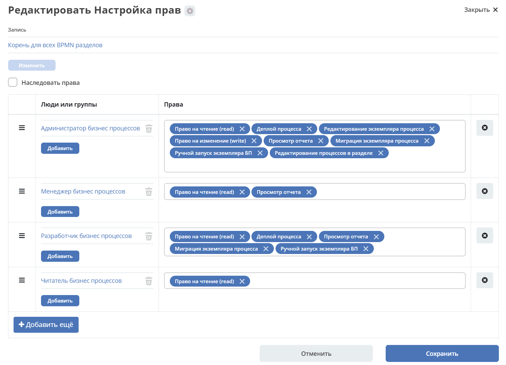

.. _bpmn_permissions:

Управление правами в BPMN разделе
============================================================

В Citeck доступ к разделам BPMN и операциям с процессами определяется правами раздела, явными назначениями на модель, её ролевыми правами и правилами рабочего пространства. Назначения можно задавать группам и отдельным пользователям. Наследование позволяет передавать права дочерним разделам и вложенным моделям. Отдельные разрешения отвечают за просмотр, создание, редактирование, публикацию и управление экземплярами процессов.

.. contents::

Настройка прав
------------------

.. note::

      Описанные ниже действия по настройке прав выполняйте от имени системного администратора (пользователя из группы **ECOS_ADMINISTRATORS**). Изменение прав доступа — отдельная операция: право редактировать модель или раздел не следует считать автоматическим разрешением менять их ACL.

Права можно настраивать для каждого раздела отдельно:

1. Открыть страницу раздела BPMN:

   .. code-block::

         https://{host}/admin?type=BPM

2. Напротив нужного раздела нажать кнопку действий и выбрать **"Редактировать права"**:

   .. image:: _static/permissions_1.png
      :width: 400
      :align: center

3. Откроется окно настройки:

   .. image:: _static/permissions_2.png
      :width: 600
      :align: center

4. В открывшемся окне можно настроить права для групп и пользователей, включить или выключить наследование следующих прав:

   .. image:: _static/permissions_3.png
      :width: 400
      :align: center

Права на типы
--------------

При создании и редактировании процессов часто требуется вносить изменения в конфигурацию типов. Чтобы разрешить редактирование и создание для пользователей без прав системного администратора, следует настроить права на родительских типах, как описано в статье :ref:`Настройка прав для описания типов <data_type_rights>`.

Права BPMN сами по себе не дают права изменять описание ECOS Type; доступ к типам настраивается отдельно.

Пример вариантов настроек:

.. tab-set::

      .. tab-item:: Все типы

         Настроить права на тип **"base"** и дать пользователям доступ на создание и редактирование любых типов.

      .. tab-item:: Только бизнес-типы

         Настроить права на тип **"user-base"** и дать пользователям доступ на создание и редактирование только бизнес-типов.

      .. tab-item:: Отдельный прокси-тип

         Создать отдельный прокси-тип, унаследованный от одного из стандартных (case/data-list/document/doclib-file и т.д.) и выдать права только на него.

Общие правила распределения прав по разделам
---------------------------------------------

- Для глобальных разделов права по умолчанию задаются в корневом разделе **ROOT**. Права наследуются от родителя к дочерним разделам и от разделов к вложенным процессам. В рабочих пространствах дополнительно действуют правила, описанные ниже.
- Если при настройке прав у раздела убрать флаг **"Наследовать права"**, наследуемые назначения родительского раздела не добавляются. Независимые права самой модели и её ролей этим флагом не отменяются.
- При включённом наследовании назначения дочерней сущности дополняются родительскими. Итоговый доступ необходимо проверять для конкретной модели и пользователя с учётом рабочего пространства.

**Редактирование и создание различаются:**

- Право **write** на раздел разрешает изменять сам раздел и участвует в предоставлении записи вложенным моделям.
- **bpmn-section-edit-process-def** позволяет редактировать модели раздела, не предоставляя само по себе право изменять раздел.
- **bpmn-section-create-process-def** требуется для создания моделей в глобальном разделе.
- **bpmn-section-create-subsection** отвечает за создание подразделов.
- **bpmn-process-def-deploy** разрешает публикацию, но не заменяет права записи или создания модели.

.. _bpmn_workspace_permissions:

Права в рабочих пространствах
------------------------------

В рабочих пространствах доступ к разделам и процессам зависит также от участия пользователя в пространстве. Для обычного пользователя, не являющегося участником пространства, доступ закрыт: права глобальных разделов не обходят это ограничение. Для системных пользователей и системных администраторов действуют отдельные правила доступа.

Для раздела **По умолчанию (DEFAULT)** и процессов в нём применяются следующие права:

- **Участник пространства** — чтение (``read``), запуск процесса (``bpmn-process-instance-run``), просмотр отчётности (``bpmn-process-def-report-view``) и просмотр экземпляров процесса (``bpmn-process-instance-read``).
- **Менеджер пространства** — все BPMN права, включая редактирование, публикацию, создание процессов и подразделов, управление экземплярами и миграцию.

Эти наборы определяют доступ в разделе DEFAULT вместо наследуемого набора ROOT. Для остальных разделов пространства участие в пространстве остаётся обязательным, а права определяются индивидуальными настройками, наследованием от разделов и ролевыми правами модели.

Набор менеджера относится к DEFAULT и не отменяет отдельные проверки операций. В неглобальном пространстве создание модели или перенос её в раздел разрешены обычному пользователю только при наличии роли менеджера пространства и выборе DEFAULT.

Корневой раздел
----------------

Корневой раздел имеет идентификатор **ROOT** и служит для настройки прав по умолчанию для глобальных разделов.

Корневой раздел виден только администраторам системы (пользователям в группе **ECOS_ADMINISTRATORS**).

В корневом разделе нельзя создавать подразделы через действия напротив этого раздела. Для создания новых разделов в корне следует использовать кнопку **"+"** над всеми разделами:

Права по умолчанию для корневого раздела BPMN
~~~~~~~~~~~~~~~~~~~~~~~~~~~~~~~~~~~~~~~~~~~~~~

Ниже приведены поставляемые назначения группам на ROOT для глобальных BPMN-разделов. Они служат основой наследования; доступ к самому ROOT ограничен системными администраторами.

.. list-table::
      :widths: 3 5
      :header-rows: 1
      :align: center
      :class: tight-table

      * - Группа
        - Права
      * - **bp-administrator**
        - | read
          | write
          | bpmn-process-def-deploy
          | bpmn-process-def-report-view
          | bpmn-process-instance-run
          | bpmn-process-instance-edit
          | bpmn-process-instance-read
          | bpmn-process-instance-migrate
          | bpmn-section-edit-process-def
      * - **bp-manager**
        - | read
          | bpmn-process-def-report-view
      * - **bp-developer**
        - | read
          | bpmn-process-def-deploy
          | bpmn-process-instance-run
          | bpmn-process-def-report-view
          | bpmn-process-instance-migrate
      * - **bp-viewer**
        - | read

.. note::

    В этих назначениях нет **bpmn-section-create-process-def** и **bpmn-section-create-subsection**, в том числе у группы **bp-administrator**. При необходимости права создания назначаются отдельно. Группа администраторов БП не равнозначна системным администраторам ECOS.

Описание BPMN прав
-------------------

.. list-table::
      :widths: 5 5 10
      :header-rows: 1
      :align: center
      :class: tight-table

      * - Идентификатор
        - Название
        - Описание
      * - **read**
        - Право на чтение (read)
        - Чтение раздела или модели с учётом итоговых разрешений и правил рабочего пространства.
      * - **write**
        - Право на изменение (write)
        - Запись раздела или модели. Право раздела также участвует в предоставлении записи вложенным моделям; создание и публикация проверяются отдельно.
      * - **bpmn-section-create-process-def**
        - Создание процессов в разделе
        - Можно ли создавать новые процессы в разделе.
      * - **bpmn-section-create-subsection**
        - Создание подразделов
        - Можно ли создавать подразделы внутри раздела.
      * - **bpmn-section-edit-process-def**
        - Редактирование процессов в разделе
        - Позволяет редактировать модели в разделе без обязательного права write на сам раздел. Не заменяет разрешение создавать новые модели.
      * - **bpmn-process-def-deploy**
        - Деплой процесса
        - Можно ли публиковать описание процесса в BPMN движок.
      * - **bpmn-process-def-report-view**
        - Просмотр отчета
        - Можно ли просматривать статистику по процессу.
      * - **bpmn-process-instance-read**
        - Просмотр экземпляра процесса
        - Можно ли просматривать экземпляры процесса.
      * - **bpmn-process-instance-edit**
        - Редактирование экземпляра процесса
        - Можно ли редактировать экземпляры процесса.
      * - **bpmn-process-instance-migrate**
        - Миграция экземпляра процесса
        - Можно ли мигрировать экземпляры процесса.
      * - **bpmn-process-instance-run**
        - Ручной запуск экземпляра бизнес-процесса
        - Можно ли запускать вручную новые экземпляры процесса.
