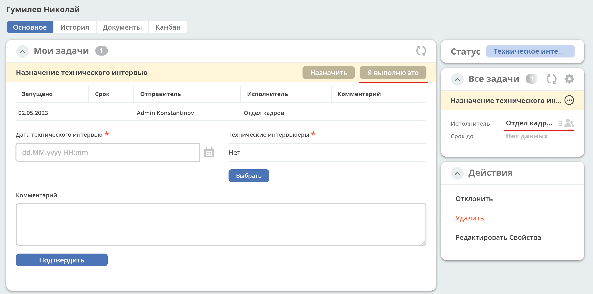
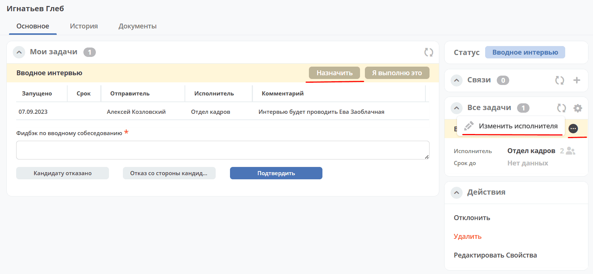
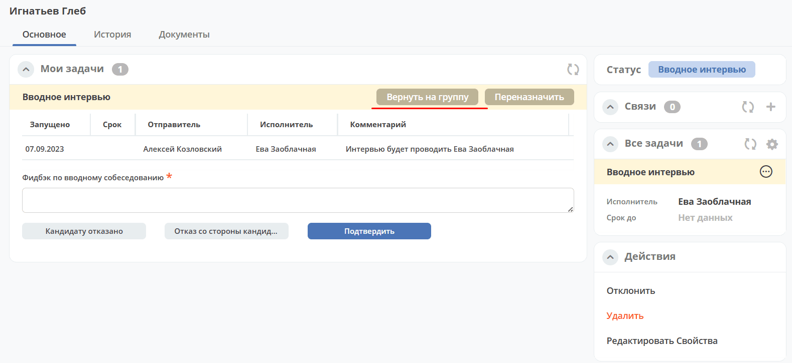

.. _tasks_options:

Работа с задачами бизнес-процесса
==================================================================

.. contents::

При работе с бизнес-процессом на пользователей назначаются задачи. Ниже описаны варианты действий с задачами.

Права
------

Права на получение задачи, назначение исполнителя и возврат задачи в пул реципиентов имеют:

    - администраторы Citeck;

    - назначенный исполнитель задачи;

    - пользователи, являющиеся реципиентами задачи, в том числе участники групп реципиентов;

    - заместители исполнителя или реципиентов при действующем замещении для типа документа, по которому запущен процесс.

Дополнительно права на переназначение (изменить исполнителя) задачи имеют пользователи, входящие в группу ``GROUP_WORKFLOW_TASKS_REASSIGN_ALLOWED``.

Доступность действия также зависит от состояния задачи: наличия исполнителя и реципиентов.

Действия с задачей
-------------------

.. grid:: 1
   :gutter: 2

   .. grid-item-card:: Я выполню это
      :link: task_execute
      :link-type: ref

      Заберите задачу из пула реципиентов и назначьте на себя.

   .. grid-item-card:: Назначить / Изменить исполнителя
      :link: task_reassign
      :link-type: ref

      Назначьте задачу из пула выбранному пользователю или замените текущего исполнителя.

   .. grid-item-card:: Вернуть на группу
      :link: task_return_to_group
      :link-type: ref

      Снимите назначенного исполнителя и верните задачу в сохранённый пул реципиентов.

   .. grid-item-card:: Просмотр схемы бизнес-процесса
      :link: task_view_scheme
      :link-type: ref

      Откройте схему бизнес-процесса с выделенной текущей задачей.

.. _task_execute:

Я выполню это
~~~~~~~~~~~~~

Действие доступно, если задача не назначена конкретному исполнителю и у неё есть реципиенты — пользователи или группы.
При выполнении действия задача забирается из пула реципиентов и назначается на текущего пользователя.

.. _task_reassign:

Назначить / Изменить исполнителя
~~~~~~~~~~~~~~~~~~~~~~~~~~~~~~~~~~

Если задача находится в пуле реципиентов, действие **Назначить** назначает её выбранному пользователю.
Если у задачи уже есть исполнитель, действие **Изменить исполнителя** заменяет его выбранным пользователем. Для смены исполнителя наличие пула реципиентов не требуется.

.. note::

    При назначении выбранному пользователю или смене исполнителя, если у нового исполнителя нет права на чтение документа, по которому идёт бизнес-процесс, ему делегируется право чтения от пользователя, выполняющего назначение.

.. _task_return_to_group:

Вернуть на группу
~~~~~~~~~~~~~~~~~

Действие снимает назначенного исполнителя и возвращает задачу в сохранённый пул реципиентов.
Доступно, если у задачи есть исполнитель и сохранённые реципиенты для возврата.

Пул сохраняется при получении или назначении задачи из пула реципиентов. При синхронизации ролевых реципиентов его состав может обновляться, поэтому он не всегда совпадает с составом на момент создания задачи.

.. _task_view_scheme:

Просмотр схемы бизнес-процесса
~~~~~~~~~~~~~~~~~~~~~~~~~~~~~~~

1. Нажмите на кнопку просмотра схемы:

   .. image:: _static/task_4.png
      :width: 600
      :align: center

2. Откроется схема выбранного БП с выделенной текущей задачей:

   .. image:: _static/task_5.png
      :width: 600
      :align: center

Добавление комментария
------------------------

При настройке формы задачи для корректной работы поля комментария необходимо соблюдать следующее правило:

.. note::

    На форме задач поле комментарий нужно обязательно добавлять с id ``comment``.
