.. _ai_task:

AI задача
================

.. contents::

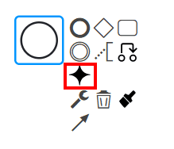

Задача вызывает AI по указанному промпту и передаёт ответ в бизнес-процесс. Ответ можно сохранить в документ, обработать скриптом или использовать на следующих шагах процесса: например, при отправке уведомления или генерации документа.

Задача поддерживает два режима: обычный запрос к LLM и вызов преднастроенного :ref:`AI-агента <user-agents>` с его инструкцией и набором инструментов. Оба режима выполняются без памяти о предыдущих обращениях. Режим определяется полем :ref:`«AI Агент» <ai-task-agent-selection>` (см. также :ref:`режимы выполнения агентов <agent-execution-modes>`).

Для выполнения требуется доступный сервис Citeck AI с обработчиком внешних задач. Процесс ожидает завершения AI задачи, после чего выполняет сохранение результата и постобработку и переходит к следующему элементу.

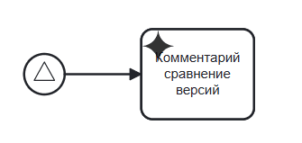

Атрибуты и форма
--------------------------------

Имя
~~~~~~~~~~~~~~~~

Укажите **Имя**.

Форма также содержит **ID элемента**, **Номер элемента** и **Документацию**. ID обязателен, должен содержать не менее трёх символов; допустимы латинские буквы, цифры, дефис, подчёркивание и ``*``.

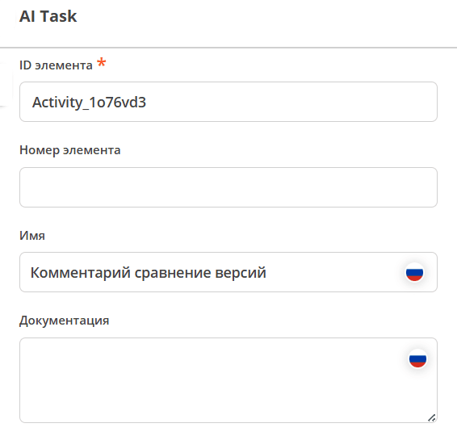

.. _ai-task-agent-selection:

Выбор AI агента
~~~~~~~~~~~~~~~~

**Пусто** — задача выполняется обычным запросом к AI: модель возвращает текстовый ответ. Сохранение ответа в документ и другие изменения выполняются настройками :ref:`постобработки задачи <ai-task-result-processing>`.

Обычный запрос использует штатные инструменты чтения данных: атрибутов, содержимого и истории документов, сведений об активностях и контактах, а также анализа документов, текущего времени и RAG-поиска.

**Выбран агент** — используются его инструкция и разрешённые инструменты. Модель определяется настройками агента с учётом конфигурации стенда: администратор может закрепить базовую модель для всех агентов.

.. important::

   В бизнес-процессе инструменты агента вызываются без подтверждения человеком. Выбирайте агента, предназначенного для самостоятельного выполнения задачи. Инструменты, запрещённые для такого режима, приводят к ошибке выполнения; они не исключаются из набора молча. Агент должен быть включён и иметь корректную конфигурацию.

Запросы, чтение документов и инструменты выполняются от имени системного пользователя рабочего пространства процесса. Для глобального процесса используется системный пользователь платформы. Скрипты предобработки, сохранение результата и постобработка выполняются по тому же правилу.

Подготовка данных для вызова AI
~~~~~~~~~~~~~~~~~~~~~~~~~~~~~~~~~~~~~~~~~~~~~~~~~~~~~~~~~~~~~

**Скрипт** — JavaScript, выполняемый до запроса к AI. Используется для подготовки данных или включения дополнительных документов в контекст.

Для добавления в контекст:

.. code-block:: javascript

  let contracts = ["emodel/ecos-contract@contract1", "emodel/ecos-contract@contract2"];
  execution.setVariable("aiRecordsContext", DataValue.of(contracts));

``aiRecordsContext`` — массив ссылок на документы, включаемых в контекст запроса. Значение должно быть обёрнуто в ``DataValue``. Дополнительные ссылки обрабатываются в обоих режимах, в том числе при отключённом флаге **«Включить документ в контекст»**. Доступ к данным определяется правами выполнения задачи.

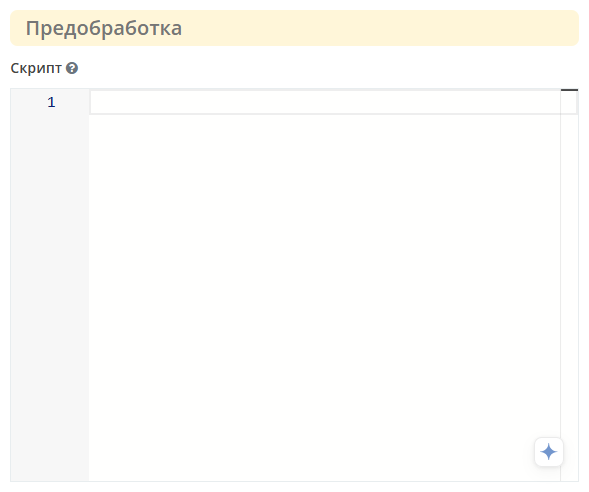

Формирование запроса к AI
~~~~~~~~~~~~~~~~~~~~~~~~~~~~~~~~~~~~~~~~~~~~~~~~~~~~~

**Включить документ в контекст** — добавляет текущий документ бизнес-процесса в контекст AI-запроса. По умолчанию включено.

Для текущего документа и ссылок из ``aiRecordsContext`` в промпт добавляются название, ссылка и тип записи. Получение атрибутов и содержимого зависит от доступных модели инструментов; всё содержимое документов автоматически в промпт не передаётся.

**Текст запроса** — промпт, отправляемый AI. Можно вставлять значения через ``${someVariable}``. Сначала читается переменная процесса; если её нет либо её текстовое значение пусто или состоит из пробелов, читается одноимённый атрибут документа через RecordsService. Если оба источника пусты или при разрешении произошла ошибка, исходный маркер остаётся в тексте. Это подстановка значений, а не вычисление произвольных выражений BPMN.

Пример:

.. code-block:: text

  Подготовь черновик письма клиенту по поводу просроченного платежа.
  Контактное лицо: ${clientName}, сумма долга: ${debtAmount}, срок просрочки: ${daysOverdue} дней.

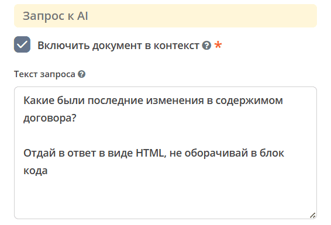

Для обычного запроса задайте роль модели, правила и требования к формату ответа в поле **«Текст запроса»**. При выборе :ref:`агента <ai-task-agent-selection>` используется инструкция, заданная в настройках агента.

Для подготовки скрипта можно воспользоваться :ref:`ассистентом для написания скриптов <AI_script_assistant>`.

Проверка настроек
~~~~~~~~~~~~~~~~~~~~~~~~~~~~~~~~~~~~~~~~~~

**Текст запроса** обязателен в обоих режимах. Серверная проверка определения процесса отклоняет пустой промпт и промпт, состоящий только из пробелов.

Для выполнения также должны быть настроены доступ к модели и внешний AI-обработчик. При отсутствии работающего обработчика задача ожидает обработки; ошибки вызова модели или агента обрабатываются механизмом внешних задач.

.. _ai-task-result-processing:

Работа с результатом работы AI
~~~~~~~~~~~~~~~~~~~~~~~~~~~~~~~~~~~~~~~~~~~~~~~~~~~~~~~~~~~

При успешном выполнении текстовый ответ сохраняется в переменную процесса ``aiResponse`` в обоих режимах. Его можно использовать в постобработке и на следующих шагах процесса.

**Сохранить результат в атрибут документа** — AI-ответ будет записан в указанный атрибут документа, по которому идет бизнес-процесс.

**Скрипт** — JavaScript, выполняемый после получения ответа от AI. Результат запроса доступен в переменной ``aiResponse``.

Сначала ответ записывается в указанный атрибут документа, затем выполняется скрипт постобработки. Поэтому скрипт видит уже сохранённый атрибут. Изменение ``aiResponse`` в постобработке автоматически не перезаписывает этот атрибут — при необходимости сохраните новое значение явно.

.. note::

   Для типового сценария проверки входящих обращений на спам платформа поставляет аспект ``ai-spam-check-data`` с атрибутами «Вероятность спама» (``probability``) и «Причина спама» (``reason``). Подключите аспект к типу данных обращения и заполняйте его атрибуты в скрипте постобработки ответа AI задачи.

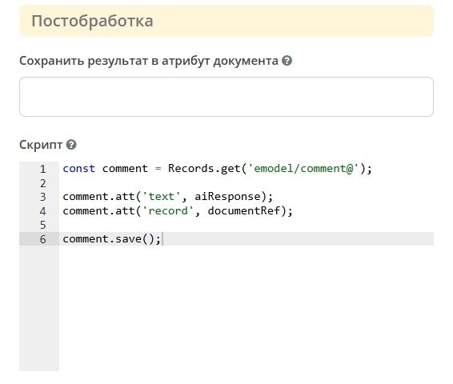

Настройки асинхронности
~~~~~~~~~~~~~~~~~~~~~~~~~~~~~~~~~~~~~~~~~~

- **Асинхронно "перед"** — исполнение доходит до точки перед блоком, транзакция комитится и дальнейшее выполнение ставится в очередь, которую разбирает уже джоба.
- **Асинхронно "после"** — исполнение доходит до точки после блока, транзакция комитится и дальнейшее выполнение ставится в очередь, которую разбирает уже джоба.

При включении асинхронности также доступны **Эксклюзивность**, **Приоритет** и **Цикл повтора** фоновой задачи.

Эти параметры задают дополнительные границы выполнения движка. Сама AI задача обрабатывается внешним сервисом и ожидает его завершения даже при отключённых флагах. Цикл повтора фоновой задачи движка не задаёт политику повторных вызовов AI внешним обработчиком.

См. подробнее об `асинхронных задачах <https://camunda.com/blog/2014/07/advanced-asynchronous-continuations/>`_.

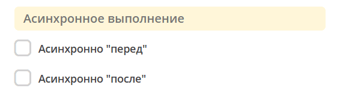

Примеры использования
--------------------------------------------

Рассмотрим 2 примера встраивания AI-задачи в бизнес-процессы.

Сравнение версий договоров
~~~~~~~~~~~~~~~~~~~~~~~~~~~~~~~~~~~~~~~~~~

В модуле «Договоры» сотрудники могут загружать разные версии договоров, вносить правки в процессе согласования.

Рассмотрим небольшой :download:`бизнес-процесс <../files/contract-content-diff-ai-process.bpmn.xml>`, который реагирует на изменение контента договора и в карточке договора добавляет комментарий, в котором указаны ключевые изменения и выводы.

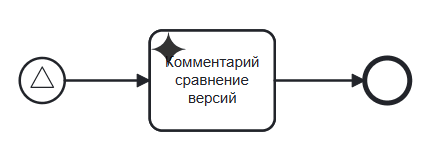

Настроен :ref:`сигнал <signal_start_event>` на изменение контента, далее запускается AI задача, которую мы спрашиваем в поле **«Текст запроса»**, как и в работе с :ref:`AI Ассистентом <AI_assistant>`, какие были последние изменения содержания договора, и просим, чтобы ответ был выдан в виде HTML формате.

В поле **«Скрипт»** раздела **«Постобработка»** создадим комментарий к договору, в котором будут перечислены изменения:

.. code-block:: javascript

    const comment = Records.get('emodel/comment@');

    comment.att('text', aiResponse);
    comment.att('record', documentRef);

    comment.save();

В карточку договора будет добавлен комментарий, в котором указаны ключевые изменения и выводы:

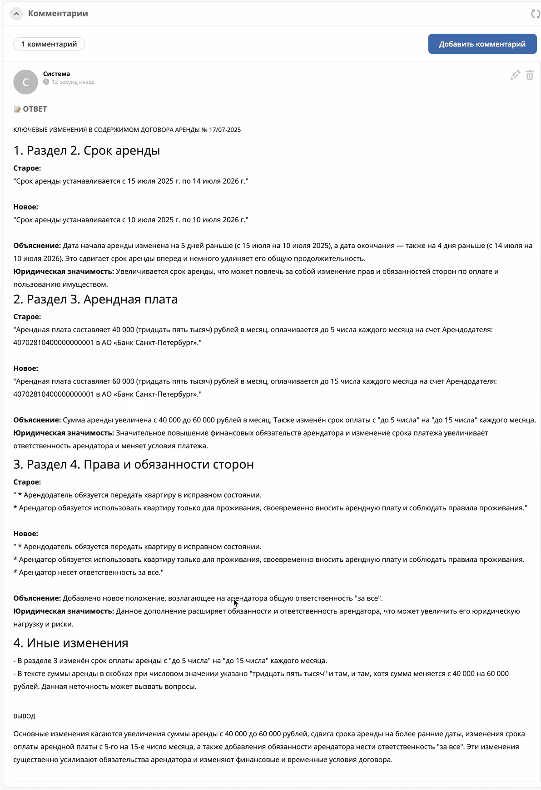

Автоматическая генерация текста в коммерческом предложении
~~~~~~~~~~~~~~~~~~~~~~~~~~~~~~~~~~~~~~~~~~~~~~~~~~~~~~~~~~~~~~~~~~~~~~~~~~~~~~~~~~~~

В модуле CRM можно сделать автоматическую генерацию текста в коммерческом предложении. :download:`Скачать процесс <../files/crm-deal-ai-process.bpmn.xml>`

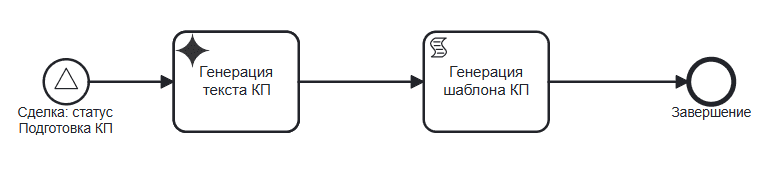

Когда сделка переходит в статус «Подготовка коммерческого предложения», запускается AI задача, которая заполняет контекстные данные: в предобработке вытаскиваем наименование клиента, юридического лица и список продуктов и услуг и используем эти данные далее в промпте.

После этого запускается :ref:`скриптовая задача <script_task>`, которая сформирует шаблон по коммерческому предложению.

Текст будет сгенерирован на основе информации клиента, поставщика и тех продуктов и услуг, которые были выбраны в карточке.

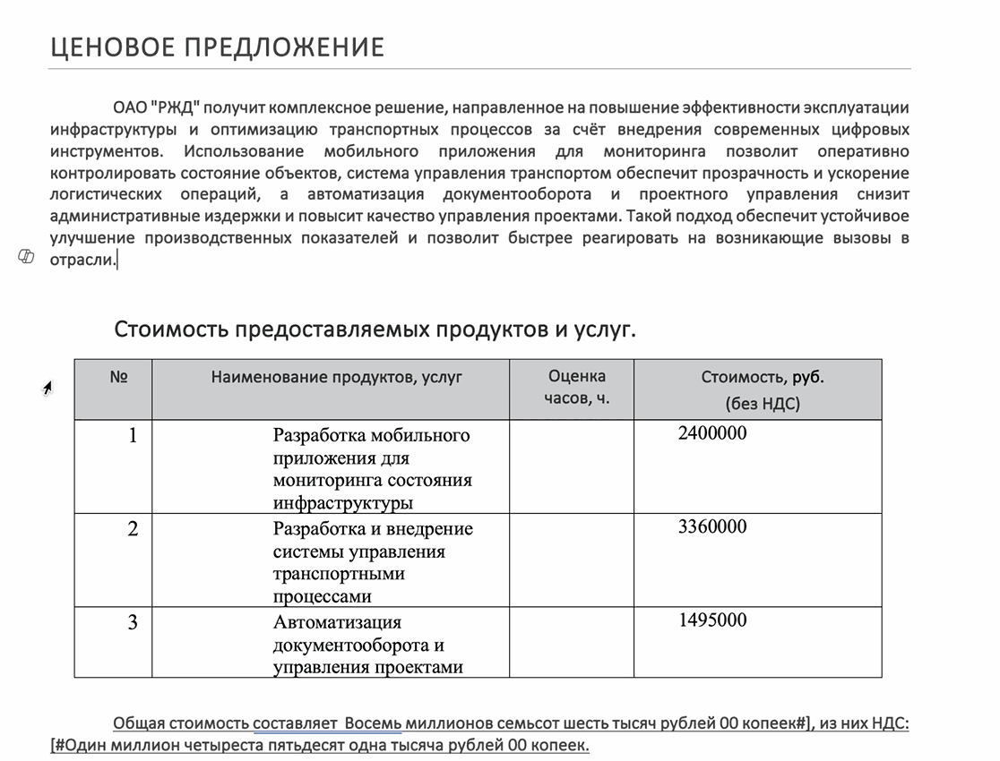
