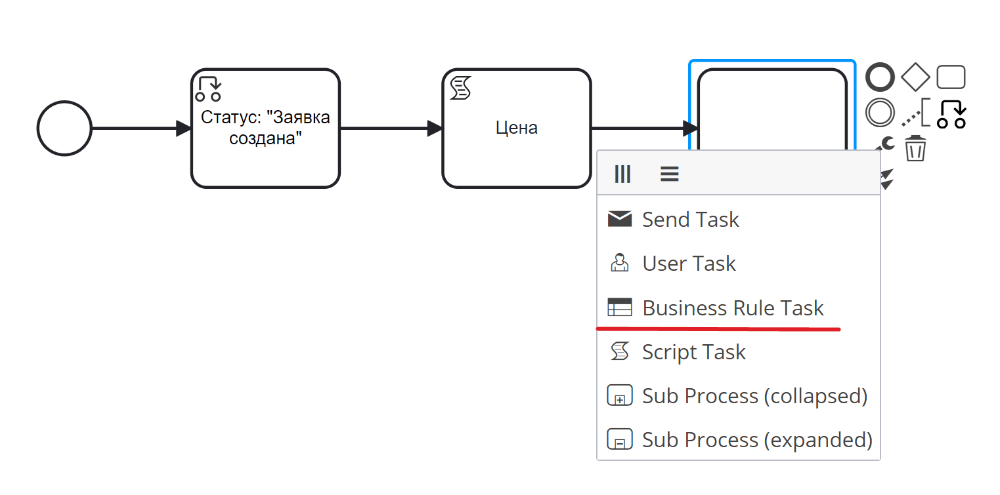
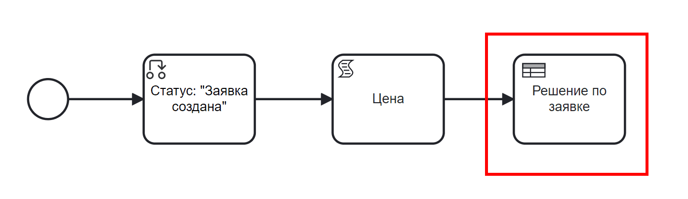
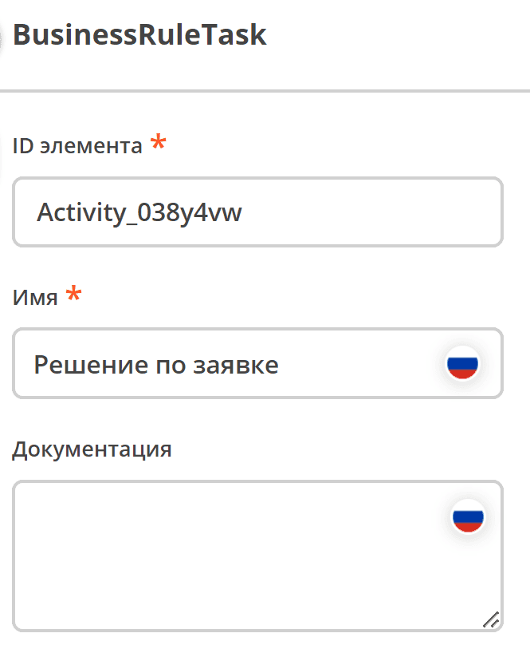
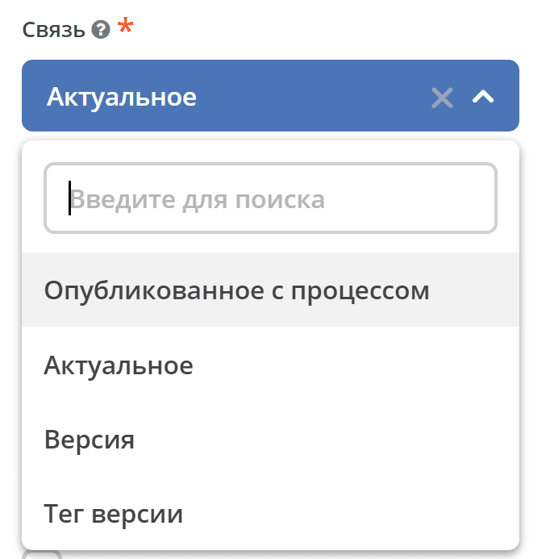
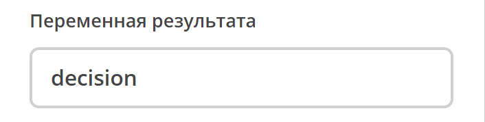
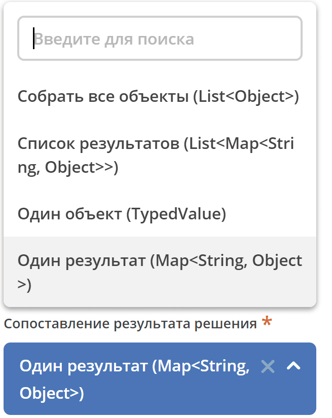
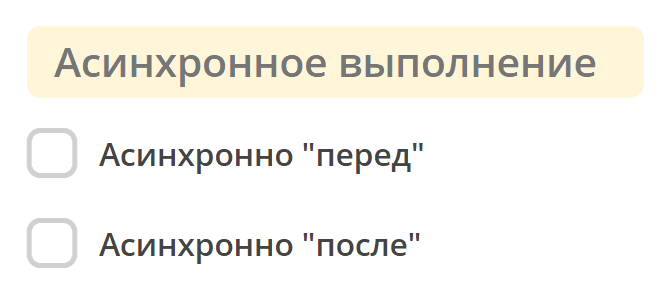
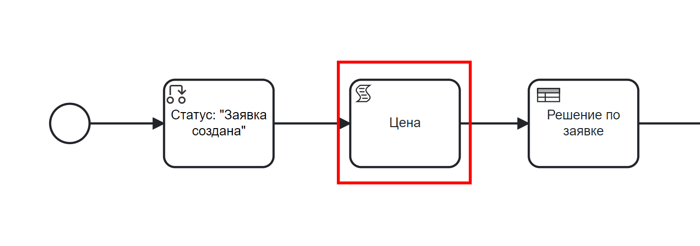
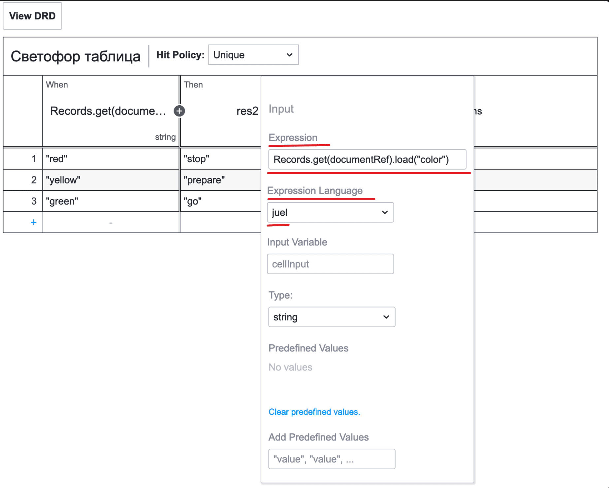

.. _business_rule_task:

Задача бизнес-правило
==============================================

.. note::

   Введенные в форму данные должны четко соответствовать (включая регистр) входным элементам таблицы принятия решений.

   Будьте внимательны при сравнении строк и использовании символов в unicode.

Задача бизнес-правило служит для вызова :ref:`решения DMN <dmn_decision>` из процесса BPMN, используется для синхронного выполнения одного или нескольких правил.

Элемент выбирается следующим образом:

|

.. note::

   Выходной элемент решения, также называемый результатом решения, не сохраняется автоматически как переменная процесса. Вы должны указать **Переменную результата** и выбрать тип **Сопоставления результата решения**.

Атрибуты и форма
--------------------------------

Имя
~~~~~~~~~~~~~~~~

Укажите **Имя**.

Решение
~~~~~~~~~~~~~~~~

Выберите **Решение** из списка созданных.

Связь с версией решения
~~~~~~~~~~~~~~~~~~~~~~~~~~~~~~~~~~~~~~~~~~~~~~

Выберите **Связь** с версией решения:

- **Опубликованное с процессом** — рассчитывается версия решения, которая была опубликована вместе с версией процесса.
- **Актуальное** — всегда последняя версия решения.
- **Версия** — позволяет указать конкретную версию решения.
- **Тег версии** — позволяет указать конкретную версию решения по тегу.

Переменная результата
~~~~~~~~~~~~~~~~~~~~~~~~~~~~~~~~~~~~~~

Введите имя **Переменной результата**, в которую нужно сохранить результат решения. Поле необязательное; заполните его, если результат требуется в дальнейшем процессе.

Сопоставление результата решения
~~~~~~~~~~~~~~~~~~~~~~~~~~~~~~~~~~~~~~~~~~~~~~~~~~~~~~

Если указана переменная результата, выберите один из четырех способов **Сопоставления результата решения**:

- **Собрать все объекты (List<Object>)** — таблицы решений с несколькими правилами сопоставления и только одним выходом.
- **Список результатов (List<Map<String, Object>>)** — таблицы решений с несколькими правилами сопоставления и несколькими выходными данными.
- **Один объект (TypedValue)** — литеральные выражения решений и таблицы решений с не более чем одним правилом сопоставления и только одним выходом.
- **Один результат (Map<String, Object>)** — таблицы решений с не более чем одним правилом сопоставления.

Настройки асинхронности
~~~~~~~~~~~~~~~~~~~~~~~~~~~~~~~~~~~~~~~~~~~~

.. warning::

   В ``ecos-process 2.38.0-SNAPSHOT`` настройки **«Асинхронно перед»** и **«Асинхронно после»** для задачи бизнес-правила сохраняются в описании процесса, но не переносятся в исполняемую схему. В этой версии включение флагов не создаёт асинхронную границу для самой задачи. Настройки тела Multi Instance обрабатываются отдельно.

Назначение флагов в Camunda:

- **Асинхронно «перед»** — исполнение доходит до точки перед блоком, транзакция комитится и дальнейшее выполнение ставится в очередь, которую разбирает уже джоба.
- **Асинхронно «после»** — исполнение доходит до точки после блока, транзакция комитится и дальнейшее выполнение ставится в очередь, которую разбирает уже джоба.

См. подробнее об `асинхронных задачах <https://camunda.com/blog/2014/07/advanced-asynchronous-continuations/>`_.

.. important::

   В форме настройки элемента обязательны следующие поля:

   - **«Решение»**;
   - **«Связь»** — по умолчанию выбрано **«Актуальное»**;
   - **«Версия»** — при связи **«Версия»**; укажите целое число не меньше 1;
   - **«Тег версии»** — при связи **«Тег версии»**;
   - **«Сопоставление результата решения»** — если заполнена **«Переменная результата»**.

   Поле **«Переменная результата»** необязательное. Поля **«Версия»**, **«Тег версии»** и **«Сопоставление результата решения»** отображаются при выполнении соответствующих условий.

Как :ref:`Input variable <input_variable>` для DMN можно использовать переменные процесса. Для этого можно сохранить информацию из документа в переменную процесса и далее ее использовать.

Например:

Со следующим скриптом:

.. code-block::

       execution.setVariable('price', document.load("price?num"));

Вариант без использования :ref:`script task <script_task>` подходит только для простых случаев и если данные уже «готовы».
Можно напрямую получить **recordsService** в **expression**, только обязательно необходимо указать язык **juel**.

Например:

.. code-block::

       Records.get(documentRef).load("color")

Настройки в :ref:`DMN решении <dmn_decision>`:

.. important::

   При вызове решения из BPMN используются переменные процесса. При других способах вызова необходимые входные данные нужно передать или сформировать средствами соответствующего контекста; автоматическое наличие переменных процесса и ``documentRef`` предполагать нельзя.

   Свойство схемы **«Модель»** при вызове из задачи бизнес-правило не используется. Если то же решение планируется назначить на :ref:`динамическую роль <dmn_role>` или на условие применения :ref:`KPI <bpmn_kpi>`, входные данные для него описываются иначе — см. :ref:`Входные и выходные данные решения <dmn_decision_data>`.
