.. _call_activity:

Call activity
==============

**Call activity** представляет собой элемент схемы процесса, который позволяет вызывать другой процесс в рамках уже выполняемого. Он используется для организации и управления повторяющимися операциями или процессами в основном процессе и позволяет улучшить читаемость и модульность схемы процесса, разделяя его на более мелкие и понятные блоки.

**Call activity** может быть представлен как прямоугольник с закругленными углами и надписью внутри, указывающей на вызываемый процесс. Также может быть использована ссылка на отдельную схему процесса, где расположен вызываемый процесс.

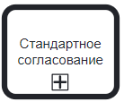

При использовании **call activity** процесс выполняет следующие шаги:

    1. Процесс достигает точки вызова (call activity).
    2. Вызывается процесс, указанный в call activity.
    3. Выполняется вызываемый процесс.
    4. После завершения вызываемого процесса, управление возвращается к основному процессу на точку вызова.
    5. Основной процесс продолжает свое выполнение.

Вы можете передавать переменные процесса в вызываемый процесс, и наоборот. Данные копируются в вызванный процесс при его запуске и копируются обратно в основной процесс при его завершении.

Атрибуты и форма
----------------------------------

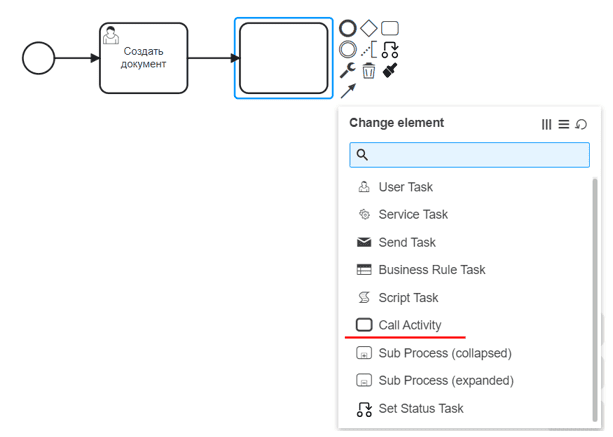

Имя
~~~~~~~~~~~~~~~~

При необходимости укажите **Имя** элемента.

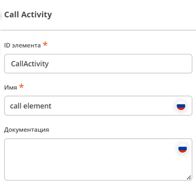

Вызываемый процесс
~~~~~~~~~~~~~~~~~~~~~~~~~~~~~~~~~~~~~~~~~~~~~~~~~~~~~

Выберите один из двух способов задания вызываемого процесса: **«Процесс»** или **«Вызываемый элемент»**. В форме при заполнении одного поля другое скрывается. Вызываемый процесс может внутри себя вызывать другие процессы.

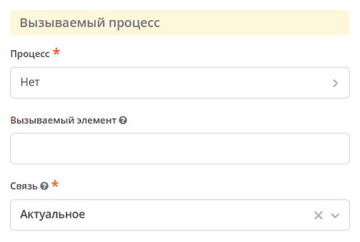

.. important::

   Для вызываемого процесса рекомендуется использовать простое стартовое событие **Start event**.

.. tab-set::

   .. tab-item:: Процесс

      Реализация от Citeck. Выбор отдельного ранее созданного процесса из журнала по кнопке **«Выбрать»**.

      .. image:: _static/call_activity/call_activity_5.png
         :width: 300
         :align: center

      .. important::

         - При работе с одним документом рекомендуется использовать одинаковый тип данных у основного и вызываемого процессов: по умолчанию ссылка на документ и его тип передаются из основного процесса.
         - Если процесс предназначен только для явного вызова, отключите его автоматический старт.
         - Для отдельно публикуемого процесса обычно используйте связь **«Актуальное»**, **«Версия»** или **«Тег версии»**. Связь **«Опубликованное с процессом»** требует совместного развертывания вызывающего и вызываемого процессов.

   .. tab-item:: Вызываемый элемент

      Стандартный вариант. Вызываемый элемент (ID процесса):

      .. image:: _static/call_activity/call_activity_6.png
         :width: 300
         :align: center

      Как найти **ID** вызываемого процесса:

      .. image:: _static/call_activity/call_activity_7.png
         :width: 600
         :align: center

      Отдельный процесс можно указать, используя **Идентификатор**:

      .. image:: _static/call_activity/call_activity_7_1.png
         :width: 600
         :align: center

      .. image:: _static/call_activity/call_activity_7_2.png
         :width: 600
         :align: center

Связь
~~~~~~~~~~~~~~~~

Выбор варианта связи с процессом. По умолчанию **«Актуальное»**.

- **Опубликованное с процессом** — используется версия вызываемого процесса из того же развертывания Camunda, что и текущий процесс. Выбор процесса из журнала сам по себе не обеспечивает совместное развертывание.
- **Актуальное** — всегда последняя версия процесса.
- **Версия** — позволяет указать конкретную версию процесса.
- **Тег версии** — позволяет указать конкретную версию процесса по тегу.

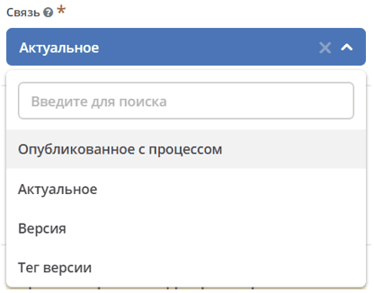

Трансляция переменных в вызываемый процесс
~~~~~~~~~~~~~~~~~~~~~~~~~~~~~~~~~~~~~~~~~~~~~~~~~~~~~~~~~~~~~~~~~~~~~~~~~~

По умолчанию пользовательские переменные нужно передавать явно либо включить передачу всех переменных. Переменные ``documentRef``, ``documentType`` и ``workflowInitiator`` передаются в вызываемый процесс автоматически, независимо от флага **«Транслировать все переменные»**.

Вызываемый процесс также получает business key основного процесса. Если business key пуст, используется строковое значение ``documentRef``.

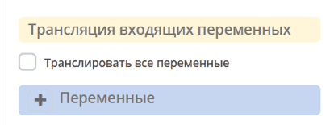

**Транслировать все переменные** — все переменные основного процесса будут переданы в вызываемый процесс, и необходимые из них будут использоваться.

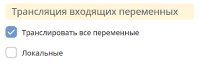

**Выбор передаваемых переменных в вызываемый процесс** — **Источник** — имя переменной основного процесса или выражение, начинающееся с ``${`` или ``#{``; **Цель** — имя переменной вызываемого процесса. Для строки с заполненным источником цель обязательна.

Передачу всех переменных можно сочетать с отдельными сопоставлениями. Для передачи всех переменных и для отдельных строк доступны флаги **«Локальные»**, управляющие локальностью сопоставления в Camunda.

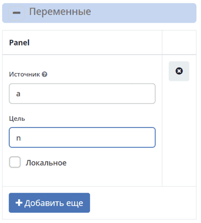

Трансляция переменных из вызываемого процесса
~~~~~~~~~~~~~~~~~~~~~~~~~~~~~~~~~~~~~~~~~~~~~~~~~~~~~~~~~~~~~~~~~~~~~~~~~~

Обратная передача переменных выполняется по заданным настройкам. Автоматические входящие сопоставления ``documentRef``, ``documentType`` и ``workflowInitiator`` не добавляют передачу этих переменных обратно.

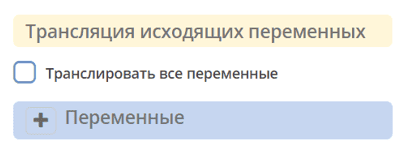

**Транслировать все переменные** — все переменные вызванного процесса будут переданы в основной процесс, и необходимые из них будут использоваться.

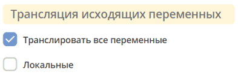

**Выбор передаваемых переменных из вызванного процесса** — **Источник** — имя переменной вызванного процесса или выражение, начинающееся с ``${`` или ``#{``; **Цель** — имя переменной основного процесса. Для строки с заполненным источником цель обязательна. Передачу всех переменных можно сочетать с отдельными сопоставлениями; также доступны настройки локальности.

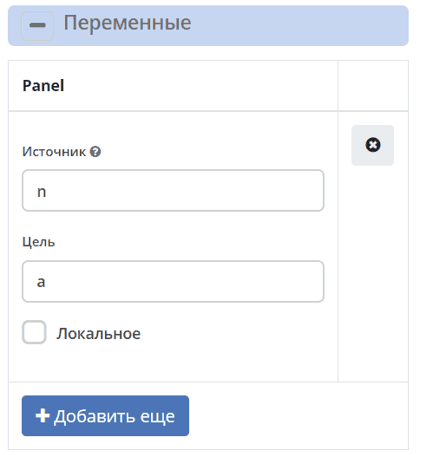

Настройки асинхронности
~~~~~~~~~~~~~~~~~~~~~~~~~~~~~~~~~~~~~~~~~~

.. warning::

   В ``ecos-process 2.38.0-SNAPSHOT`` настройки **«Асинхронно перед»** и **«Асинхронно после»** для Call activity сохраняются в описании процесса, но не переносятся в исполняемую схему. В этой версии включение флагов не создаёт асинхронную границу для самого вызова. Настройки тела Multi Instance обрабатываются отдельно.

Назначение флагов в Camunda:

- **Асинхронно «перед»** — исполнение доходит до точки перед блоком, транзакция комитится и дальнейшее выполнение ставится в очередь, которую разбирает уже джоба.
- **Асинхронно «после»** — исполнение доходит до точки после блока, транзакция комитится и дальнейшее выполнение ставится в очередь, которую разбирает уже джоба.

См. подробнее об `асинхронных задачах <https://camunda.com/blog/2014/07/advanced-asynchronous-continuations/>`_.

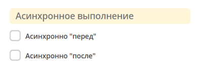

.. important::

   При настройке элемента заполните:

   - **«Процесс»** или **«Вызываемый элемент»** — выберите один способ задания процесса;
   - **«Связь»** — обязательное поле формы, по умолчанию **«Актуальное»**;
   - **«Версия»** — обязательна в форме при связи **«Версия»**; укажите целое число не меньше 1;
   - **«Тег версии»** — обязателен в форме при связи **«Тег версии»**.

   Наличие вызываемого процесса и подходящей версии проверяется движком при выполнении вызова.

Multi Instance
~~~~~~~~~~~~~~

Для многократного вызова процесса в форме доступны настройки **Multi Instance**.
