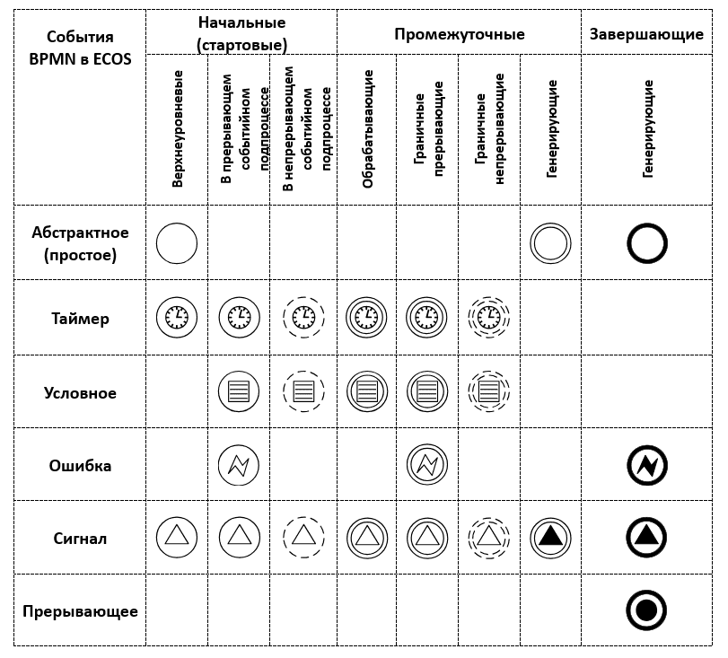

.. _bpmn_events:

События
================

**Событие** — один из ключевых элементов BPMN. В отличие от задачи, которая описывает действие (что нужно сделать), событие описывает факт, который происходит в ходе процесса и влияет на его выполнение: запускает процесс, изменяет его ход или завершает его. Примеры событий: истечение срока, получение сигнала от внешней системы, возникновение ошибки.

Графические элементы событий в BPMN классифицируют в зависимости от положения события на схеме процесса:

.. list-table::
      :widths: 5 20
      :class: tight-table

      * -
          .. image:: _static/events/common_1.png
                :width: 40
                :align: center

        - Начальное (стартовое) событие — запускает процесс или событийный подпроцесс / Start event
      * -
          .. image:: _static/events/common_2.png
                :width: 40
                :align: center

        - Промежуточное событие / Intermediate Event
      * -
          .. image:: _static/events/common_3.png
                :width: 40
                :align: center

        - Конечное событие — завершает путь выполнения; дальнейшее поведение зависит от типа события / End event

Обычное конечное событие завершает достигшую его ветвь. Другие активные ветви могут продолжать работу. Для завершения всей текущей области используется :ref:`Terminate End Event <ecos_bpmn_termination>`, а для передачи ошибки обработчику — :ref:`конечное событие «Ошибка» <ecos_bpmn_error>`.

**Промежуточные события** находятся между стартовыми и конечными событиями BPMN и изображаются двойной линией. По способу обработки различают catching и throwing. Отдельно выделяют граничные события, прикреплённые к активности:

   * **Обрабатывающие (catching)** — события ожидания. На время промежуточного обрабатывающего события текущая ветка выполнения приостанавливается; другие параллельные ветки могут продолжать работу. Такие события не привязаны к какой-либо задаче:

      .. image:: _static/events/interm_1.png
            :width: 300
            :align: center

      Поместите на схему промежуточное событие, нажмите на гаечный ключ в контекстном меню и выберите один из возможных подтипов:

      .. image:: _static/events/interm_2.png
            :width: 300
            :align: center

   * **Граничные (boundary)** — события, которые привязаны к какой-либо активности (например, задаче) и на схеме располагаются на рамке (границе) элемента активности.

      .. image:: _static/events/interm_3.png
            :width: 300
            :align: center

      Граничные события делятся на два класса:

            * **граничные прерывающие (boundary interrupting)** (на рисунке отмечен как **1**)
            * **граничные непрерывающие (boundary non-interrupting)** (на рисунке отмечен как **2**)

      Прерывающее граничное событие ожидается во время выполнения активности. До срабатывания события активность выполняется обычным образом. Когда событие срабатывает, активность отменяется и выполнение продолжается по исходящему потоку события.

      Непрерывающее граничное событие при срабатывании создаёт дополнительную ветвь, сохраняя активность выполняющейся. Например, таймер может отправлять напоминания, пока пользователь работает над задачей. Повторные срабатывания зависят от типа и настроек события и возможны, пока соответствующая подписка активна.

      Не все типы поддерживают оба варианта: граничное событие **«Ошибка»** всегда прерывающее.

      Перетащите элемент промежуточного события на рамку задачи или другого элемента, и дальше выберите требуемый тип, нажав на изображение гаечного ключа в контекстном меню.

      .. image:: _static/events/interm_4.png
            :width: 350
            :align: center

   * **Генерирующие (throwing)**

      Когда поток управления достигает генерирующего события, выполняется соответствующая обработка, например отправка сигнала. После успешной обработки текущая ветвь продолжает выполнение. Такое событие не ожидает будущего входящего события, как catching.

      .. image:: _static/events/interm_5.png
            :width: 350
            :align: center

      Рамка такая же, как и у обрабатывающего события, но по стандарту BPMN изображение внутри генерирующего события заливается черным цветом.

      Поместите на схему промежуточное событие, нажмите на гаечный ключ в контекстном меню и выберите один из возможных подтипов:

      .. image:: _static/events/interm_6.png
            :width: 350
            :align: center

На данный момент в Citeck доступны следующие типы событий:

.. grid:: 1
   :gutter: 3

   .. grid-item-card:: Таймер
      :link: ecos_bpmn_timer
      :link-type: ref

      .. image:: _static/events/common_4.png
         :width: 100
         :align: left

      Ожидает заданную дату, продолжительность или срабатывание цикла. Граничный таймер позволяет ограничить время выполнения активности либо отправлять напоминания.

   .. grid-item-card:: Условное
      :link: ecos_bpmn_conditional
      :link-type: ref

      .. image:: _static/events/common_7.png
         :width: 100
         :align: left

      Проверяет условие при активации и изменениях видимых переменных процесса. Дополнительно может реагировать на события изменения документа.

   .. grid-item-card:: Ошибка
      :link: ecos_bpmn_error
      :link-type: ref

      .. image:: _static/events/common_9.png
         :width: 100
         :align: left

      Передаёт BPMN-ошибку обработчику либо перехватывает её. Источником может быть конечное событие «Ошибка» или код сервиса, выбрасывающий BpmnError.

   .. grid-item-card:: Сигнал
      :link: ecos_bpmn_events
      :link-type: ref

      .. image:: _static/events/common_5.png
         :width: 100
         :align: left

      Ожидает или отправляет сигнал; используется интеграция с :ref:`событиями Citeck <bpmn_events_integrations>`. Событие может быть доставлено нескольким обработчикам, соответствующим имени и фильтрам подписки.

   .. grid-item-card:: Прерывающее
      :link: ecos_bpmn_termination
      :link-type: ref

      .. image:: _static/events/common_8.png
         :width: 100
         :align: left

      Завершает текущую область выполнения и все активные потоки внутри неё: на уровне процесса — процесс, внутри подпроцесса — этот подпроцесс.

Выбор типа события
------------------

Тип события определяет, в каких местах схемы его можно использовать:

.. list-table::
   :header-rows: 1
   :widths: 20 40 40
   :class: tight-table

   * - Тип
     - Ожидание и обработка
     - Генерация и завершение
   * - **Таймер**
     - Стартовое, промежуточное catching, граничное.
     - Не используется как throwing или конечное событие.
   * - **Условие**
     - Стартовое в событийном подпроцессе, промежуточное catching, граничное.
     - Не используется как throwing или конечное событие.
   * - **Ошибка**
     - Стартовое в событийном подпроцессе и граничное; оба прерывающие.
     - Конечное событие выбрасывает BPMN-ошибку.
   * - **Сигнал**
     - Стартовое процесса или событийного подпроцесса, промежуточное catching, граничное.
     - Промежуточное throwing и конечное событие.
   * - **Terminate**
     - Не используется как обработчик входящего события.
     - Только конечное событие.

Условия доступности конкретных настроек и примеры приведены в статьях соответствующих типов. Параметры **«Асинхронно перед»** и **«Асинхронно после»**, если они доступны в форме, задают дополнительные границы исполнения. Они не включают само ожидание таймера, сигнала или выполнения условия.

Событийный подпроцесс
---------------------

:ref:`Событийный подпроцесс <event_subprocess>` запускается собственным стартовым событием и не соединяется внешними потоками управления с основной схемой. Режим прерывания выбирается у его стартового события.

Прерывающий вариант отменяет активные выполнения конкретной охватывающей области; непрерывающий запускает дополнительную ветвь параллельно с ними. Поддерживаемые старты, правила повторного запуска и настройка описаны в отдельной статье.

.. toctree::
    :maxdepth: 2
    :hidden:

    events/ecos_bpmn_components_timer
    events/ecos_bpmn_components_conditional
    events/ecos_bpmn_components_error
    events/ecos_bpmn_components_signal
    events/ecos_bpmn_components_termination
    events/ecos_bpmn_components_event_subprocess
