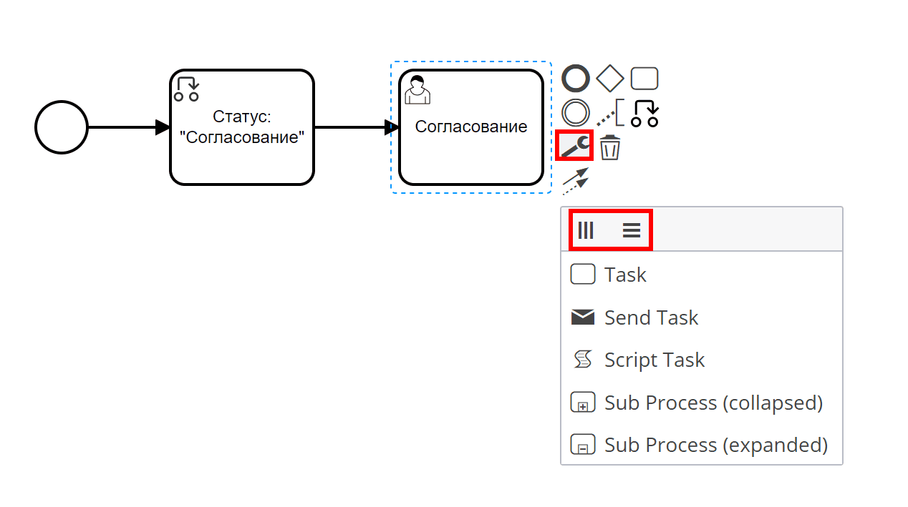
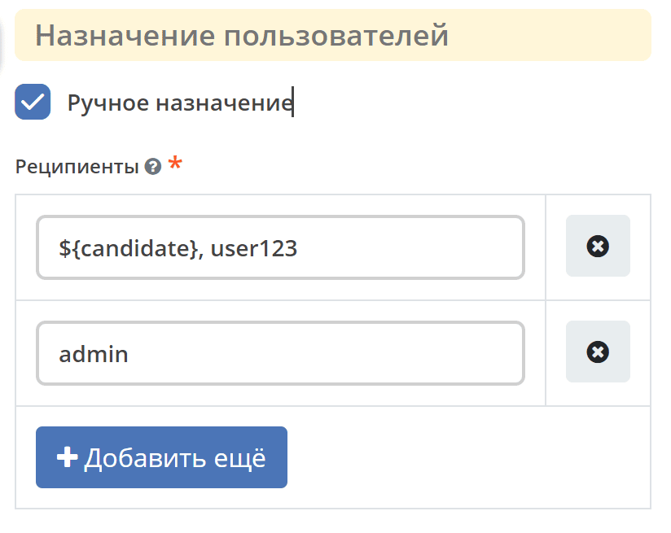
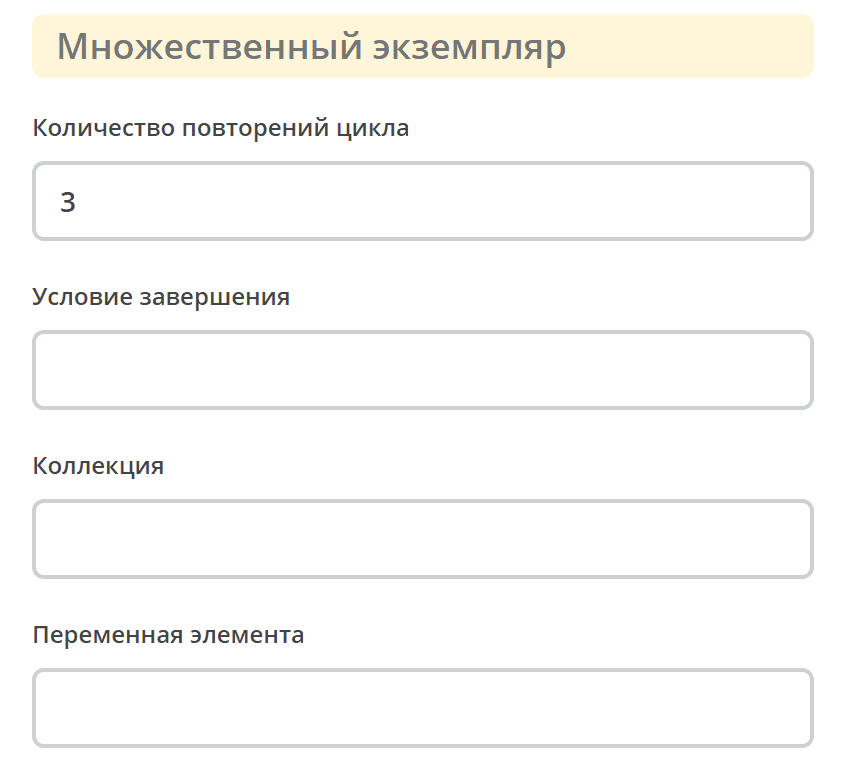
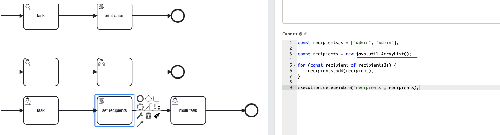
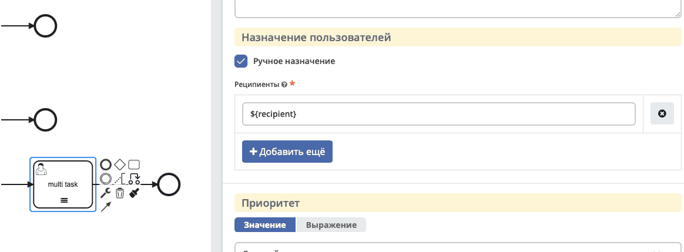
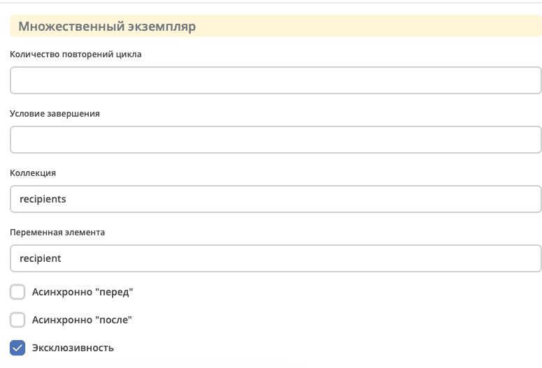

.. _multi_instance:

Multi instance
==============

.. contents::

**Multi Instance (многоэкземплярная активность)** — способ определения повторения определенного шага в бизнес-процессе.

В концепциях программирования мультиэкземпляр соответствует for each конструкции: он позволяет выполнять определенный шаг или даже полный подпроцесс для каждого элемента в данной коллекции, последовательно или параллельно.

Многоэкземплярная активность — обычное действие, для которого определены дополнительные свойства (так называемые multi-instance characteristics), которые заставляют действие выполняться несколько раз во время выполнения.

Ниже описана настройка нескольких экземпляров для следующих действий:

* Пользовательская задача;
* Задача-сценарий;
* Подпроцесс.

На уровне модели и преобразования в исполняемую схему Multi Instance также поддерживается для сервисной задачи, задачи бизнес-правила, Call activity и задач ECOS, включая AI задачу. Доступность настройки в интерфейсе зависит от типа элемента и версии редактора.

В редакторе Multi Instance можно установить следующим образом:

Sequential и Parallel Multi Instance
-------------------------------------

.. tab-set::

   .. tab-item:: Sequential Multi Instance

      .. image:: _static/multi_instance/45.png
         :width: 30
         :align: center

      **Sequential Multi Instance** — последовательная активность с несколькими экземплярами.

      Экземпляры выполняются друг за другом. Когда один экземпляр завершен, создается новый экземпляр для следующего элемента указанной коллекции.

      .. image:: _static/multi_instance/94.png
         :width: 300
         :align: center

   .. tab-item:: Parallel Multi Instance

      .. image:: _static/multi_instance/44.png
         :width: 30
         :align: center

      **Parallel Multi Instance** — параллельная активность с несколькими экземплярами.

      Все экземпляры создаются при активации тела активности с несколькими экземплярами и могут оставаться активными одновременно. Данные отдельного элемента храните в переменной экземпляра; при изменении общих переменных процесса учитывайте параллельное выполнение.

      .. image:: _static/multi_instance/95.png
         :width: 300
         :align: center

Подробно о `Multi instance <https://docs.camunda.org/manual/7.8/reference/bpmn20/tasks/task-markers/#multiple-instance>`_.

Настройки
---------

Пользовательская задача
~~~~~~~~~~~~~~~~~~~~~~~~

При назначении по ролям parallel или sequential multi-instance работает в автоматическом режиме: отдельная задача создаётся для каждой **authority**, полученной из ролей. Пользователь записывается в **assignee**, группа — в **candidateGroup**. Коллекция исполнителей формируется автоматически, переменная элемента — ``assigneeElement``.

.. important::

   В автоматическом режиме по ролям используется только выбор последовательного или параллельного выполнения. Заданные вручную количество повторений, условие завершения, коллекция, переменная элемента и настройки асинхронности/повторных попыток тела Multi Instance в ``ecos-process 2.38.0-SNAPSHOT`` не переносятся в исполняемую схему.

При выставлении флага **«Ручное назначение»** появляется возможность указать реципиентов:

Подробно :ref:`о реципиентах <user_task>`.

При ручном назначении автоматический режим по ролям выключен. Коллекцию и другие параметры Multi Instance необходимо задать в общих настройках ниже; само включение ручного назначения не создаёт отдельную задачу каждому реципиенту.

Общие настройки множественного экземпляра
~~~~~~~~~~~~~~~~~~~~~~~~~~~~~~~~~~~~~~~~~~

Общие настройки применяются к :ref:`Скриптовой задаче <script_task>`, :ref:`Подпроцессу <sub_process>`, :ref:`Сервисной задаче <service_task>`, :ref:`Задаче бизнес-правилу <business_rule_task>`, :ref:`Call activity <call_activity>`, задачам ECOS и **Пользовательской задаче с ручным назначением**. Доступность настроек в интерфейсе зависит от типа элемента и версии редактора. Для автоматического режима пользовательской задачи по ролям действуют ограничения, описанные выше.

.. list-table::
   :widths: 5 20
   :class: tight-table
   :align: center

   * - **Количество повторений цикла / Loop cardinality**
     - Число экземпляров или выражение для его вычисления.
   * - **Условие завершения / Completion condition**
     - Выражение, которое вычисляется каждый раз, когда заканчивается один экземпляр. При истинном результате многоэкземплярная активность завершается досрочно, оставшиеся экземпляры отменяются.
   * - **Коллекция / Collection**
     - Имя переменной с коллекцией или выражение, возвращающее коллекцию. Для каждого её элемента создаётся экземпляр активности.
   * - **Переменная элемента / Element variable**
     - Локальная переменная конкретного экземпляра, содержащая соответствующий элемент коллекции.

Для задания числа экземпляров выберите подходящий способ: количество повторений либо коллекцию. Выражения указываются явно, например ``${instanceCount}`` для количества повторений; для коллекции можно указать имя переменной, например ``recipients``.

Настройки тела Multi Instance
~~~~~~~~~~~~~~~~~~~~~~~~~~~~

В общих настройках доступны **«Асинхронно перед»**, **«Асинхронно после»**, **«Эксклюзивность»** и **«Цикл повтора»** фоновой задачи. Поле цикла повтора отображается при включении асинхронности.

Эти параметры относятся к телу Multi Instance и задаются отдельно от асинхронности самого элемента. Для автоматического режима пользовательской задачи по ролям действует ограничение, описанное выше.

Примеры использования
----------------------

Пользовательская задача
~~~~~~~~~~~~~~~~~~~~~~~~

Чтобы создать параллельные пользовательские задачи для получателей из переменной процесса ``recipients``, содержащей коллекцию, задайте:

* Режим **Parallel Multi Instance**.
* Флаг **«Ручное назначение»** — включён.
* **«Реципиенты»** — ``${recipient}``.
* **«Коллекция»** — ``recipients``.
* **«Переменная элемента»** — ``recipient``.

Каждый экземпляр получает свой элемент коллекции в переменной ``recipient`` и назначается указанному в ней получателю. Для последовательного выполнения выберите **Sequential Multi Instance**.

Коллекцию можно подготовить заранее, например с использованием ``java.util.ArrayList``. Ниже показан пример настройки:

|

|

