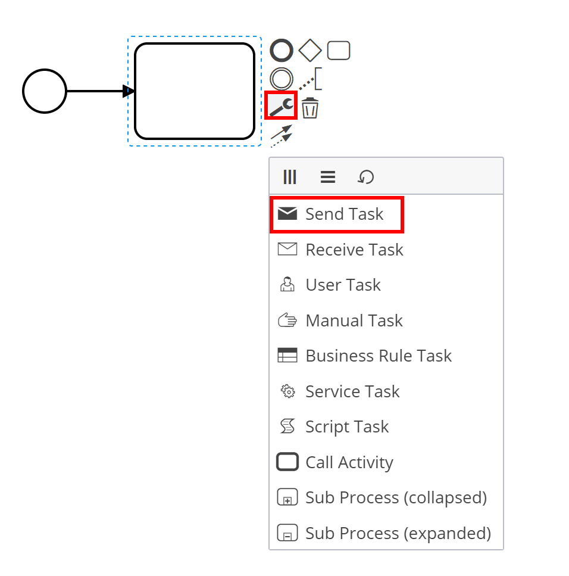
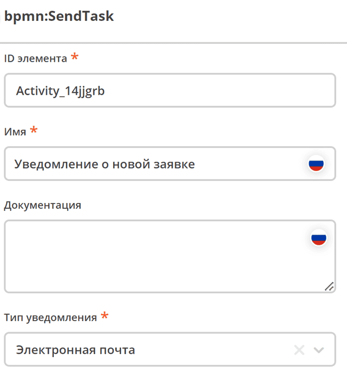
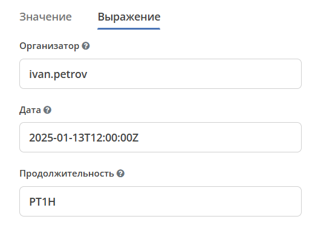
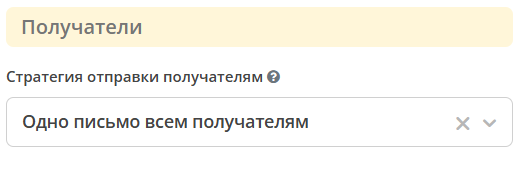
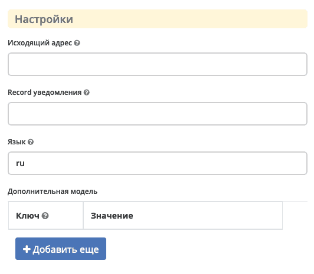
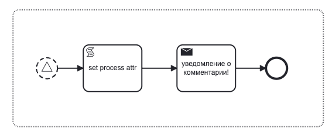
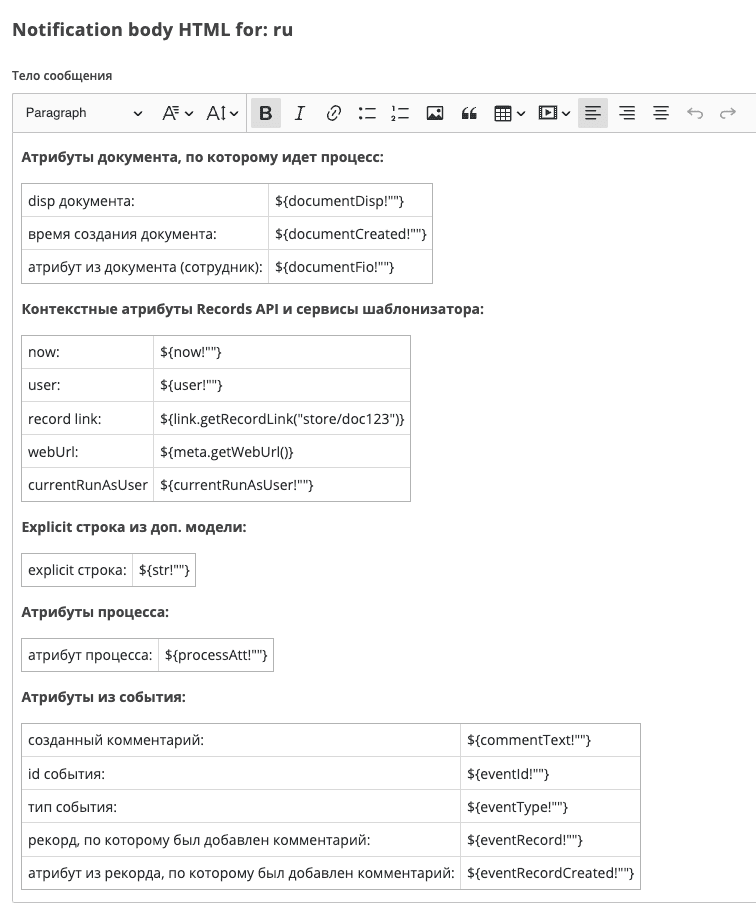
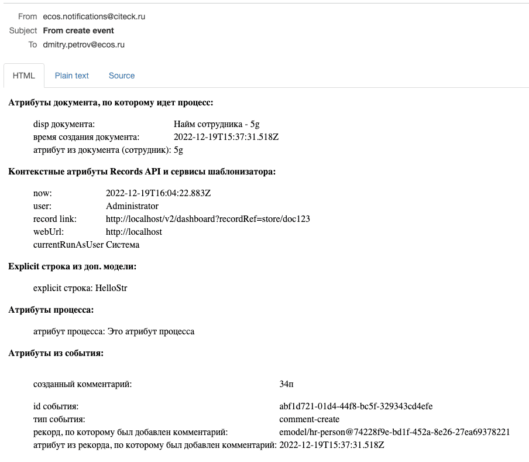

.. _notification:

Уведомление
========================

.. contents::

Общее описание
------------------------------

Элемент используется для отправки уведомлений пользователям. На данный момент поддерживается только уведомление по электронной почте.

Уведомления отправляются через микросервис ecos-notifications, см. подробнее — :ref:`уведомления <notifications>` и :ref:`шаблоны уведомлений <notification_templates>`.

Атрибуты и форма
--------------------------------

Имя и тип уведомления
~~~~~~~~~~~~~~~~~~~~~~

Указать **Имя**, **Тип уведомления** указан по умолчанию **Электронная почта**.

Шаблон или текст сообщения
~~~~~~~~~~~~~~~~~~~~~~~~~~~

При прямом использовании **Заголовка** и **Тела** возможно указывать только текст, без использования динамических переменных из процесса или документа.

.. tab-set::

   .. tab-item:: Шаблон уведомления

      Можно выбрать :ref:`шаблон уведомления <notification_templates>`.

      .. image:: _static/notifications/50.png
         :width: 350
         :align: center

   .. tab-item:: Заголовок и тело сообщения

      Или напрямую указать **Заголовок** и **Тело** сообщения.

      .. image:: _static/notifications/51.png
         :width: 350
         :align: center

Отправка писем-встреч в календарь
~~~~~~~~~~~~~~~~~~~~~~~~~~~~~~~~~~

**Название** и **Описание** могут быть указаны напрямую или через expression ``${someVariable}``.

Настройки события могут быть выбраны как значениями, так и указаны в виде выражений.

Часовой пояс организатора в текущей реализации преобразуется в UTC либо фиксированное целочасовое смещение. Для зон с сезонным переводом времени или дробным смещением проверьте результат в используемом календарном клиенте; сохранение всех правил исходной зоны не гарантируется.

.. tab-set::

   .. tab-item:: Значение

      **Организатор** выбирается из ролей, заполненных в :ref:`типе данных <data_types_main>`. Конечным результатом обработки поля будет являться email. Если в роли содержится несколько пользователей, то будет выбран первый вычисленный email.

      **Дата** начала события. При создании события будет указан часовой пояс организатора из профиля пользователя.

      **Продолжительность** события выберите из списка.

      .. image:: _static/notifications/calc_event_01.png
         :width: 350
         :align: center

   .. tab-item:: Выражение

      **Организатор** — имя, recordRef или емейл организатора. Конечным результатом обработки поля будет являться email.

      Поддерживаются expression для получения данных из переменных или сервисов. Например:

      - ``ivan.petrov``
      - ``GROUP_company_accountant``
      - ``emodel/authority-group@company_accountant``
      - ``emodel/person@ivan``
      - ``ivan.petrov@citeck.ru``

      Если передан объект, который содержит несколько емейлов (группа пользователей), то будет выбран первый вычисленный email.

      **Дата** начала события может быть указана в формате ISO или выражение:

      - ``2020-06-20T10:30:00Z``
      - ``${ someDate}``

      Выражение должно возвращать непустой ``java.util.Date`` или значение, представимое корректной ISO 8601-строкой Instant. ``null`` приводит к ошибке разбора даты.

      **Продолжительность события** указывается в `ISO 8601 <https://en.wikipedia.org/wiki/ISO_8601>`_ формате. Например:

      - PT15S — 15 секунд
      - PT1H30M — 1 час 30 минут
      - P14D — 14 дней

      Может быть указана напрямую или через expression. Например: ``${someVariable}``

      .. image:: _static/notifications/calc_event_02.png
         :width: 350
         :align: center

Получатели
~~~~~~~~~~

**Получатели** — список получателей уведомления. Получатели могут быть указаны через роли или выражения.

**Стратегия отправки получателям**:

- **Одно письмо всем получателям** — все адреса в поле «Кому». Значение по умолчанию.
- **Отдельное письмо каждому получателю** — каждому адресу в поле «Кому» приходит персональное письмо, получатели не видят друг друга. Применяется только при пустых «Копия» и «Скрытая копия».
- **Отдельное письмо каждой роли** — сообщение всем адресатам каждой непустой роли; адресаты из выражений образуют отдельную группу. Также требует пустых «Копия» и «Скрытая копия».

Значения в XML: ``COMBINED`` (по умолчанию), ``PER_RECIPIENT`` и ``PER_ROLE``. Один человек в нескольких ролях может попасть в несколько сообщений. Для сообщения роли доступны дополнительные данные ``recipientRoleId`` и ``recipientRoleName``.

.. tab-set::

   .. tab-item:: Роли

      **Роли** — роли, заполненные в :ref:`типе данных <data_types_main>`.

      .. image:: _static/notifications/send_task_recipient_roles.png
         :width: 350
         :align: center

   .. tab-item:: Выражение

      **Выражение** — имя, recordRef или емейл получателя. Поддерживаются expression для получения данных из переменных или сервисов. Expression может вернуть множественное значение — строки разделенные запятой: ``ivan@mail.com,user2,user3``.

      Например:

      - ``ivan.petrov``
      - ``GROUP_company_accountant``
      - ``emodel/authority-group@company_accountant``
      - ``emodel/person@ivan``
      - ``${someVariable}``
      - ``${someService.getEmails()},petya.voks``

      .. image:: _static/notifications/send_task_recipient_expression.png
         :width: 350
         :align: center

Исходящий адрес и дополнительные настройки
~~~~~~~~~~~~~~~~~~~~~~~~~~~~~~~~~~~~~~~~~~~

**Исходящий адрес** — исходящий адрес уведомления. Может быть указан напрямую или через expression. Если пусто, то будет использовано значение по умолчанию. Например:

- ``someAddress@mail.com``
- ``"Some Name" <someAddress@mail.com>``
- ``${someExpressionToGetAddress}``

Получение адреса из Конфигурации Citeck:

- ``${Config.getNotNull("app/you-app$you-config-key").asText()}``

Итоговый адрес может быть заменён настройкой ``ecos-notifications.email.from.fixed``. См. :ref:`настройку исходящего адреса <ecos-notifications-settings>`.

**Record уведомления** — базовый record для заполнения шаблона. Если в этом поле ничего не указано, то берется документ, по которому запущен бизнес-процесс.

**Язык** — указывается язык шаблона уведомления в формате ``ru``, ``en`` и т.д. Если язык не указан, то берется язык по умолчанию.

**Дополнительная модель (additional meta)** — описание дополнительной мета информации, где:

- *ключ (string)* — по ключу становится доступна информация в модели шаблона уведомления.
- *значение (object)* — если в значении передана строка и начинается с префикса ``!str_``, то символы после префикса записываются как строка, иначе строка считается как recordRef.

.. important::

   При сохранении, сохранении/публикации процесса проверяется обязательность заполнения следующих полей:

   - **«Шаблон»** или **«Тело сообщения»**;
   - Хотя бы один список адресатов: **«Получатели»**, **«Копия»** или **«Скрытая копия»** (Роли или Выражение).

   Для раздельных стратегий допустим только список «Получатели». При включённом календарном приглашении также обязательны название, описание, организатор, дата и длительность. При заполнении основного поля даты/длительности оно имеет приоритет над альтернативным expression.

   Иначе в :ref:`линтере <bpmn_linter>` будет выдана ошибка.

.. _notification_variables:

Доступные переменные
------------------------------------------

В модели шаблона уведомлений есть доступ к следующим переменным:

1. *Переменные из базового record*. По умолчанию это документ, по которому идет бизнес-процесс. Обращение происходит напрямую к атрибутам record.
2. *Переменные процесса.* Через переменную ``$process`` доступны переменные процесса на момент отправки уведомления.
3. *Переменные* :ref:`событий Citeck <ecos_bpmn_events>`. Доступны через переменную ``$process.event``.
4. *Контекстные переменные Records API*

Также в самом шаблоне уведомлений доступны :ref:`сервисы шаблонизатора <notification_template_services>`.

Поля ``event`` доступны, если соответствующее событие передано в контекст процесса. ``$process.currentRunAsUser`` содержит ссылку пользователя, от имени которого выполнялась подготовка уведомления. Группы получателей раскрываются в подходящие адреса; отключённые пользователи и пустые email исключаются. Если адресаты не найдены, сервис уведомлений может сохранить ``RECIPIENTS_NOT_FOUND``.

Пример использования переменных в шаблоне
~~~~~~~~~~~~~~~~~~~~~~~~~~~~~~~~~~~~~~~~~~~~~~~~~~~~~~~~~~~~~~~~~~~~~~~~~~~~~~~~

Для примера используем **event sub process**, который реагирует на событие добавления нового комментария и отправляет уведомление.

Шаблон уведомления содержит модель:

.. code-block:: yaml

       "model": {
              "documentDisp": ".disp",
              "documentCreated": "_created",
              "documentFio": "fio",
              "now": "$now",
              "user": "$user",
              "processAtt": "$process.someAttr",
              "str": "$str",
              "commentText": "$process.event.text",
              "eventId": "$process.event._meta.id",
              "eventType": "$process.event._meta.type",
              "eventRecord": "$process.event.eventRecord",
              "eventRecordCreated": "$process.event.eventRecordCreated",
              "currentRunAsUser": "$process.currentRunAsUser"
       }

Шаблон уведомления содержит текст:

В результате получим следующее уведомление:

Если необходимо отправить сообщение о добавлении комментария с вложением (реакция на событие добавления комментария), то нужно добавить в модель уведомления атрибут:

.. code-block:: yaml

       "model": {
              "_attachments": "$process.event.attachments[]._as.ref._content{bytes, meta:?json}"
       }
