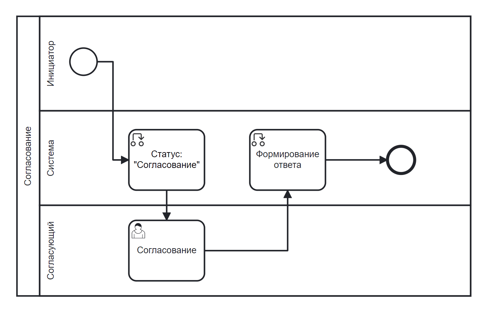
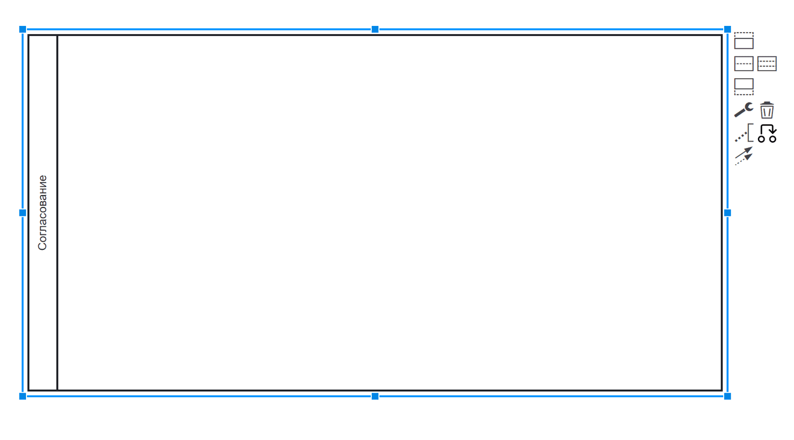
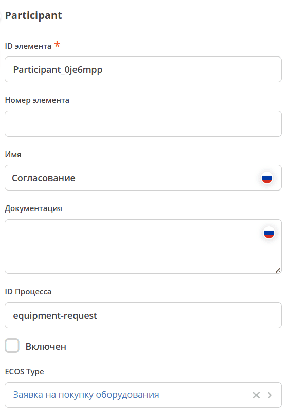
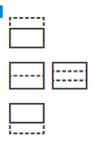
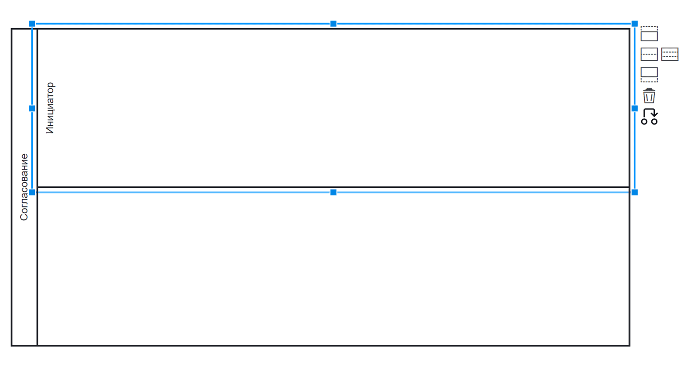
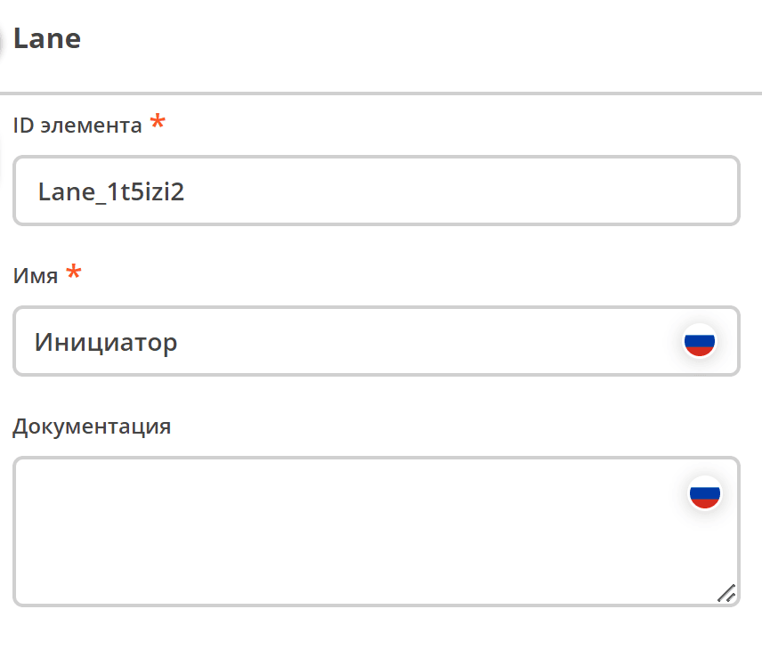

.. _pool:

Пул и Дорожка
==========================

.. contents::

На одной BPMN-схеме могут быть представлены несколько **пулов** — участников взаимодействия, связанных с отдельными процессами.

Внутри пула можно выделить **«дорожки»** для визуальной группировки элементов процесса.

.. grid:: 1
   :gutter: 3

   .. grid-item-card:: Пул
      :link: pool_participant
      :link-type: ref

      .. image:: _static/pool/pool_2.png
         :width: 300
         :align: left

      Используется для обозначения границ бизнес-процесса.

   .. grid-item-card:: Дорожка
      :link: pool_lanes
      :link-type: ref

      .. image:: _static/pool/pool_3.png
         :width: 300
         :align: left

      Используется для отражения ответственных исполнителей и их ролей в процессе.

Правила:

1. Дорожки опциональны — схема может обходиться без них.
2. Дорожки могут быть вложенными (иерархическими).
3. Семантика дорожек может быть любой, на усмотрение автора схемы — подразделение, роль, должность.
4. В текущей модели Citeck BPMN дорожки задаются на уровне процесса. Вложенные дорожки внутри встроенных подпроцессов (embedded subprocesses) не поддерживаются.
5. Дорожки визуально группируют элементы схемы. Расположение пользовательских и автоматических задач, подпроцессов, шлюзов и событий на дорожке не меняет порядок их выполнения.
6. Даже для задач, назначаемых людям, дорожки по сути являются комментариями — реальный исполнитель задается в атрибутах модели для данной задачи.

.. _pool_participant:

Пул Participant
--------------------

При необходимости укажите **Имя** пула и выберите :ref:`тип данных <roles_statuses>`.

Пул (Participant) обозначает участника взаимодействия и связывается с процессом через поле **«ID Процесса»**. На одной схеме могут быть несколько пулов, представляющих разные процессы, а у разных процессов может быть привязка к разным типам данных. Если ECOS Тип не задан, то типом считается тот, который определен в definition. Если задан, то используется собственный.

Флаг **«Включен»** задаёт признак включения процесса пула. При обработке сигналов учитывается как этот флаг, так и флаг включения всего описания процесса: выключенное описание отключает обработку сигналов для его процессов.

.. important::

   Различайте два идентификатора:

   - **«ID элемента»** — идентификатор самого пула Participant. В форме это обязательное поле: минимум 3 символа.
   - **«ID Процесса»** — идентификатор процесса, представленного пулом. Он должен ссылаться на соответствующий процесс схемы.

   Поле **«ID Процесса»** не помечено в форме как обязательное; это не гарантирует допустимость пустой или некорректной ссылки при исполнении. **«Имя»** пула необязательно.

Для добавления дорожек в пул используйте:

.. _pool_lanes:

Дорожки
----------------

При необходимости укажите **Имя** дорожки. Оно не определяет исполнителей задач: назначение задаётся в настройках самих задач.

