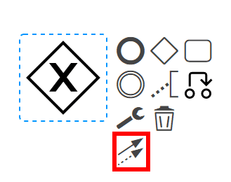
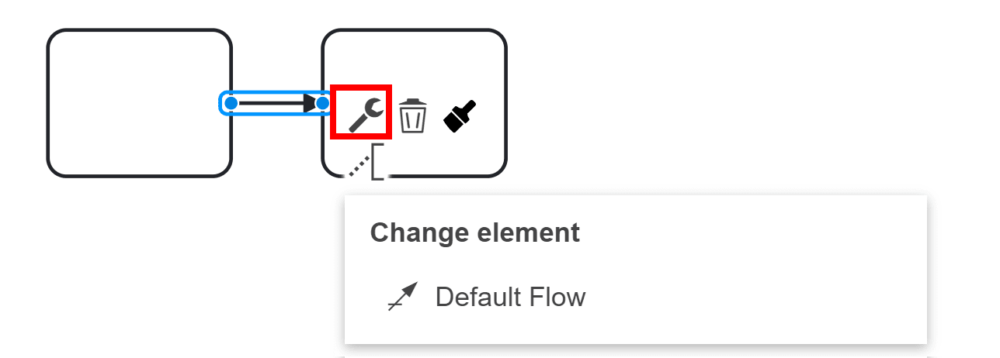
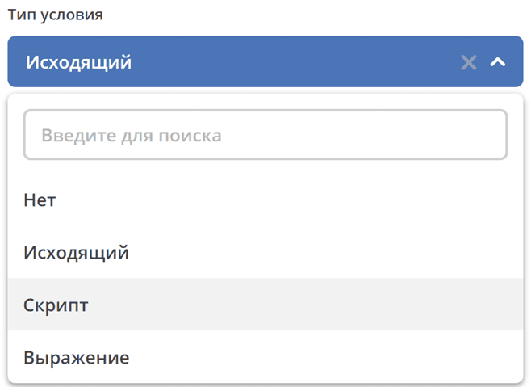
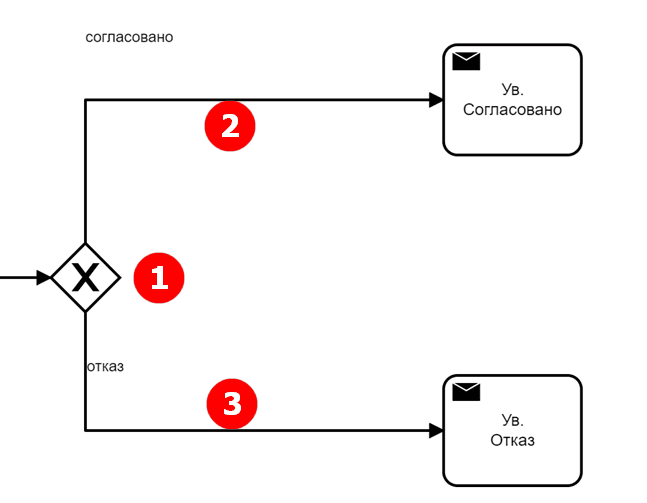

.. _seq_flow:
.. _sequential flow:

Потоки управления
=================

Поток управления соединяет элементы внутри BPMN-процесса (события, задачи, подпроцессы и шлюзы) и задаёт порядок их выполнения.

Далее ведите стрелку к необходимому элементу.

Виды потоков управления:

.. list-table::
      :widths: 10 20
      :align: center
      :class: tight-table

      * -
           .. image:: _static/seq_flow/normal_flow.png
              :width: 150
              :align: center

        - | **Стандартный поток управления** (Sequence flow) соединяет элементы процесса и не назначен потоком по умолчанию. При необходимости на нём задаётся условие перехода.
      * -
           .. image:: _static/seq_flow/default_flow.png
              :width: 150
              :align: center

        - | **Поток управления по умолчанию** (Default flow) определяет ту ветвь бизнес-процесса, которая выполняется, когда все условия ветвления не выполнены.
          | Этот поток может использоваться как совместно с эксклюзивным шлюзом, так и без него.

.. _sequential flow_change:

Стандартный поток управления задается по умолчанию. Для изменения вида потока:

.. _sequential flow_type:

Для потока можно указать тип условия. По умолчанию выбран тип **«Нет»**. Доступны следующие варианты:

* **Нет** — условие не задаётся. Сам по себе этот тип не делает поток потоком по умолчанию.
* **Исходящий** — проверка результата (вердикта) выбранной предшествующей задачи. Выберите пару «задача — результат» из доступного списка.
* **Скрипт** — JavaScript, который должен вернуть булевое значение. Например: ``paymentSum >= 30000``.
* **Выражение** — выражение JUEL, например ``${paymentSum >= 30000}`` (`подробнее о выражениях Camunda 7 <https://docs.camunda.org/manual/7.24/user-guide/process-engine/expression-language/>`_).

Назначение потока по умолчанию и выбор типа условия — разные настройки. Для потока по умолчанию используйте **«Нет»**: он выбирается, когда остальные ветви не подходят.

Для условного ветвления шлюза можно использовать **«Скрипт»** или **«Выражение»**:

.. list-table::
      :widths: 5 5
      :align: center
      :class: tight-table

      * - Для согласования:
        - Для отказа в согласовании:
      * -
               .. image:: _static/seq_flow/65.png
                :width: 300
                :align: center

        -
               .. image:: _static/seq_flow/66.png
                :width: 300
                :align: center

.. important::

   В форме настройки потока поле **«Имя»** обязательно для заполнения. В зависимости от выбранного типа условия заполните соответствующее поле:

   - **«Исходящий»** — выберите задачу и её результат;
   - **«Скрипт»** — укажите скрипт;
   - **«Выражение»** — укажите выражение.

   Для условных ветвей задайте способ проверки условия. Поток по умолчанию не требует такого условия. Допустимые сочетания потоков зависят от исходного элемента и правил редактора и движка BPMN.
