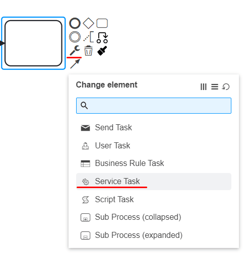
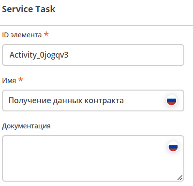
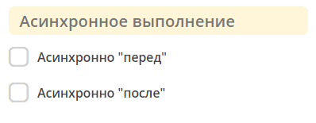

.. _service_task:

Сервисная задача
================

.. contents::

**Сервисная задача** выполняет автоматическое действие: передаёт работу внешнему обработчику либо вычисляет выражение, например вызывает метод доступного сервиса.

В редакторе Citeck доступны два способа реализации: внешняя задача для асинхронной обработки отдельным приложением и выполнение выражения.

Выражение может вызывать метод доступного сервиса или вычислять значение. Настройка Java-класса (JavaDelegate или ActivityBehavior) и delegate expression, предусмотренная в Camunda, в форме сервисной задачи Citeck не представлена.

Атрибуты и форма
------------------

Имя
~~~

При необходимости укажите **Имя** элемента.

Тип
~~~

Выберите **Тип** — **Внешняя задача** или **Выражение**. По умолчанию выбрана **Внешняя задача**.

.. tab-set::

   .. tab-item:: Внешняя задача

      Для выполнения сервисной задачи внешним обработчиком укажите **Топик внешней задачи**.

      **Топик внешней задачи** — имя, по которому внешний обработчик получает задачи Camunda для выполнения. Имя топика должно соответствовать настройкам обработчика. В форме длина имени ограничена 50 символами.

      Внешняя задача ожидает обработки независимо от флагов **«Асинхронно перед»** и **«Асинхронно после»**.

      :ref:`См. подробно <ecos_bpmn_external_task>`

      .. image:: _static/service_task/service_task_3.png
         :width: 300
         :align: center

   .. tab-item:: Выражение

      Укажите **Выражение**, которое будет выполнено при достижении задачи.

      Возвращаемое значение выполнения сервисной задачи может быть присвоено уже существующей или новой переменной процесса путем указания имени переменной процесса в качестве буквального значения для атрибута **Переменная результата**.

      Любое существующее значение для определенной переменной процесса будет перезаписано значением результата выполнения сервисной задачи. Если имя переменной результата не указано, значение результата выполнения сервисной задачи игнорируется.

      Поле **«Переменная результата»** необязательное. В форме длина имени переменной ограничена 50 символами.

      .. image:: _static/service_task/service_task_4.png
         :width: 300
         :align: center

Настройки асинхронности
~~~~~~~~~~~~~~~~~~~~~~~~

- **Асинхронно "перед"** — исполнение доходит до точки перед блоком, транзакция комитится и дальнейшее выполнение ставится в очередь, которую разбирает уже джоба.
- **Асинхронно "после"** — исполнение доходит до точки после блока, транзакция комитится и дальнейшее выполнение ставится в очередь, которую разбирает уже джоба.

При включении асинхронности также доступны **«Эксклюзивность»**, **«Цикл повтора»** и **«Приоритет»** фоновой задачи. Эти настройки относятся к фоновой задаче движка; повторы обработки внешней задачи настраиваются отдельно во внешнем обработчике.

См. подробнее о `асинхронных задачах <https://camunda.com/blog/2014/07/advanced-asynchronous-continuations/>`_.

.. important::

   В форме настройки элемента обязательны следующие поля:

   - **«Тип»**;
   - **«Топик внешней задачи»** — для типа **«Внешняя задача»**;
   - **«Выражение»** — для типа **«Выражение»**.

   При серверной валидации топик или выражение для выбранного типа не должны быть пустыми или состоять из пробелов. **«Переменная результата»** необязательна и отображается для типа **«Выражение»**.

Multi Instance
~~~~~~~~~~~~~~

Для многократного выполнения сервисной задачи в форме доступны настройки **Multi Instance**.
