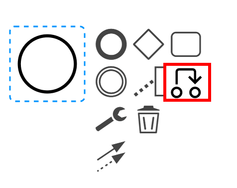
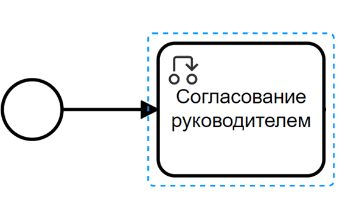
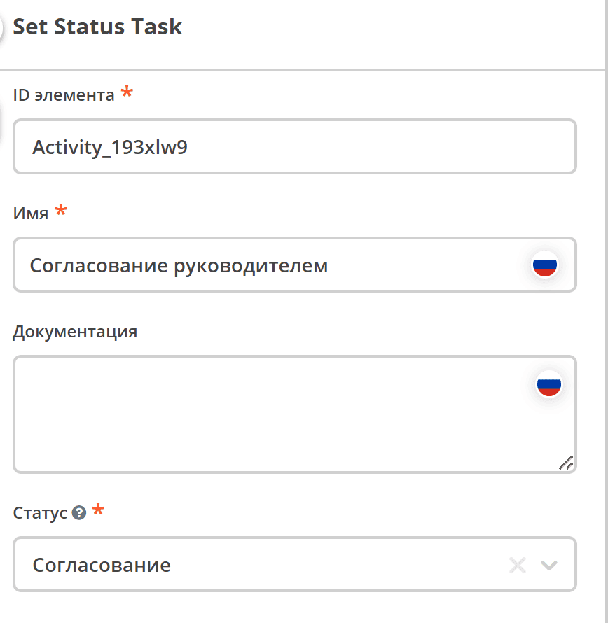

.. _set_status:

Установка статуса
=================

Уникальный для Citeck элемент, отмеченный как:

Элемент изменяет статус документа, по которому выполняется бизнес-процесс.

.. important::

   Для выполнения элемента в переменной процесса ``documentRef`` должна быть задана непустая ссылка на документ. Если ссылка отсутствует, выполнение завершится ошибкой.

Атрибуты и форма
----------------

При необходимости укажите **Имя** элемента и выберите **Статус** из списка статусов, заполненных в :ref:`типе данных Citeck <roles_statuses>`, указанном в настройках процесса. Служебные статусы ``ANY`` и ``EMPTY`` недоступны для выбора.

.. important::

   В форме настройки элемента поле **«Статус»** обязательно для заполнения. Имя элемента необязательно.

Настройки асинхронности
----------------------

При необходимости включите **«Асинхронно перед»** или **«Асинхронно после»**, чтобы выполнять процесс через фоновую задачу на соответствующей границе элемента.

При включении асинхронности доступны **«Эксклюзивность»**, **«Цикл повтора»** и **«Приоритет»** фоновой задачи.
