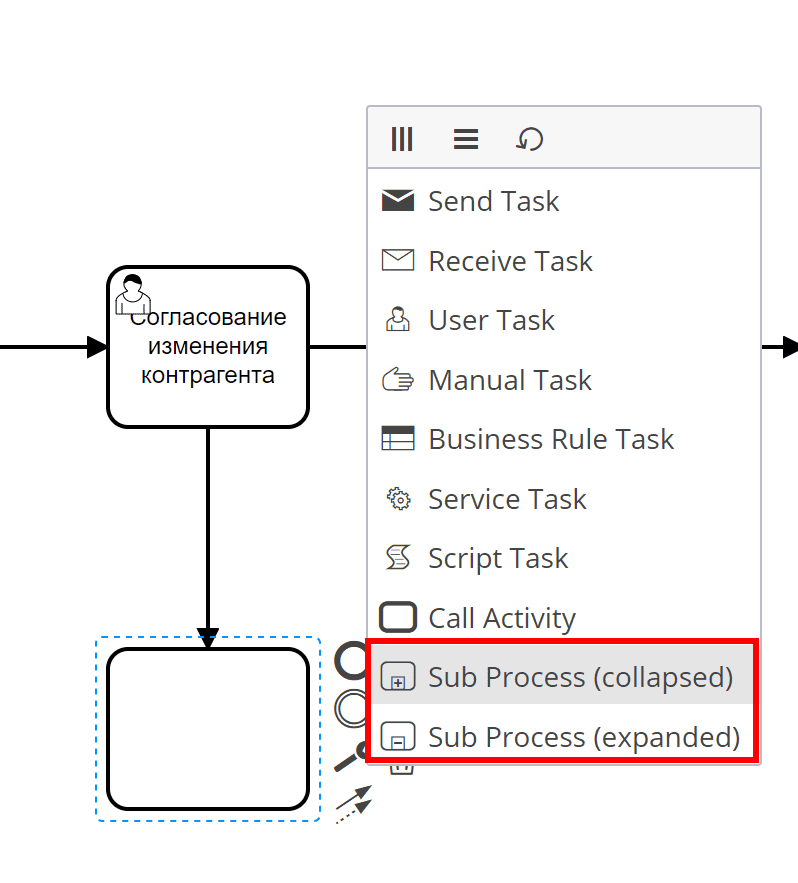
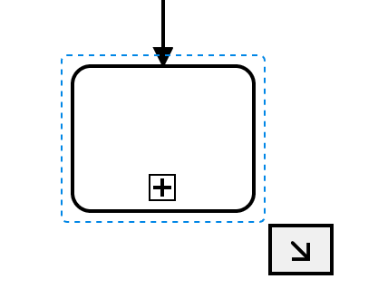
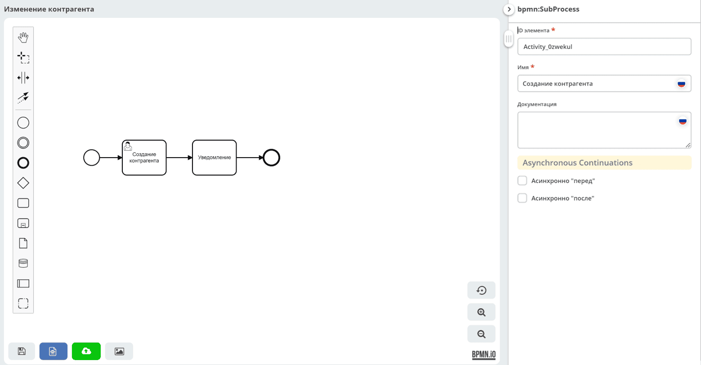
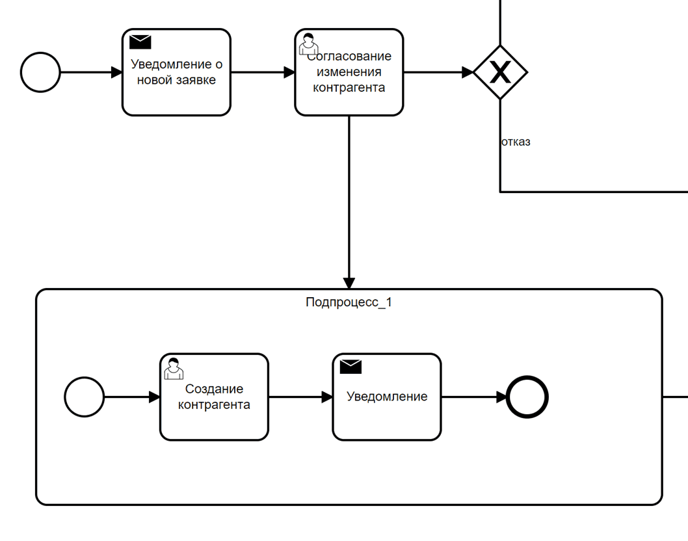
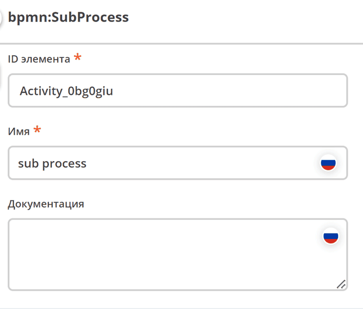
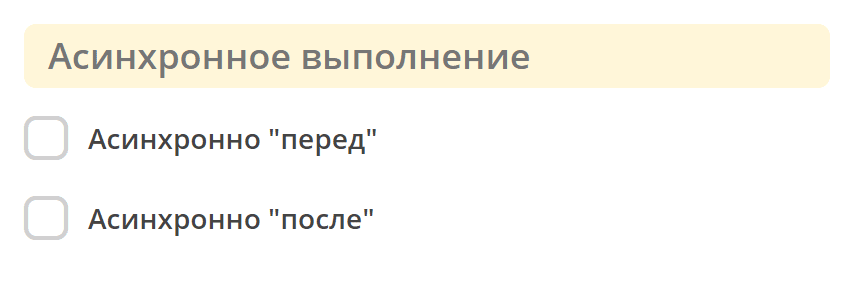

.. _sub_process:

Подпроцесс
==========

**Подпроцесс** — элемент BPMN-схемы, который объединяет набор действий, шлюзов, событий и потоков операций в единый составной блок внутри основного процесса.

Подпроцесс позволяет структурировать сложные процессы: повторяющиеся или логически обособленные фрагменты выносятся в отдельный блок, что улучшает читаемость схемы и упрощает её сопровождение. В отличие от :ref:`Call activity <call_activity>`, подпроцесс не является самостоятельным процессом — он существует в рамках родительского процесса. Внутри него доступны переменные охватывающей области; подпроцесс также может иметь локальные переменные, видимые только в своей области выполнения и вложенных областях.

В ECOS BPMN поддерживаются два варианта отображения подпроцесса:

**Sub Process (collapsed)** — свернутый подпроцесс. Его содержимое редактируется отдельно от основной схемы; для перехода используйте стрелку. Это тот же подпроцесс внутри родительского процесса:

**Sub Process (expanded)** — подпроцесс, который отражается на основном окне редактора:

Атрибуты
--------

Имя
~~~~~~~~~~~~~~~~

При необходимости укажите **Имя** подпроцесса.

Настройки асинхронности
~~~~~~~~~~~~~~~~~~~~~~~~~~~~~~~~~~~~~~~~~~

- **Асинхронно "перед"** — исполнение доходит до точки перед блоком, транзакция комитится и дальнейшее выполнение ставится в очередь, которую разбирает уже джоба.
- **Асинхронно "после"** — исполнение доходит до точки после блока, транзакция комитится и дальнейшее выполнение ставится в очередь, которую разбирает уже джоба.

При включении асинхронности доступны **«Эксклюзивность»**, **«Цикл повтора»** и **«Приоритет»** фоновой задачи. Настройки выполнения тела Multi Instance задаются отдельно.

См. подробнее о `асинхронных задачах <https://camunda.com/blog/2014/07/advanced-asynchronous-continuations/>`_.

Multi Instance
~~~~~~~~~~~~~~

Подпроцесс поддерживает последовательное и параллельное выполнение нескольких экземпляров. После выбора режима **Multi Instance** в редакторе доступны настройки количества повторений или коллекции, переменной элемента и условия завершения.

Создание элементов подпроцесса аналогично описанным в разделе :ref:`Компоненты Citeck BPMN <ecos_bpmn_components>`.

О подпроцессе, запускаемом событием, см. :ref:`Событийный подпроцесс <event_subprocess>`.
