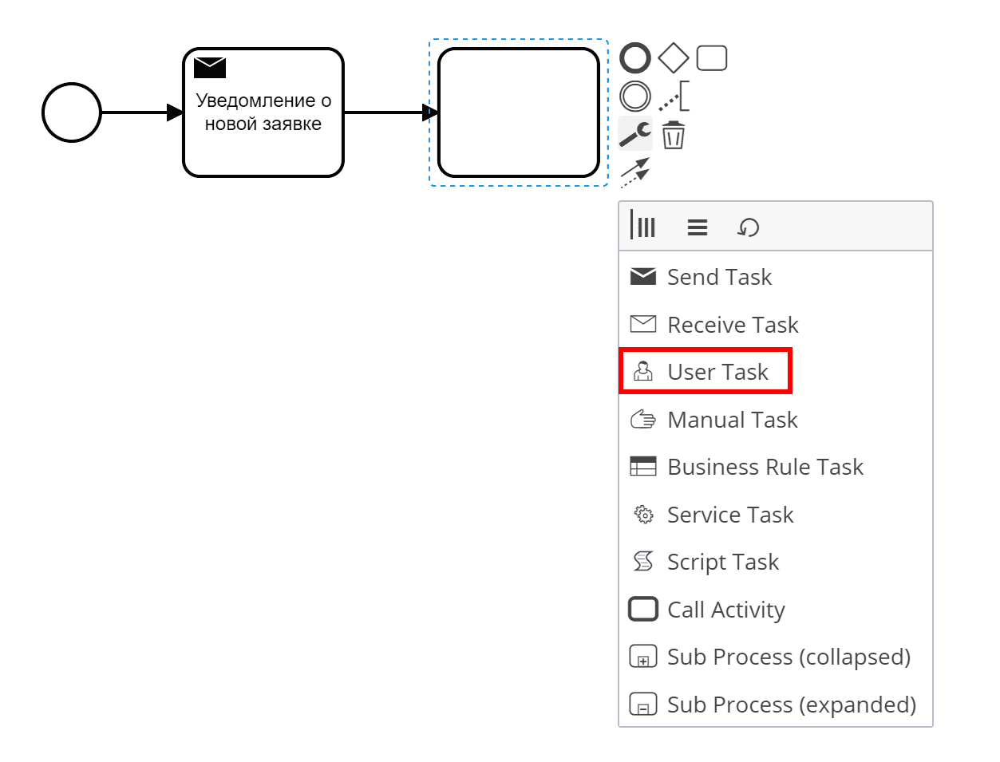
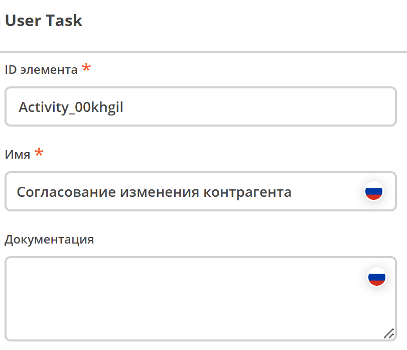
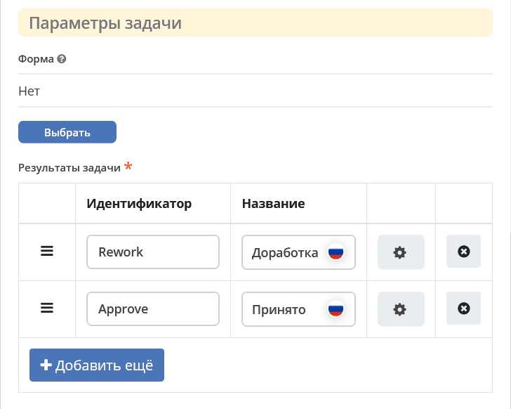
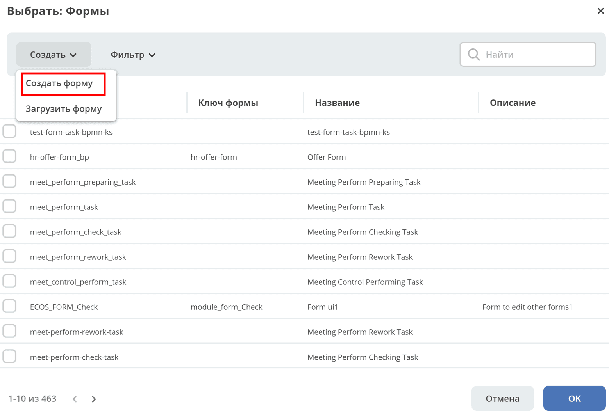
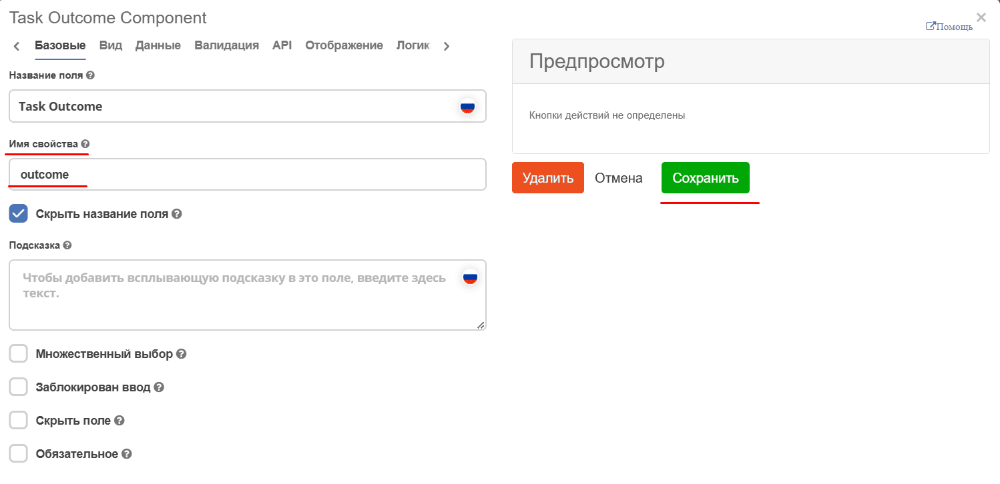
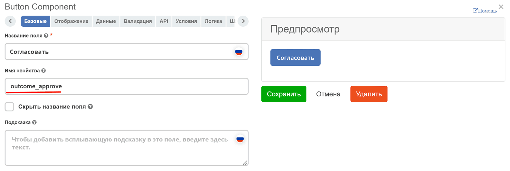
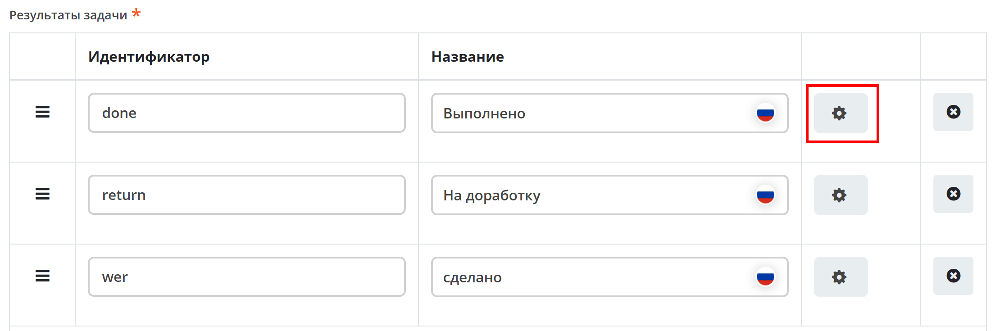
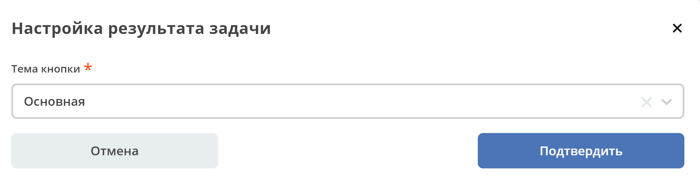
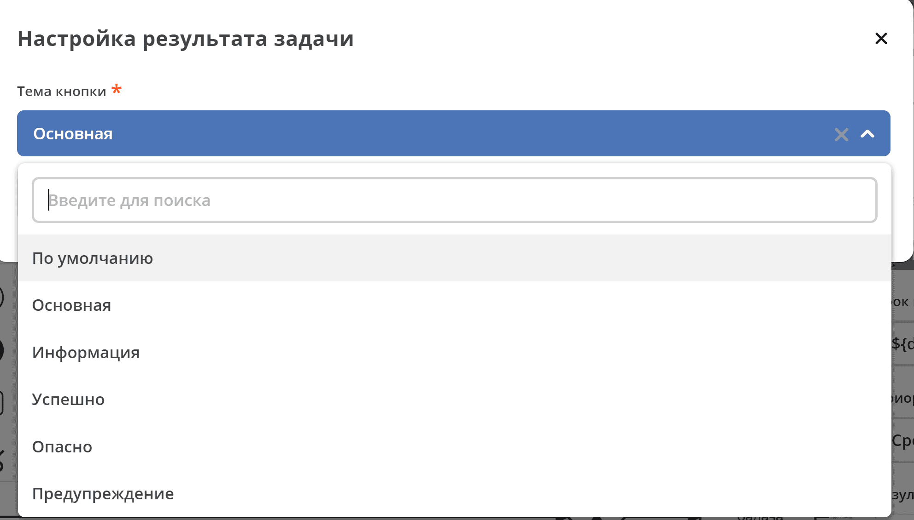
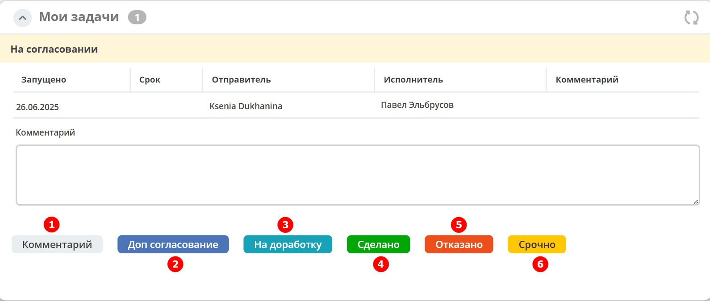

.. _user_task:

Пользовательская задача
=======================

.. contents::

Пользовательская задача выполняется пользователем или участником процесса. При выполнении таких задач обычно требуется ввод данных, манипуляции с объектами и т.д.

Атрибуты и форма
----------------

Имя
~~~

Укажите **Имя** задачи.

Реципиенты
~~~~~~~~~~

Укажите **реципиентов** — пользователей — исполнителей задачи. Реципиент может быть выбран из списка ролей или указан вручную.

Единственный пользователь становится исполнителем (assignee). Несколько пользователей или группа обычно становятся кандидатами одной задачи. Отдельная задача каждому требует соответствующей multi-instance-конфигурации; автоматический multi-instance по ролям несовместим с ручным назначением.

.. tab-set::

   .. tab-item:: Из списка ролей

      Представлен список ролей, заполненных в :ref:`типе данных <roles_statuses>`.

      .. image:: _static/user_task/55_1.png
         :width: 320
         :align: center

      .. image:: _static/user_task/55_2.png
         :width: 320
         :align: center

      .. image:: _static/user_task/55_3.png
         :width: 320
         :align: center

   .. tab-item:: Вручную

      Необходимо выставить флаг **Ручное назначение**. В поле указывается **имя** или **recordRef** реципиента. Поддерживаются expression для получения реципиентов из переменных или сервисов.

      Expression может вернуть множественное значение — строки, разделенные запятой: ``user1,user2,user3``

      Например:

      - ``ivan.petrov``
      - ``GROUP_company_accountant``
      - ``emodel/authority-group@company_accountant``
      - ``${someVariable}``
      - ``${someService.getRecipients()},petya.voks``

      .. image:: _static/user_task/55_4.png
         :width: 320
         :align: center

Приоритет
~~~~~~~~~

.. tab-set::

   .. tab-item:: Значение

      Выберите **приоритет** задачи из списка.

      .. image:: _static/user_task/priority_01.png
         :width: 320
         :align: center

   .. tab-item:: Выражение

      Укажите **приоритет (выражение)** — expression для получения приоритета задачи из переменных или сервисов. Выражение должно вернуть число, представляющее собой приоритет:

      - Высокий — 1
      - Средний — 2
      - Низкий — 3

      .. image:: _static/user_task/priority_02.png
         :width: 320
         :align: center

Срок
~~~~

Возможность устанавливать **срок** задачи вручную или через выражение.

.. tab-set::

   .. tab-item:: Значение

      При вычислении срока задачи точкой отсчета является дата создания задачи.

      **Тип времени** — Календарное или Рабочее.

      **Продолжительность** — поддерживаемый формат ``PT<n>H``, ``PT<n>M`` или ``PT<n>H<n>M``. Секунды, дробные значения и другие варианты ISO Duration в этом поле не принимаются. Например:

      - PT15M — 15 минут
      - PT3H — 3 часа
      - PT1H30M — 1 час и 30 минут

      Тип времени — **Календарное**:

      .. image:: _static/user_task/working_calendar_01.png
         :width: 350
         :align: center

      Тип времени — **Рабочее**. **Рабочее расписание** — ссылка на рабочее расписание, которое будет использоваться для вычисления рабочего времени.

      Вместо продолжительности можно задать положительное число **«Рабочие дни»**. Эти поля взаимоисключающие. Если расписание не указано, используется ``emodel/working-schedule@DEFAULT``. Продолжительность также должна быть положительной.

      .. image:: _static/user_task/working_calendar_02.png
         :width: 350
         :align: center

      .. note::

         Вычисление срока по рабочему расписанию доступно только в Enterprise версии.

   .. tab-item:: Выражение

      **Вычисляемый срок**.

      Дата в формате ISO:

      | ``2020-06-20T10:30:00Z`` — 20 июня 2020 года 10 часов 30 минут 0 секунд (UTC)
      | или в виде выражения ``${ someDate}`` предварительно задав :ref:`переменную execution <execution>` через :ref:`скриптовую задачу <script_task>`

      Выражение должно возвращать ``java.util.Date``, ``java.lang.String`` с ISO 8601-датой или ``null`` для отсутствующего срока. Значение передаётся механизму dueDate Camunda.

      .. image:: _static/user_task/working_calendar_03.png
         :width: 350
         :align: center

Для удобной работы со временем и продолжительностью в js движок добавлены объекты Time и Duration. :ref:`См. Работа с датами и временными интервалами <time_and_duration>`

Результат задачи и форма
~~~~~~~~~~~~~~~~~~~~~~~~

Укажите **результат задачи** (вердикт) — **идентификатор** и **название**. В вердиктах можно настроить темы для кнопки. :ref:`См. подробно о результатах задачи <user_task_result_themes>`

**Форма задачи** определяет то, что будет отображено при назначении задачи пользователю. **Форму задачи** можно выбрать из списка, создать. Если форму задачи не указывать — тогда пользователю будут отображены **результаты задачи**, указанные в соответствующем поле, и поле для ввода комментария. :ref:`См. подробно о формах <user_task_form>`

.. note::

  Срок выполнения задачи также можно изменить с помощью **TaskService** или в **TaskListeners** с помощью переданного **DelegateTask**.

.. important::

  При сохранении, сохранении/публикации процесса проверяется обязательность заполнения следующих полей:

   - **«Реципиенты задачи»**;
   - **«Результат задачи»**: хотя бы один вердикт.

  В редакторе приоритет обязателен и по умолчанию равен **Среднему**. При импорте XML без приоритета сервер подставляет ``MEDIUM``; отсутствие поля не является отдельной ошибкой серверной валидации. Непустое выражение приоритета имеет приоритет над выбранным значением.

  Иначе в :ref:`линтере <bpmn_linter>` будет выдана ошибка.

  При одновременном установлении срока вручную и через выражение, выражение имеет больший приоритет.

.. _user_task_lazy_approval:

Функционал Lazy approval для задачи
------------------------------------

.. note::

  Требуется лицензия разработчика либо лицензия с функцией ``lazy-approval``.

  Панель **Согласование по почте** доступна на стендах, где есть лицензия разработчика или лицензия с включенным функционалом lazy approval.

**Lazy approval** — функционал, позволяющий принимать решения из электронной почты, не заходя в Citeck. Например:

.. list-table::
      :widths: 20 20
      :align: center
      :class: tight-table

      * - | Письмо о согласовании:
        -
            .. image:: _static/user_task/LA_example.png
                  :width: 400
                  :align: center

      * - | В письме выбран вердикт **На доработку**:

        -
            .. image:: _static/user_task/LA_example_1.png
                  :width: 400
                  :align: center

О предварительных настройках функционала см. :ref:`подробно <lazy_approval_settings>`

Письмо подготавливается при создании задачи, если доступны лицензия, адресаты и шаблон. Включённый флаг сам по себе не гарантирует доставку или новое письмо при смене назначения существующей задачи.

Для включения функционала **lazy approval** для определенной задачи необходимо выставить чекбокс **«Согласование по почте»**.

.. list-table::
      :widths: 5 5
      :align: center
      :class: tight-table

      * - | Тип уведомления по умолчанию выставлен **Электронная почта**.
          | Выберите **шаблон уведомления** из созданных ранее
        -
               .. image:: _static/user_task/user_task_LA.png
                :width: 300
                :align: center

      * - | Или выставите чекбокс **Ручной ввод шаблона уведомления**, чтобы воспользоваться другими способами:
          | Выберите **шаблон уведомления** из созданных ранее
          | 1. Можно константно в текстовом формате указать **RecordRef** нужного шаблона.
          | 2. Используя переменную из процесса. Переменную необходимо указывать по следующему синтаксису **${имя_переменной}**. Задать переменную можно ранее в скрипте или иными способами. Пример скрипта в процессе:

            .. code-block::

              execution.setVariable('la_not_templ', "notifications/template@test-la-notification");
        -
               .. image:: _static/user_task/user_task_LA_1.png
                :width: 300
                :align: center

      * - | Выставите чекбокс **Включить отчеты о выполнении согласований через почту**, чтобы пользователь получал ответные сообщения об успешно/неудачно выполненных задачах и выберите шаблоны из созданных ранее.
          | См. подробно о :ref:`отчеты об обработке сообщений <lazy_approval_reports>`
        -
               .. image:: _static/user_task/user_task_LA_2.png
                :width: 300
                :align: center

.. warning::

   В ``ecos-integrations 2.40.0-SNAPSHOT`` переопределение шаблона ошибочного LA-отчёта из задачи не применяется из-за дефекта сервиса: используется общий ``la-report-error-template``. Подробности и условия отправки — в :ref:`отчётах Lazy approval <lazy_approval_reports>`.

.. _user_task_form:

Форма задачи
------------

.. note::

       Если форма задачи не указана, то будут отображаться доступные вердикты задачи, заполненные в поле **Результат задачи** и поле для ввода комментария:

        .. image:: _static/user_task/default_task.png
              :width: 600
              :align: center

       Результаты задачи версионируются вместе с описанием процесса.

Форму можно создать, нажав **Выбрать - Создать форму**

Для добавления кнопок вердиктов задачи на вашу форму, можно воспользоваться компонентом формы **Task Outcome**, который автоматически формирует кнопки вердиктов исходя из настроек **Результатов задачи**.

Вердикты задачи можно добавить вручную для более гибкой настройки конфигурации. Для этого на форму задачи необходимо добавить кнопку, где **«Имя свойства»** задается по шаблону **outcome_идентификаторВердикта**. Например, **outcome_approve**.

При завершении сервер требует ровно один истинный ``outcome_<id>`` и проверяет права текущего исполнителя/кандидата/делегата. Убедитесь, что данные формы не сохраняют одновременно несколько выбранных вердиктов.

Если какие-то задачи могут совпадать, то можно использовать одинаковую форму.

См. пример :ref:`создания формы <approve_form_bpmn>` и :ref:`best practice <best_practice_task_form>` по расположению кнопок на форме.

Использование переменных на форме
~~~~~~~~~~~~~~~~~~~~~~~~~~~~~~~~~~~~

Элементы формы задачи связаны с переменными инстанса (экземпляра) процесса. Если в области видимости задачи/процесса есть переменная с таким же **id** (Имя свойства), как и у элемента формы, то ее содержимое отобразится на форме.

При сабмите (публикации) формы задачи переменные будут записаны в переменные процесса.

Элементы формы задачи так же могут быть связаны с переменными документа, по которому идет бизнес-процесс.

Для отображения и обновления переменных документа на форме задачи необходимо добавить элемент с **id** (Имя свойства) с префиксом ``_ECM_``, например ``_ECM_paymentSum``, где ``paymentSum`` — свойства документа.

.. _user_task_result_themes:

Темы для кнопок вердикта
------------------------

В вердиктах доступна настройка темы кнопок. Настройка влияет на цвет кнопки по аналогии с кнопками на форме.

|

Возможные варианты:

Примеры:

|

.. list-table::
      :widths: 5 10
      :class: tight-table
      :align: center

      * - **1**
        - По умолчанию
      * - **2**
        - Основная
      * - **3**
        - Информация
      * - **4**
        - Успешно
      * - **5**
        - Опасно
      * - **6**
        - Предупреждение

.. _user_task_result_comment_required:

Обязательный комментарий для вердикта
-------------------------------------

В настройках вердикта доступен флаг **«Комментарий обязателен»**. На универсальной форме и в компоненте **Task Outcome** он блокирует отправку выбранного вердикта с пустым или состоящим из пробелов комментарием.

Флаг настраивается отдельно для каждого вердикта в окне настройки результата задачи рядом с выбором темы кнопки.

.. note::

    Валидация срабатывает на универсальной форме задачи (когда форма задачи не задана) и на пользовательских формах, использующих компонент **Task Outcome**. При попытке нажать на кнопку вердикта с пустым комментарием отправка формы блокируется и под полем **Комментарий** отображается сообщение об ошибке.

Типовые сценарии использования:

* вердикты **«Отклонить»**, **«Вернуть на доработку»**, **«Аннулировать»** — где требуется указать причину;
* любые завершающие вердикты, для которых важно зафиксировать обоснование решения исполнителя.

Если флаг выключен (значение по умолчанию), комментарий остаётся необязательным.

Эта проверка выполняется интерфейсом Task Outcome. Произвольные кнопки ``outcome_*``, прямые API-вызовы и Lazy approval не получают её автоматически. Если комментарий обязателен как бизнес-условие, обеспечьте отдельную проверку для всех используемых способов завершения.
