.. _ecos_bpmn_conditional:

Условие
=======

.. contents:: Содержание

**Событие BPMN с типом «Условие» (условное событие)** используется для моделирования реакции бизнес-процесса на изменения условий.

Событие «Условие» запускает событие при выполнении определенного условия. Как только определенное условие выполнено, процесс продолжается.

Событие «Условие» всегда является обработчиком и может использоваться как:

- начальное событие подпроцесса события;
- промежуточное событие (intermediate event);
- граничное событие (boundary event).

Начальное и граничное событие могут быть прерывающими (interrupting) и непрерывающими (non-interrupting).

Событие «Условие» запускается с помощью переменных процесса.

.. note::

   Событие «Условие» нельзя использовать в качестве завершающего события.

Начальное событие «Условие» для событийного подпроцесса (Conditional Start Event)
-----------------------------------------------------------------------------------

Подобно условным граничным событиям, начальные события «Условие» для подпроцесса события могут быть прерывающими и непрерывающими.

Подпроцесс события должен иметь одно начальное событие.

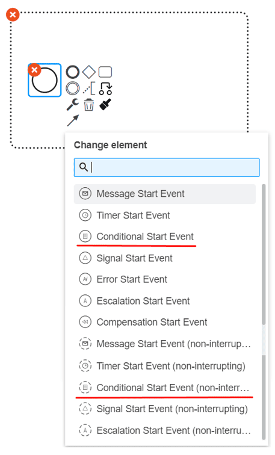

Граничное событие «Условие» (Conditional Boundary Event)
----------------------------------------------------------

Граничное событие «Условие» действует как наблюдатель, который срабатывает, если выполняется определенное условие.

Прерывающее событие (interrupting) установлено по умолчанию.

Непрерывающее событие (non-interrupting) приводит к тому, что исходная активность не прерывается, экземпляр остается активным. Вместо этого создается дополнительный путь исполнения, принимающий исходящий переход события. Непрерывающее событие «Условие» (non-interrupting) может запускаться более одного раза, пока активность, к которой оно прикреплено, активна.

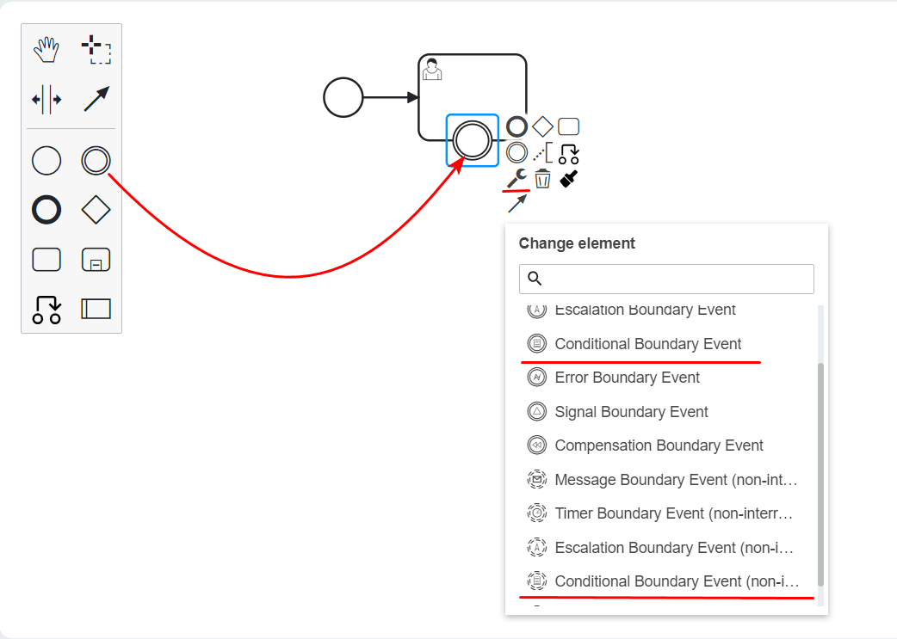

Промежуточное обрабатывающее событие «Условие» (Conditional Intermediate Catch Event)
---------------------------------------------------------------------------------------

Промежуточное событие «Условие» похоже на ожидание, пока условие не станет истинным. Когда выполнение достигает действия перехвата события, условие оценивается в первый раз. Если условие выполнено, процесс выполнения переходит к следующему действию. Если условие не выполняется, выполнение остается в этом действии до тех пор, пока условие не будет выполнено.

Промежуточное событие «Условие» определяется как промежуточное обрабатывающее событие.

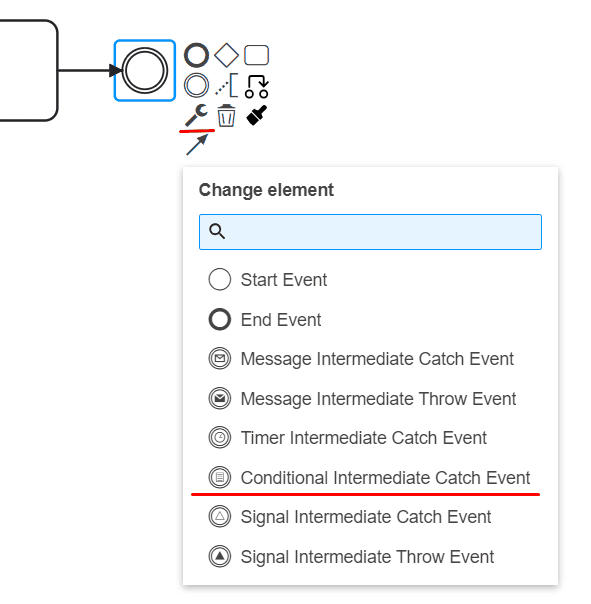

Атрибуты
--------

Чтобы указать, когда должно запускаться условное событие, необходимо заполнить раздел **«Условие»**.
Условие может быть выражением и иметь доступ к переменным экземпляра процесса.

Условие проверяется при активации события и при изменениях видимых ему переменных процесса. Проверки можно ограничить именем переменной и типами её изменений.

По умолчанию повторную проверку вызывает создание, обновление или удаление любой видимой переменной процесса.

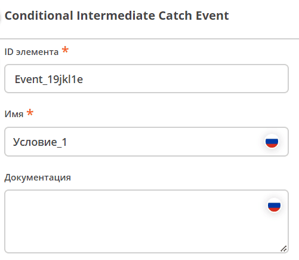

Реагировать на изменение документа
~~~~~~~~~~~~~~~~~~~~~~~~~~~~~~~~~~~

Флаг добавляет проверку условия по событиям изменения атрибутов документа, по которому идёт бизнес-процесс. Он не отключает обычную проверку при активации события и изменениях видимых переменных процесса.

.. important::

   Для реакции на документ business key экземпляра процесса должен совпадать с полной ссылкой на изменяемую запись. Изменение должно поступить как событие ``RecordChangedEvent``, а тип записи — входить в типы зарегистрированной подписки. При регистрации учитываются типы, заданные в описании процесса и его пулах.

При пустом списке **«Переменные документа»** (``documentVariables``) проверка не ограничивается конкретными атрибутами. Чтобы ограничить её, укажите точные идентификаторы изменяемых атрибутов из события. Проверка запускается при совпадении хотя бы одного идентификатора со списком изменений ``diff.list[].id``. Выражения и шаблоны с ``*`` в этом списке не вычисляются.

.. important::

   При включённом флаге **«Реагировать на изменение документа»** поля **«Имя переменной»** и **«События переменной»** должны быть пустыми. Они относятся к переменным процесса; сервер отклоняет их сочетание с режимом отслеживания документа.

.. warning::

   В ``ecos-process 2.38.0-SNAPSHOT`` при выключении реакции на документ очистите список ``documentVariables``. Из-за ограничения текущего фильтра совпадение атрибута из непустого списка может вызвать проверку даже при выключенном флаге, если для типа документа зарегистрирована действующая подписка на изменения.

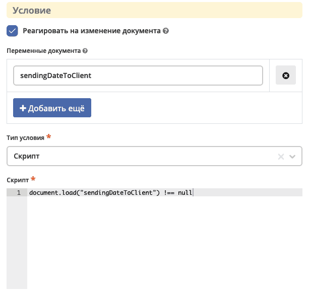

Имя переменной
~~~~~~~~~~~~~~

Используется, когда флаг **«Реагировать на изменение документа»** выключен. По умолчанию условие проверяется при изменении любой переменной процесса. Укажите имя, чтобы ограничить проверку одной переменной.

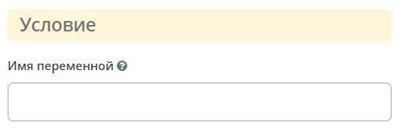

События переменной
~~~~~~~~~~~~~~~~~~~

При выключенном флаге **«Реагировать на изменение документа»** можно ограничить тип изменений переменной процесса:

- Создание
- Обновление
- Удаление

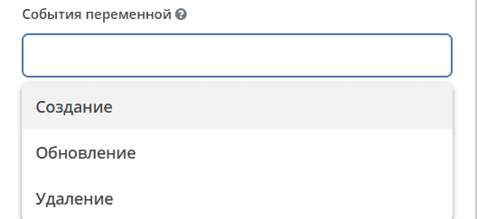

Тип условия
~~~~~~~~~~~

.. tab-set::

   .. tab-item:: Выражение

      Выражение JUEL с логическим результатом, например ``${amount > 100}``. Этот тип выбран в форме по умолчанию.

      .. image:: _static/conditional_event_8.png
         :width: 320
         :align: center

   .. tab-item:: Скрипт

      JavaScript с логическим результатом, например ``amount > 100``.

      См. подробно о :ref:`скриптах <script_task>`.

      .. image:: _static/conditional_event_9.png
         :width: 320
         :align: center

Настройки асинхронности
~~~~~~~~~~~~~~~~~~~~~~~~

- **Асинхронно "перед"** — исполнение доходит до точки перед блоком, транзакция комитится и дальнейшее выполнение ставится в очередь, которую разбирает уже джоба.
- **Асинхронно "после"** — исполнение доходит до точки после блока, транзакция комитится и дальнейшее выполнение ставится в очередь, которую разбирает уже джоба.

См. подробнее о `асинхронных задачах <https://camunda.com/blog/2014/07/advanced-asynchronous-continuations/>`_.

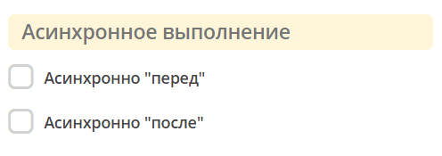

.. important::

   В форме необходимо выбрать **«Тип условия»** — **«Скрипт»** или **«Выражение»** — и заполнить соответствующее поле. Типы **«Нет»** и **«Исходящий»** для условного события не допускаются серверной валидацией.

Оценка сверху вниз
--------------------

Изменение переменной вызывает оценку условий сверху вниз: сначала в области BPMN, где изменена переменная, затем во вложенных областях, которым она видна. Обход прекращается, если срабатывает событие, прерывающее текущую область и отменяющее её дочерние выполнения, либо если вложенных областей больше нет.

Например, см. следующую модель процесса BPMN:

Если переменная изменена в области подпроцесса, сначала проверяется его условное граничное событие. Если оно прерывает подпроцесс, вложенные выполнения отменяются. Иначе проверка продолжается во вложенных областях, включая условное граничное событие *UserTask B*.

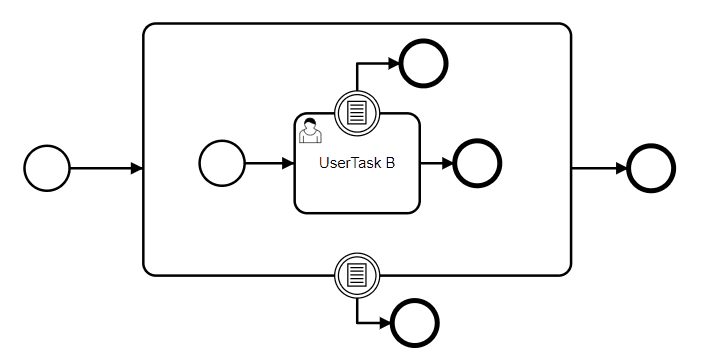

Оценка с учётом области видимости
--------------------------------

Изменения переменных в контексте экземпляра области действия могут инициировать только те условные события, которым видна переменная, но не влияют на несвязанные экземпляры области. Это означает, что если переменная изменяется, оцениваются только те условные события, которые прослушиваются в контексте этого экземпляра области или его дочерних элементов.

См. следующую модель процесса BPMN:

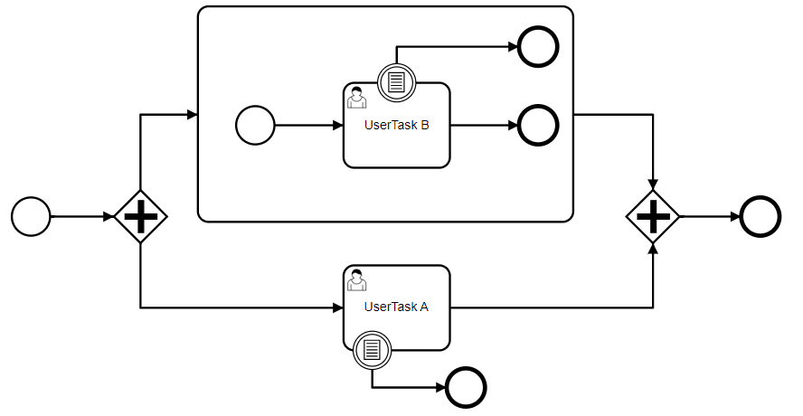

Если мы запустили описанный выше процесс и *UserTask B* и *UserTask A* активны, то иерархия экземпляров активности будет следующей:

.. code-block::

    ProcessInstance
        UserTask A
        SubProcess
            UserTask B

Если переменная создана локально внутри *SubProcess*, её изменение может вызвать проверку условных событий этой области и вложенной *UserTask B*. Граничное событие соседней *UserTask A* не реагирует на это изменение: локальная переменная подпроцесса ему не видна.

Различайте создание локальной переменной и вызов ``execution.setVariable(...)``: последний может обновить уже существующую переменную родительской области.

Примеры
--------

Пример использования условного граничного события:

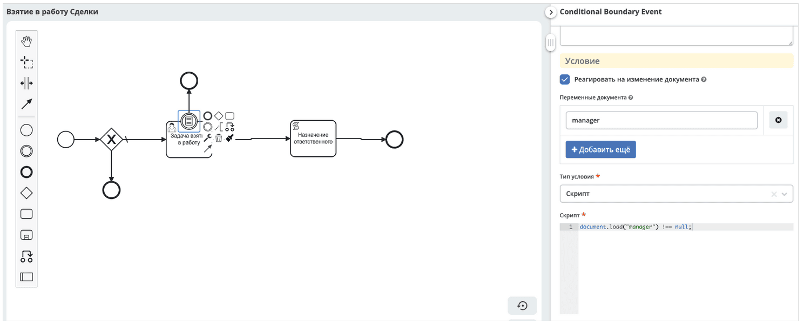

Скрипт:

.. code-block::

      document.load("manager") !== null;
