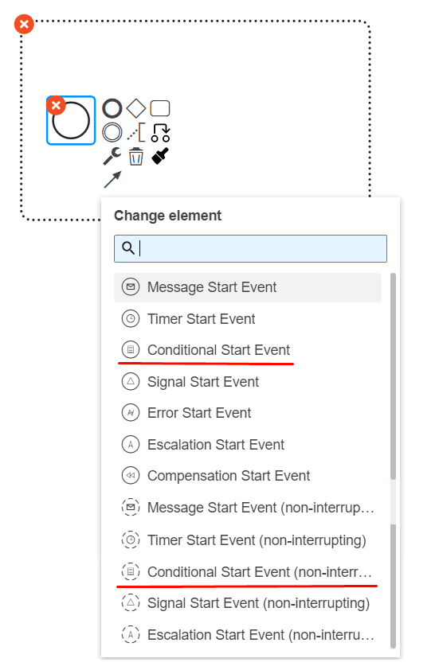
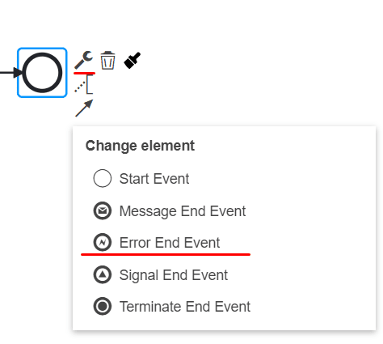
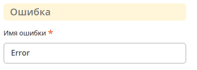
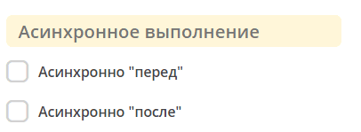
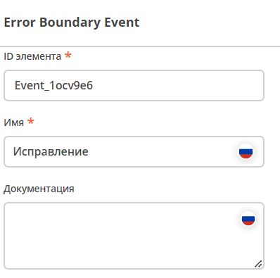
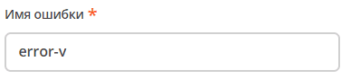

.. _ecos_bpmn_error:

Ошибка
======

.. contents::

**Событие BPMN с типом «Ошибка»** используется для моделирования возможных ошибок при выполнении процесса, а также для отображения последовательности действий по устранению этих ошибок.

BPMN не приводит какой-либо классификации возможных ошибок. Бизнес-аналитик сам выбирает какая ошибка может возникнуть в проектируемом процессе.

**Событие «Ошибка»** может быть стартовым событием событийного подпроцесса, граничным событием активности или конечным событием.

BPMN-ошибка может быть выброшена конечным событием **«Ошибка»** или кодом исполняемого сервиса через ``org.camunda.bpm.engine.delegate.BpmnError``. Не следует считать, что любое техническое исключение автоматически является BPMN-ошибкой и будет обработано этим событием.

Начальное событие «Ошибка»
---------------------------

**Начальное событие «Ошибка»** используется только для запуска событийного подпроцесса и является прерывающим. При его срабатывании прерываются обычные выполнения охватывающей области и запускается событийный подпроцесс обработки ошибки.

Конечное событие «Ошибка»
--------------------------

**Конечное событие «Ошибка»** показывает, что в результате выполнения процесса произошла ошибка.

Когда выполнение процесса достигает события завершения ошибки, текущий путь выполнения завершается и выдается ошибка.

Эту ошибку можно перехватить граничным событием **«Ошибка»** или начальным событием **«Ошибка»** событийного подпроцесса в подходящей охватывающей области.

.. note::

   Если подходящий обработчик ошибки не найден, Camunda по умолчанию записывает информацию в журнал и завершает текущую ветку выполнения. При включённом параметре движка ``enableExceptionsAfterUnhandledBpmnError`` вместо этого выбрасывается исключение. См. `обработку неперехваченных BPMN-ошибок <https://docs.camunda.org/manual/7.24/reference/bpmn20/events/error-events/#unhandled-bpmn-error>`_.

.. image:: _static/error_event_2.png
   :width: 600
   :align: center

На рисунке — **(1)**

Имя
~~~

Необязательное отображаемое имя BPMN-элемента. Оно не используется для сопоставления ошибок.

.. image:: _static/error_event_4_1.png
   :width: 300
   :align: center

Имя ошибки
~~~~~~~~~~

Имя определения ошибки, по которому Citeck формирует общую BPMN-ошибку в описании процесса. Поле обязательно.

Для независимых определений используйте разные имена. Если имя используется повторно, код и сообщение должны быть согласованы: события с одинаковым именем ссылаются на одно общее определение.

Код
~~~

Код выбрасываемой ошибки, используемый для сопоставления с обработчиком. Для конечного события поле обязательно в форме.

.. image:: _static/error_event_4_3.png
   :width: 300
   :align: center

Сообщение
~~~~~~~~~

Необязательное сообщение выбрасываемой ошибки. Обработчик может получить его через настроенную **«Переменную ошибки»**.

Настройки асинхронности
~~~~~~~~~~~~~~~~~~~~~~~

- **Асинхронно "перед"** — исполнение доходит до точки перед блоком, транзакция комитится и дальнейшее выполнение ставится в очередь, которую разбирает уже джоба.
- **Асинхронно "после"** — исполнение доходит до точки после блока, транзакция комитится и дальнейшее выполнение ставится в очередь, которую разбирает уже джоба.

См. подробнее о `асинхронных задачах <https://camunda.com/blog/2014/07/advanced-asynchronous-continuations/>`_.

Граничное событие «Ошибка»
---------------------------------

**Граничное событие «Ошибка» (Boundary Error Event)** всегда является прерывающим. Это означает, что перехваченная ошибка прерывает выполнение привязанной активности, и поток операций идет по другому маршруту.

На рисунке — **(2)**

.. image:: _static/error_event_5.png
   :width: 300
   :align: center

Название события
~~~~~~~~~~~~~~~~

Необязательное отображаемое имя граничного события.

Имя ошибки
~~~~~~~~~~

Укажите обязательное имя определения ошибки для обработчика. Оно может отличаться от имени определения выбрасываемой ошибки: сопоставление выполняется по коду.

Код
~~~

Код ошибки, которую должен перехватывать обработчик. Если оставить поле пустым, обработчик принимает BPMN-ошибки без ограничения по коду.

.. image:: _static/error_event_6_3.png
   :width: 300
   :align: center

Переменная кода
~~~~~~~~~~~~~~~

Необязательное имя переменной, которая будет содержать код перехваченной ошибки.

Переменная ошибки
~~~~~~~~~~~~~~~~~

Необязательное имя переменной, в которой будет содержаться сообщение перехваченной ошибки.

.. image:: _static/error_event_6_5.png
   :width: 300
   :align: center

Настройки асинхронности
~~~~~~~~~~~~~~~~~~~~~~~

- **Асинхронно "перед"** — исполнение доходит до точки перед блоком, транзакция комитится и дальнейшее выполнение ставится в очередь, которую разбирает уже джоба.
- **Асинхронно "после"** — исполнение доходит до точки после блока, транзакция комитится и дальнейшее выполнение ставится в очередь, которую разбирает уже джоба.

См. подробнее о `асинхронных задачах <https://camunda.com/blog/2014/07/advanced-asynchronous-continuations/>`_.

.. image:: _static/error_event_6_6.png
   :width: 300
   :align: center

Boundary Error Event перехватывает ошибки, возникающие в области выполнения активности, к которой оно прикреплено.

Определение error boundary event наиболее целесообразно для встроенного подпроцесса или действия вызова, поскольку подпроцесс создает область действия для всех действий внутри подпроцесса.

.. note::

   Ошибка распространяется вверх по охватывающим областям до подходящего обработчика. Сопоставление выполняется по коду ошибки; отображаемые имена источника и обработчика не обязаны совпадать.

Когда **событие «Ошибка»** перехвачено, действие, для которого определено граничное событие (boundary event), завершается, а также завершаются все текущие выполнения в нем (например, параллельные действия, вложенные подпроцессы и т. д.). Выполнение процесса продолжается в соответствии с исходящим потоком последовательности boundary event.

errorCode (код ошибки) используется для сопоставления обнаруженных ошибок:

- Если установлена *errorCodeVariable (Переменная кода)*, код ошибки можно получить с помощью этой переменной.
- Если установлена переменная *errorMessageVariable (Переменная ошибки)*, сообщение об ошибке можно получить с помощью этой переменной.

.. important::

   При настройке события учитывайте:

   - **«Имя ошибки»** обязательно для всех описанных видов события; серверная валидация запрещает пустое имя и имя из пробелов.
   - **«Код»** обязателен в форме конечного события. У обработчика он необязателен: пустое поле означает отсутствие ограничения по коду.
   - **«Переменная кода»** и **«Переменная ошибки»** необязательны и задаются у обработчика.

   В форме длина имени ошибки, кода и имён переменных ограничена 50 символами.
