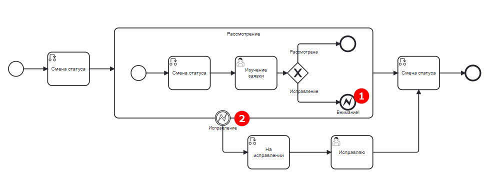
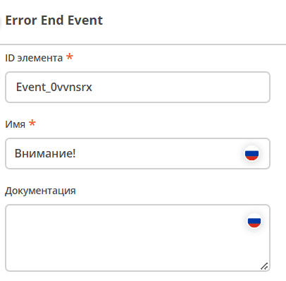
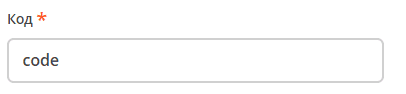
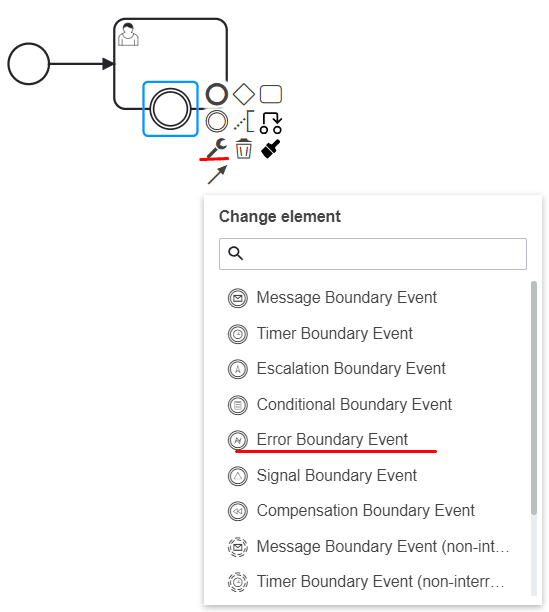
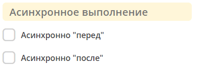

.. _ecos_bpmn_error:

Ошибка
======

.. contents::

**Событие BPMN с типом «Ошибка»** используется для моделирования возможных ошибок при выполнении процесса, а также для отображения последовательности действий по устранению этих ошибок.

BPMN не приводит какой-либо классификации возможных ошибок. Бизнес-аналитик сам выбирает какая ошибка может возникнуть в проектируемом процессе.

**Событие «Ошибка»** может быть стартовым событием событийного подпроцесса, граничным событием активности или конечным событием.

Начальное событие «Ошибка»
---------------------------

**Начальное событие «Ошибка»** используется только для запуска событийного подпроцесса. Событийный подпроцесс, начинающийся с ошибки, всегда прерывает родительский процесс.

.. image:: _static/error_event_1.png
   :width: 300
   :align: center

Конечное событие «Ошибка»
--------------------------

**Конечное событие «Ошибка»** показывает, что в результате выполнения процесса произошла ошибка.

Когда выполнение процесса достигает события завершения ошибки, текущий путь выполнения завершается и выдается ошибка.

Эту ошибку можно перехватить с помощью соответствующего промежуточного граничного события с типом "Ошибка" (Boundary Catch Event).

.. note::

   Если подходящий обработчик ошибки не найден, Camunda по умолчанию записывает информацию в журнал и завершает текущую ветку выполнения. При включённом параметре движка ``enableExceptionsAfterUnhandledBpmnError`` вместо этого выбрасывается исключение. См. `обработку неперехваченных BPMN-ошибок <https://docs.camunda.org/manual/7.24/reference/bpmn20/events/error-events/#unhandled-bpmn-error>`_.

На рисунке — **(1)**

.. image:: _static/error_event_3.png
   :width: 300
   :align: center

Имя
~~~

Имя ошибки
~~~~~~~~~~

.. image:: _static/error_event_4_2.png
   :width: 300
   :align: center

Код
~~~

Сообщение
~~~~~~~~~

.. image:: _static/error_event_4_4.png
   :width: 300
   :align: center

Настройки асинхронности
~~~~~~~~~~~~~~~~~~~~~~~

- **Асинхронно "перед"** — исполнение доходит до точки перед блоком, транзакция комитится и дальнейшее выполнение ставится в очередь, которую разбирает уже джоба.
- **Асинхронно "после"** — исполнение доходит до точки после блока, транзакция комитится и дальнейшее выполнение ставится в очередь, которую разбирает уже джоба.

См. подробнее о `асинхронных задачах <https://camunda.com/blog/2014/07/advanced-asynchronous-continuations/>`_.

.. image:: _static/error_event_4_5.png
   :width: 300
   :align: center

Граничное событие «Ошибка»
---------------------------------

**Граничное событие «Ошибка» (Boundary Error Event)** всегда является прерывающим. Это означает, что перехваченная ошибка прерывает выполнение привязанной активности, и поток операций идет по другому маршруту.

На рисунке — **(2)**

Название события
~~~~~~~~~~~~~~~~

.. image:: _static/error_event_6_1.png
   :width: 300
   :align: center

Имя ошибки
~~~~~~~~~~

.. image:: _static/error_event_6_2.png
   :width: 300
   :align: center

Код
~~~

Переменная кода
~~~~~~~~~~~~~~~

Имя переменной, которая будет содержать код ошибки.

.. image:: _static/error_event_6_4.png
   :width: 300
   :align: center

Переменная ошибки
~~~~~~~~~~~~~~~~~

Имя переменной, в которой будет содержаться сообщение об ошибке.

Настройки асинхронности
~~~~~~~~~~~~~~~~~~~~~~~

- **Асинхронно "перед"** — исполнение доходит до точки перед блоком, транзакция комитится и дальнейшее выполнение ставится в очередь, которую разбирает уже джоба.
- **Асинхронно "после"** — исполнение доходит до точки после блока, транзакция комитится и дальнейшее выполнение ставится в очередь, которую разбирает уже джоба.

См. подробнее о `асинхронных задачах <https://camunda.com/blog/2014/07/advanced-asynchronous-continuations/>`_.

Boundary Error Event перехватывает ошибки, возникающие в области выполнения активности, к которой оно прикреплено.

Определение error boundary event наиболее целесообразно для встроенного подпроцесса или действия вызова, поскольку подпроцесс создает область действия для всех действий внутри подпроцесса. Ошибки выдаются конечным событием «Ошибка».

.. note::

   Такая ошибка будет распространять свои родительские области вверх до тех пор, пока не будет найдена область, в которой определено граничное событие ошибки, соответствующее определению события ошибки.

Когда **событие «Ошибка»** перехвачено, действие, для которого определено граничное событие (boundary event), завершается, а также завершаются все текущие выполнения в нем (например, параллельные действия, вложенные подпроцессы и т. д.). Выполнение процесса продолжается в соответствии с исходящим потоком последовательности boundary event.

errorCode (код ошибки) используется для сопоставления обнаруженных ошибок:

- Если установлена *errorCodeVariable (Переменная кода)*, код ошибки можно получить с помощью этой переменной.
- Если установлена переменная *errorMessageVariable (Переменная ошибки)*, сообщение об ошибке можно получить с помощью этой переменной.

.. important::

  При сохранении, сохранении/публикации процесса проверяется обязательность заполнения следующих полей:

   - **«Имя ошибки»**;
   - **«Код»**

  Иначе в :ref:`линтере <bpmn_linter>` будет выдана ошибка.
