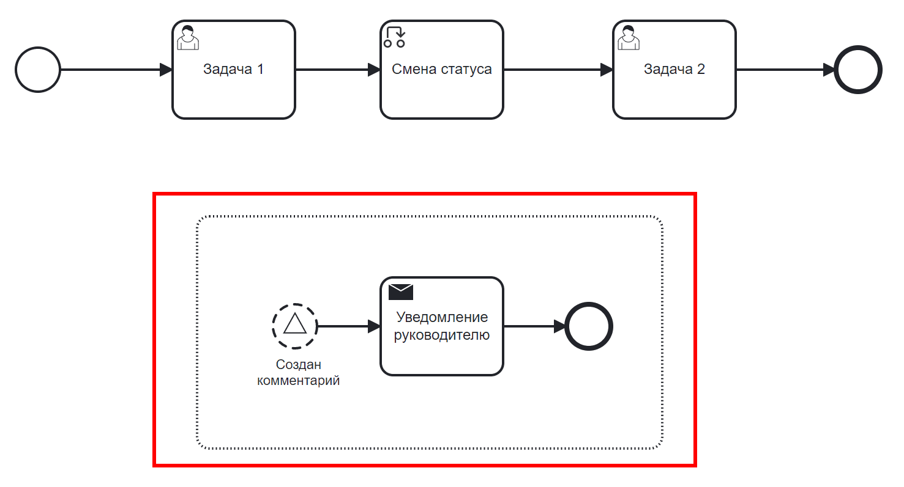
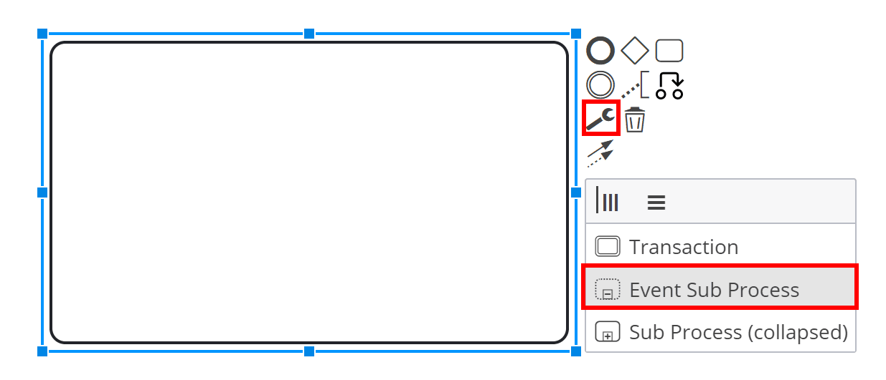
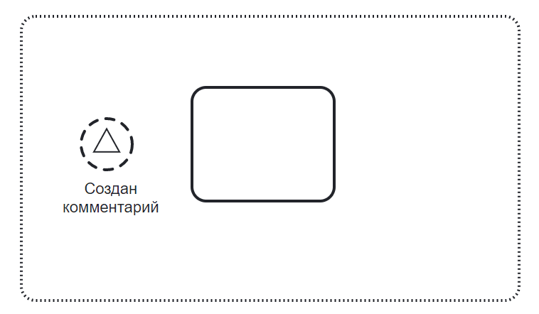
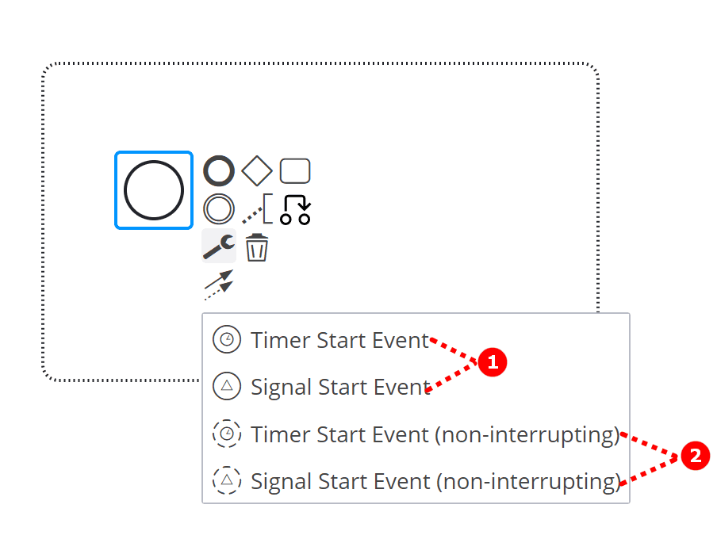

.. _event_subprocess:

Событийный подпроцесс
=====================

.. contents::

**Событийный подпроцесс** — подпроцесс, запускаемый событием.

Событийный подпроцесс изображается на схеме прямоугольником с закругленными углами и границей, выполненной тонкой пунктирной линией.

Событийный подпроцесс BPMN запускается собственным стартовым событием и не имеет входящих и исходящих потоков операций, что отличает его от обычного подпроцесса, который запускается потоком операций родительского процесса.

Он существует внутри родительского процесса и использует его области видимости переменных. Отдельное копирование переменных при запуске и завершении, как у Call activity, не настраивается. Подробнее о структуре и переменных см. :ref:`Подпроцесс <sub_process>`.

Создание
--------

Для создания событийного подпроцесса создайте сначала стандартный :ref:`подпроцесс <sub_process>`. И далее выберите:

После преобразования подпроцесса в событийный:

1. Добавьте внутри него одно стартовое событие нужного типа.
2. Выберите прерывающий или непрерывающий вариант, если тип события допускает оба.
3. Заполните параметры стартового события по соответствующей статье ниже.
4. Соедините стартовое событие с внутренними действиями подпроцесса.

Сам событийный подпроцесс не соединяйте входящими и исходящими потоками операций с основной схемой.

Типы стартовых событий
-----------------------

Для запуска событийного подпроцесса могут быть использованы следующие типы событий:

- :ref:`Таймер <ecos_bpmn_timer>`;
- :ref:`Событие Citeck <ecos_bpmn_events>`;
- :ref:`Ошибка <ecos_bpmn_error>` — только прерывающий вариант;
- :ref:`Условие <ecos_bpmn_conditional>`.

Прерывающий и непрерывающий подпроцесс
----------------------------------------

Событийный подпроцесс может быть **прерывающим (interrupting)** и **непрерывающим (non-interrupting)**.

.. tab-set::

    .. tab-item:: Прерывающий

        При его запуске активные выполнения в охватывающей области процесса или подпроцесса отменяются, и управление переходит в событийный подпроцесс. После его завершения отменённые задачи и ветки не возобновляются. Прерывание относится к конкретному экземпляру охватывающей области, а не ко всем экземплярам бизнес-процесса.

    .. tab-item:: Непрерывающий

        Не прерывает основной процесс и выполняется параллельно с ним. Например, параллельно с работой основного процесса может идти его проверка или иное действие. Непрерывающих событийных подпроцессов может одновременно выполняться несколько.

        Пока охватывающая область активна и соответствующая подписка действует, новые подходящие события могут запускать дополнительные экземпляры. Возможность и частота повторного запуска зависят от типа и настроек стартового события: например, от цикла таймера или фильтра события Citeck.

Прерывающий и непрерывающий событийные подпроцессы отличаются друг от друга только типом стартового события, поэтому настройка этого отличия производится не из свойств подпроцесса, а из свойств стартового события:

**1** — стартовые события для **прерывающего** событийного подпроцесса

**2** — стартовые события для **непрерывающего** событийного подпроцесса

Данные, доступные обработчику при запуске, зависят от типа события. Например, событие Citeck может передавать данные в переменной ``event``; наличие одинакового набора данных для таймера, ошибки и условия предполагать нельзя.

Создание остальных элементов подпроцесса аналогично описанным в разделе :ref:`Компоненты Citeck BPMN <ecos_bpmn_components>`.
