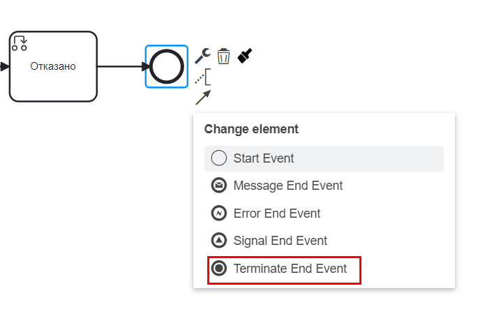
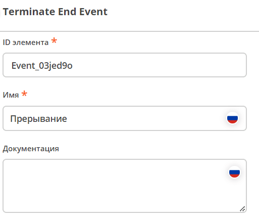
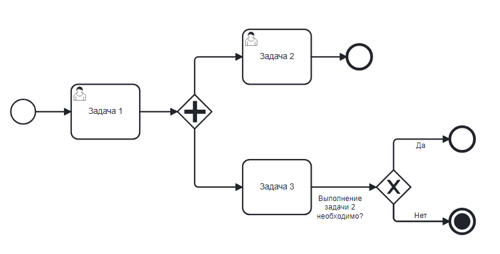

.. _ecos_bpmn_termination:

Прерывающее
===========

.. contents::

**Прерывающее событие** немедленно завершает текущую область выполнения и все активные потоки внутри неё. На уровне процесса завершается весь процесс; внутри подпроцесса — этот подпроцесс.

**Прерывающее событие** может быть только конечным событием (Terminate End Event) в процессе.

Настройка
---------

Чтобы добавить прерывающее событие, выберите конечное событие и в меню замены элемента выберите **Terminate End Event**:

Специфичных настроек у данного типа события нет. Форма содержит стандартные поля: **«ID элемента»**, **«Номер элемента»**, **«Имя»** и **«Документация»**. Имя, номер и документация необязательны.

Поведение
---------

На уровне процесса **Terminate End Event** завершает текущий экземпляр процесса и отменяет оставшиеся активные выполнения внутри него.

Во встроенном подпроцессе завершается область этого подпроцесса и отменяются её активные выполнения. Это само по себе не означает завершения всего родительского процесса.

Пример
------

После выполнения «Задача 1» процесс разделяется на два параллельных потока — «Задача 2» и «Задача 3». Если после «Задачи 3» проверка «Выполнение задачи 2 необходимо?» дает ответ «Нет», процесс завершается через прерывающее событие, не дожидаясь завершения потока с «Задачей 2»:

