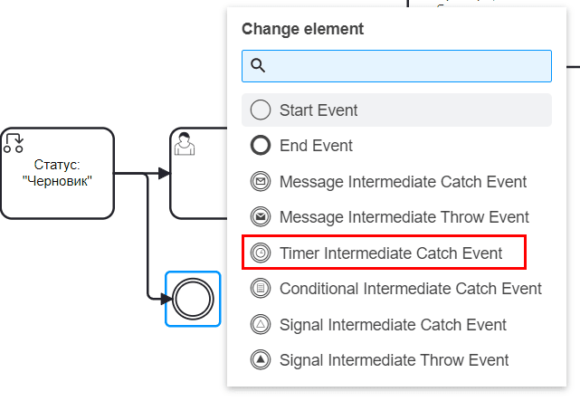
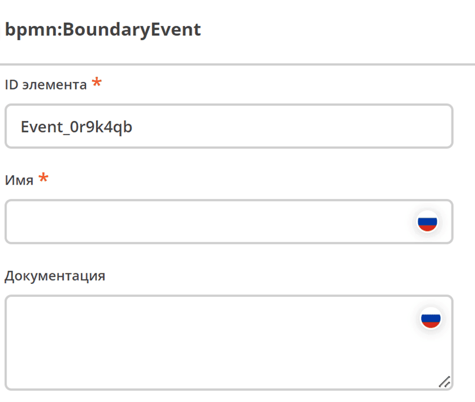
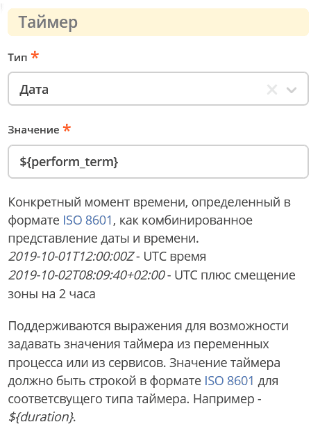
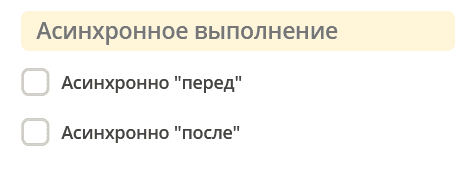
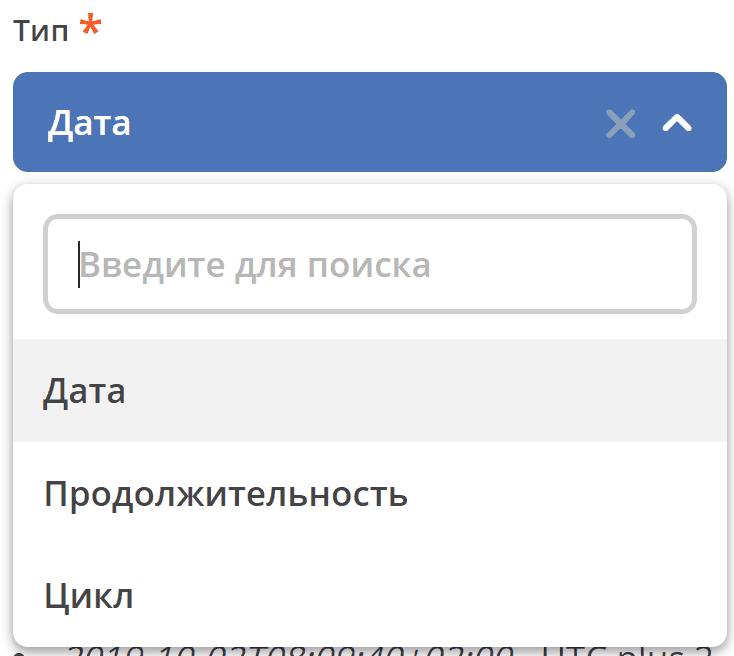

.. _ecos_bpmn_timer:

Таймер
======

**Событие «Таймер»** показывает ожидание процессом регулярного события, определенного момента времени или временного периода. На время ожидания текущий поток управления бизнес-процесса приостанавливается.

**Событие «Таймер»** всегда является событием-обработчиком: **стартовым**, **промежуточным обрабатывающим** или **граничным**. Граничный таймер ожидается во время выполнения активности и при срабатывании либо прерывает её, либо создаёт дополнительную ветку — в зависимости от выбранного варианта события.

.. contents::
   :local:
   :depth: 1

Атрибуты
--------

Имя
~~~~

При необходимости укажите **Имя** события. Поле необязательно.

Тип и Значение
~~~~~~~~~~~~~~

Выберите **Тип** таймера — **«Дата»**, **«Продолжительность»** или **«Цикл»** — и заполните **«Значение»** в соответствующем формате либо укажите выражение. По умолчанию в форме выбран тип **«Дата»**.

Настройки асинхронности
~~~~~~~~~~~~~~~~~~~~~~~~

- **Асинхронно "перед"** — исполнение доходит до точки перед блоком, транзакция комитится и дальнейшее выполнение ставится в очередь, которую разбирает уже джоба.
- **Асинхронно "после"** — исполнение доходит до точки после блока, транзакция комитится и дальнейшее выполнение ставится в очередь, которую разбирает уже джоба.

Эти флаги задают дополнительные границы выполнения события. Само ожидание таймера работает независимо от их включения. **Цикл повтора** фоновой задачи при ошибке исполнения и тип таймера **«Цикл»**, задающий расписание срабатываний, — разные настройки.

См. подробнее о `асинхронных задачах <https://camunda.com/blog/2014/07/advanced-asynchronous-continuations/>`_.

Возможные типы таймера
~~~~~~~~~~~~~~~~~~~~~~~

.. _time_format:

.. list-table::
   :header-rows: 1
   :widths: 15 35 25
   :class: tight-table

   * - Тип
     - Описание
     - Примеры
   * - **Дата**
     - Указанный момент времени, определяемый как комбинированное представление даты и времени в соответствии с `ISO 8601 <https://en.wikipedia.org/wiki/ISO_8601>`_.
     - | 2019-10-01T12:00:00Z — время UTC
       | 2019-10-02T08:09:40+02:00 — UTC плюс смещение зоны на 2 часа
   * - **Продолжительность**
     - Интервал ожидания от момента активации соответствующего таймера, заданный в формате длительности `ISO 8601 <https://en.wikipedia.org/wiki/ISO_8601>`_.
     - | PT15S — 15 секунд
       | PT1H30M — 1 час 30 минут
       | P14D — 14 дней
   * - **Цикл**
     - Цикл, определенный как формат повторяющихся интервалов `ISO 8601 <https://en.wikipedia.org/wiki/ISO_8601>`_.
     - | R5/PT10S — каждые 10 секунд, до 5 раз
       | R/P1D — каждый день без ограничения числа повторов, пока таймер активен

Повторы выполняются, пока таймер остаётся активным. Например, непрерывающий граничный таймер может отправлять напоминания до завершения задачи. Значение ``R/P1D`` не означает продолжение напоминаний после завершения задачи. Прерывающий граничный таймер при срабатывании отменяет прикреплённую активность.

Вы можете использовать выражения для значения таймера. Таким образом, вы можете влиять на определение таймера на основе переменных процесса. Переменные процесса должны содержать строку `ISO 8601 <https://en.wikipedia.org/wiki/ISO_8601>`_ (или cron для типа цикла) для соответствующего типа таймера.

Например — ``${duration}``.

Для таймера внутри выполняющегося процесса переменная должна быть доступна в области вычисления. Например, при типе **«Цикл»** можно указать ``${timeValue}``, если переменная ``timeValue`` содержит строку ``R/P1D``.

Стартовый таймер верхнего уровня настраивается до создания экземпляра процесса. Не рассчитывайте на доступность переменных ещё не созданного экземпляра; доступность используемых сервисов и конфигурации проверяйте отдельно.

.. important::

   В форме настройки таймера обязательны:

   - **«Тип»**;
   - **«Значение»**.

   Значение должно соответствовать выбранному типу таймера. Корректность формата или результата выражения проверяется движком при обработке определения таймера.
