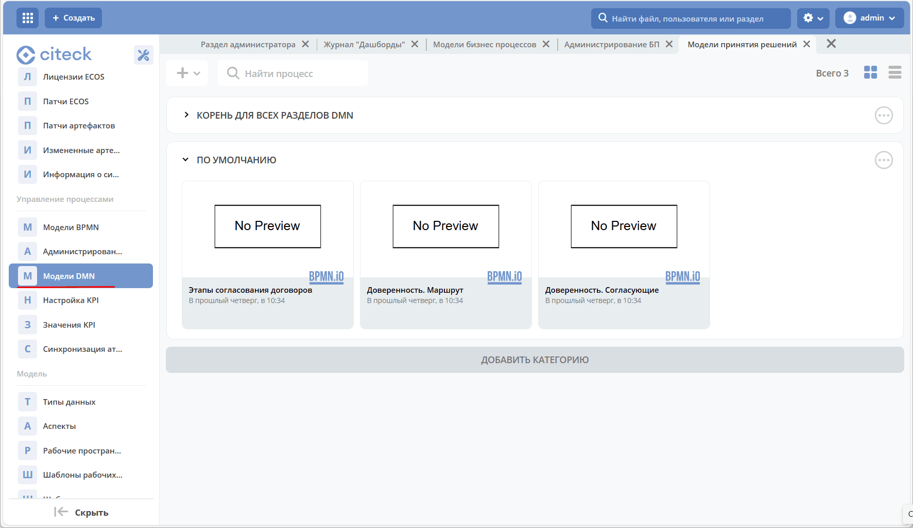

.. _ecos_dmn:

Общее описание Citeck DMN
==========================================

**Citeck DMN** — встроенный инструмент моделирования бизнес-правил и принятия решений на базе стандарта DMN (Decision Model and Notation). Он позволяет визуально описывать логику принятия решений в виде таблиц решений: задавать условия, входные и выходные параметры, правила применения — и напрямую использовать созданные модели в бизнес-процессах без написания кода.

Платформа основана на библиотеке редактора `dmn-js <https://bpmn.io/toolkit/dmn-js/>`_ и движке `camunda <https://camunda.com/>`_. Редактор поддерживает полный цикл работы с моделью решения: создание и редактирование таблицы, публикацию (деплой) и интеграцию с процессами BPMN.

Решения используются в :ref:`задачах бизнес-правило BPMN <business_rule_task>`, :ref:`динамических ролях <dmn_role>` и :ref:`условиях применения KPI <dmn_result_kpi>`. Источники входных переменных и требования к результату зависят от способа вызова; подробнее см. :ref:`Входные и выходные данные решения <dmn_decision_data>`.

Сохранение модели и публикация в движок — отдельные операции. Порядок создания, сохранения и публикации описан в разделе :ref:`Базовые операции <new_dmn>`.

Перейдите в журнал **"Модели DMN" (Рабочее пространство "Раздел администратора" - Управление процессами)**:

