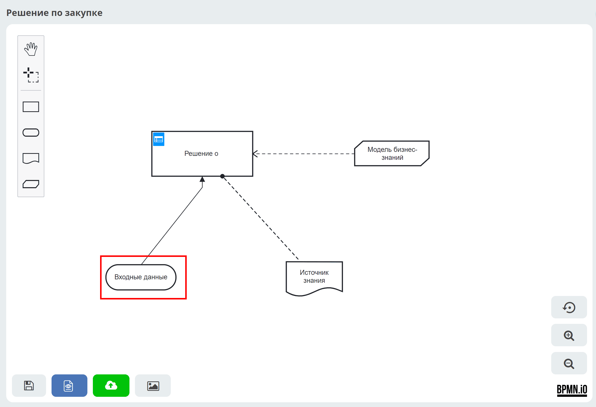

.. _dmn_input_data:

Входные данные
======================================

**Входные данные** — внешние данные, передаваемые в узел принятия решений или модель бизнес-знания. Элемент представляет бизнес-объекты и понятия предметной области — например, сведения о клиенте из кредитной заявки.

Вспомогательный неисполняемый элемент. Его добавление на диаграмму не загружает данные документа и не создаёт значения переменных автоматически. Значения передаются при вычислении решения; см. :ref:`Входные и выходные данные решения <dmn_decision_data>`.
