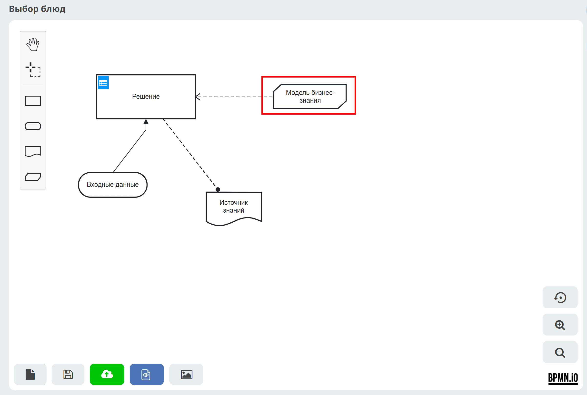

.. _dmn_knowledge_model:

Модель бизнес-знаний
================================================

**Модель бизнес-знаний (Business Knowledge Model, BKM)** в нотации DMN обозначает повторно используемую функцию. Она позволяет представить общую логику нескольких решений, зависящих от разных входных данных.

В рассматриваемом редакторе Citeck это вспомогательный неисполняемый элемент. Он используется для описания модели; настройка исполняемой функции BKM здесь не предусмотрена. Для выполнения логики используйте :ref:`решение <dmn_decision>` с таблицей или литеральным выражением.
