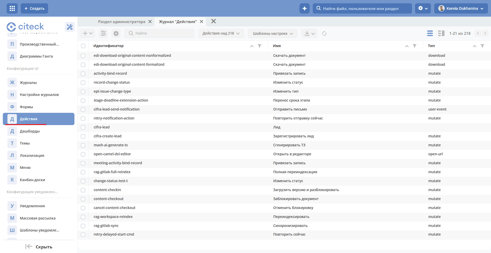
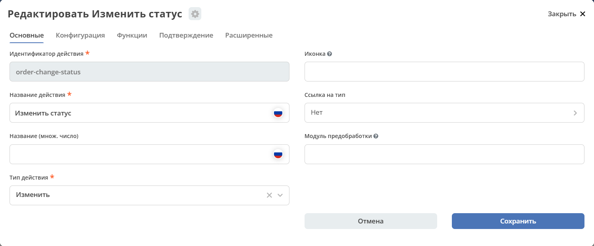
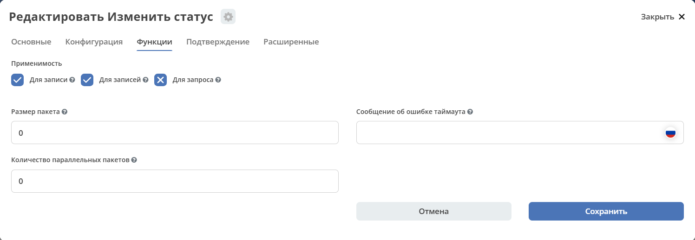
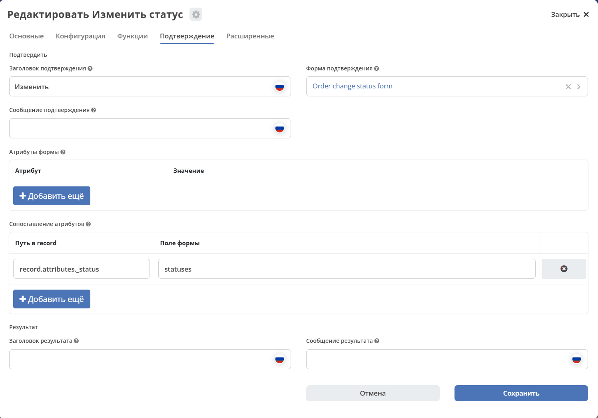
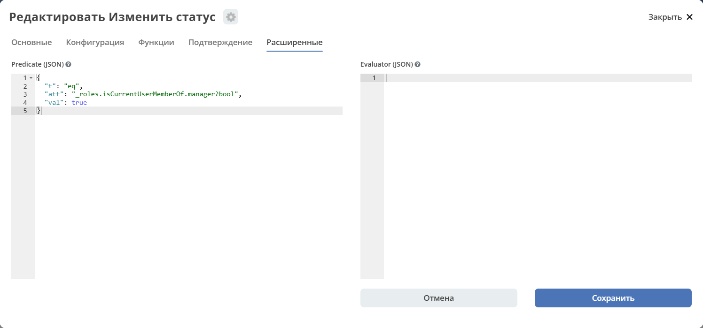

.. _ui_actions_create_ui:

Создание действия через интерфейс
=================================

Для просмотра существующих действий и их редактирования создан журнал **«Действия»** **(Рабочее пространство «Раздел администратора» - Конфигурация UI):**

.. contents::
    :depth: 2

Варианты получения экземпляра действия
--------------------------------------

Действие можно создать или загрузить уже созданное в систему.

.. tab-set::

   .. tab-item:: Создание

      Для создания действия необходимо нажать **+ - Создать действие**:

      .. image:: ../_static/ui_actions/UI/create_01_1.png
             :width: 500
             :align: center

      Откроется форма действия. Подробно см. :ref:`ниже <ui_actions_create_form>`.

   .. tab-item:: Загрузка

      Для загрузки созданного действия необходимо нажать **+ - Загрузить действие**:

      .. image:: ../_static/ui_actions/UI/create_01_2.png
             :width: 500
             :align: center

      Откроется общая форма загрузки модуля, в которой нужно выбрать файл действия в формате **.json**. Формат файла описан в разделе :ref:`Формат действия <ui_actions_format>`.

.. _ui_actions_create_form:

Создание нового действия
------------------------

Форма действия используется и при создании, и при редактировании действия. Она состоит из пяти вкладок: **Основные**, **Конфигурация**, **Функции**, **Подтверждение** и **Расширенные**.

Кнопка **«Сохранить»** неактивна, пока в форме есть ошибки валидации (например, не заполнено обязательное поле).

Основные
~~~~~~~~

.. list-table::
      :widths: 10 5 30
      :header-rows: 1
      :class: tight-table
      :align: center

      * - Поле
        - Ключ
        - Описание
      * - **Идентификатор действия** \*
        - ``id``
        - | Уникальный идентификатор действия.
          | Должен начинаться с латинской буквы и может содержать латинские буквы, цифры, ``_`` и ``-`` (шаблон ``^[a-zA-Z][a-zA-Z0-9_-]*$``).
          | Задается только при создании: при редактировании поле заблокировано.
      * - **Название действия** \*
        - ``name``
        - Название, которое увидит пользователь. Поддерживает локализацию.
      * - **Название (множ. число)**
        - ``pluralName``
        - Название действия во множественном числе. Поддерживает локализацию.
      * - **Тип действия** \*
        - ``type``
        - | Тип определяет логику, которая будет выполнена при запуске действия (``view``, ``edit``, ``delete``, ``download``, ``create``, ``open-url``, ``fetch``, ``mutate``, ``script``, ``transform``, ``user-event`` и др.).
          | От выбранного типа зависит содержимое вкладки **Конфигурация**.
          | Подробно о типах — в разделе :ref:`Типы действий <ui_actions_types>`.
      * - **Иконка**
        - ``icon``
        - Код иконки из иконочного шрифта Citeck, например ``icon-edit``, ``icon-delete``.
      * - **Ссылка на тип**
        - ``typeRef``
        - Тип данных, выбирается из журнала типов данных.
      * - **Модуль предобработки**
        - ``preActionModule``
        - Ссылка на JS-модуль предобработки.

\* — обязательное поле.

Конфигурация
~~~~~~~~~~~~

На вкладке задаются параметры ``config`` действия. Набор параметров зависит от типа действия и описан в разделе :ref:`Типы действий <ui_actions_types>`.

Вид вкладки зависит от значения поля **Тип действия**:

.. tab-set::

   .. tab-item:: Остальные типы

      Отображается редактор **Конфигурация (JSON)**, в котором задается конфигурация действия в формате JSON.

      Пример конфигурации для действия с типом :ref:`mutate <mutate_action>`, которое меняет статус текущей записи:

      .. image:: ../_static/ui_actions/UI/create_03.png
            :width: 700
            :align: center

      В конфигурации можно подставлять атрибуты записи, над которой выполняется действие, например ``${recordRef}``. Подробно — в разделе :ref:`Общие настройки любого действия <ui_actions_frontend_settings>`.

   .. tab-item:: Тип «script»

      Отображается редактор JavaScript, в котором пишется код действия. В редакторе доступны AI-подсказки.

      Код сохраняется в конфигурацию действия в виде ``{ "fn": "<код>" }``.

      .. image:: ../_static/ui_actions/UI/ai_script_help.png
            :width: 700
            :align: center

Функции
~~~~~~~

В блоке **Применимость** указывается, в каких режимах доступно действие (см. категории действий на странице :ref:`Действия <ui_actions>`). Каждый флажок имеет три состояния: включено, выключено и не задано.

.. list-table::
      :widths: 10 10 30
      :header-rows: 1
      :class: tight-table
      :align: center

      * - Поле
        - Ключ
        - Описание
      * - **Для записи**
        - ``features.execForRecord``
        - Действие выполняется над одной записью.
      * - **Для записей**
        - ``features.execForRecords``
        - Действие выполняется над записями, выбранными в журнале.
      * - **Для запроса**
        - ``features.execForQuery``
        - | Действие выполняется над всеми записями, которые подходят под фильтрацию журнала.
          | Если флажок включен, дополнительно отображается флажок ``execAsForRecords`` — выполнить действие так же, как для выбранных записей.
      * - **Размер пакета**
        - ``execForRecordsBatchSize``
        - Количество записей в одном пакете при выполнении действия над несколькими записями. По умолчанию ``0``.
      * - **Количество параллельных пакетов**
        - ``execForRecordsParallelBatchesCount``
        - Количество пакетов, обрабатываемых одновременно. По умолчанию ``1``.
      * - **Сообщение об ошибке таймаута**
        - ``timeoutErrorMessage``
        - Сообщение, которое увидит пользователь, если действие не выполнится за отведенное время. Поддерживает локализацию.

Подтверждение
~~~~~~~~~~~~~

На вкладке настраивается окно подтверждения, которое показывается перед выполнением действия, и уведомление о результате.

Блок **Подтвердить** (``confirm``):

.. list-table::
      :widths: 10 10 30
      :header-rows: 1
      :class: tight-table
      :align: center

      * - Поле
        - Ключ
        - Описание
      * - **Заголовок подтверждения**
        - ``confirm.title``
        - Заголовок окна подтверждения. Поддерживает локализацию.
      * - **Сообщение подтверждения**
        - ``confirm.message``
        - Текст в окне подтверждения. Поддерживает локализацию.
      * - **Форма подтверждения**
        - ``confirm.formRef``
        - Форма, которая отображается в окне подтверждения. Выбирается из журнала форм. Если форма задана, **Сообщение подтверждения** не отображается.
      * - **Атрибуты формы**
        - ``confirm.formAttributes``
        - Атрибуты, которые передаются в форму подтверждения: **Атрибут** — имя атрибута формы, **Значение** — выражение, например ``${name}``.
      * - **Сопоставление атрибутов**
        - ``confirm.attributesMapping``
        - | Куда передать данные, введенные на форме подтверждения: **Путь в record** — путь в конфигурации действия, **Поле формы** — ключ поля на форме.
          | На скриншоте выше значение поля ``statuses`` с формы подтверждения записывается в ``record.attributes._status`` конфигурации действия.

Блок **Результат** (``result``):

.. list-table::
      :widths: 10 10 30
      :header-rows: 1
      :class: tight-table
      :align: center

      * - Поле
        - Ключ
        - Описание
      * - **Заголовок результата**
        - ``result.title``
        - Заголовок уведомления о результате выполнения действия. Поддерживает локализацию.
      * - **Сообщение результата**
        - ``result.message``
        - Текст уведомления о результате выполнения действия. Поддерживает локализацию.

.. note::

   Если поля блока **Подтвердить** не заполнены, действие выполняется без подтверждения.

Расширенные
~~~~~~~~~~~

.. list-table::
      :widths: 10 5 30
      :header-rows: 1
      :class: tight-table
      :align: center

      * - Поле
        - Ключ
        - Описание
      * - **Predicate (JSON)**
        - ``predicate``
        - | Условие, при котором действие отображается пользователю. Подробно о :ref:`предикатах <ecos-predicate_main>`.
          | На скриншоте выше действие доступно только пользователям с ролью ``manager`` в текущей записи.
      * - **Evaluator (JSON)**
        - ``evaluator``
        - Вычислитель доступности действия. Пример — в разделе :ref:`Настройка действий в журналах <ui_actions_journal_settings>`.

Сохранение действия
-------------------

После нажатия **«Сохранить»** действие сохраняется в системе с учетом рабочих пространств:

- новое действие, а также копия действия с измененным идентификатором, создается в текущем рабочем пространстве;
- существующее действие при редактировании остается в своем рабочем пространстве;
- в идентификаторе можно явно указать рабочее пространство в виде ``<wsSysId>:<id>``.

.. warning::

   Если рабочее пространство, указанное в префиксе идентификатора, не совпадает с рабочим пространством действия, сохранение завершится ошибкой.

Подключение действия
--------------------

Чтобы действие появилось в интерфейсе, его нужно добавить в список действий:

- для карточки — в типе данных, см. :ref:`Настройка действий для карточки <ui_actions_card_settings>`;
- для журнала — в конфигурации журнала, см. :ref:`Настройка действий в журналах <ui_actions_journal_settings>`.
