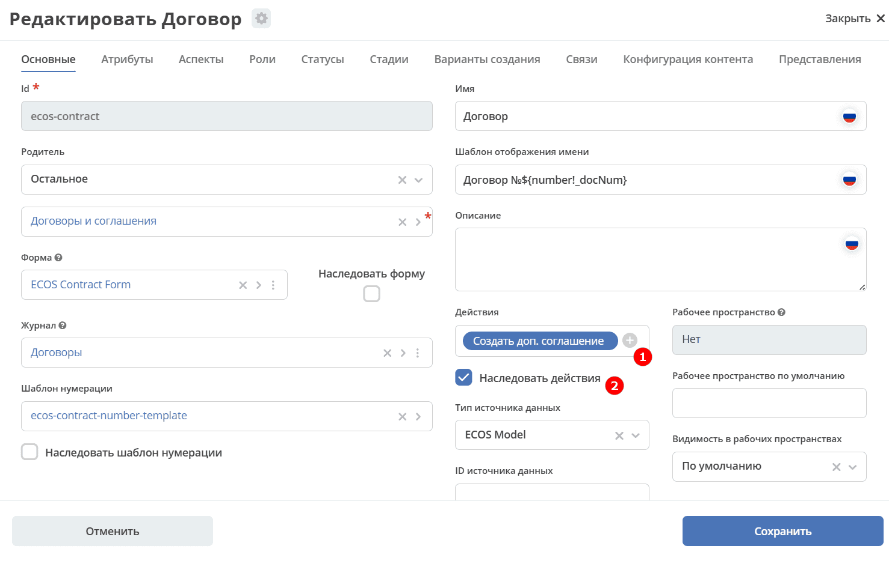
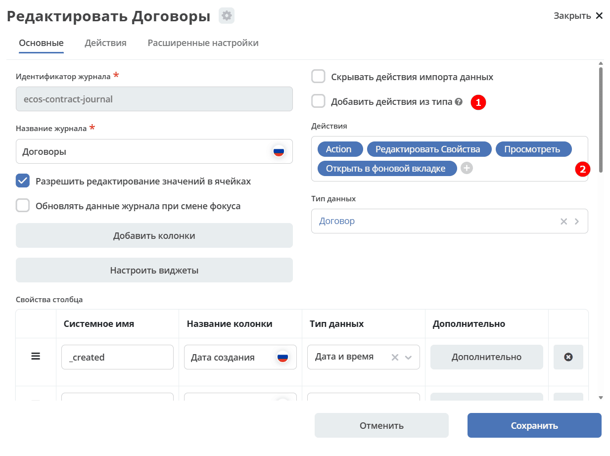

.. _ui_actions_extending:

Расширение и настройка действий
================================

Как добавлять новые действия и типы действий, настраивать списки действий для карточек и журналов, а также технические детали формата результата.

.. contents::
    :depth: 2

Расширение действий
--------------------

Добавление новых инстансов действий
~~~~~~~~~~~~~~~~~~~~~~~~~~~~~~~~~~~~~

Экземпляр действия описывается в JSON или YAML как артефакт типа ``ui/action``. Правила размещения и загрузки артефактов описаны в разделе :ref:`Артефакты <ecos_artifacts>`.

Пример описания:

.. code-block:: json

 {
    "id": "confirm-list-html",
    "key": "card-template.confirm-list.html",
    "name": "Скачать лист согласования",
    "type": "download-card-template",
    "config": {
        "templateType": "confirm-list",
        "format": "html"
    }
 }

Для тестирования эту конфигурацию можно загрузить в журнале действий вручную, см. :ref:`Создание действия через интерфейс <ui_actions_create_ui>`.

Добавление новых типов действий
~~~~~~~~~~~~~~~~~~~~~~~~~~~~~~~

Встроенные обработчики находятся в ``src/components/core/Records/actions/handler`` проекта ecos-ui. Новый исполнитель наследует ``ActionsExecutor`` и регистрируется в ``actionsRegistry``. Доступны только те режимы, методы которых он реализует.

Описать новое действие:

.. code-block:: javascript

    import ActionsExecutor from '@/components/core/Records/actions/handler/ActionsExecutor';

    export default class ShowRecordIdAction extends ActionsExecutor {
      static ACTION_ID = 'show-record-id';

      async execForRecord(record, action, context) {
        return {
          type: 'msg',
          data: { status: 'OK', message: record.id }
        };
      }

      getDefaultActionModel() {
        return { name: 'Показать идентификатор', icon: 'icon-small-eye-show' };
      }
    }

Зарегистрировать новый тип:

.. code-block:: javascript

    import actionsRegistry from '@/components/core/Records/actions/actionsRegistry';
    import ShowRecordIdAction from './ShowRecordIdAction';

    actionsRegistry.register(new ShowRecordIdAction());

Регистрацию нужно выполнить при загрузке модуля интерфейса до получения действий. После этого экземпляр действия может использовать ``type: show-record-id``. Встроенные обработчики регистрируются в ``src/components/core/Records/actions/actions.js``.

Реестр также доступен как ``window.Citeck.ActionsRegistry``. Подключаемому модулю нужно обеспечить доступ к совместимому базовому классу исполнителя; один JSON-артефакт не добавляет новый JS-обработчик. Для выполнения произвольного кода над записью можно использовать существующий тип :ref:`script <ui_action_script>`.

Для значений модели по умолчанию используется ``getDefaultActionModel()``, для ограничения по контексту интерфейса — ``isAllowedInContext(context)``. Проверка серверных прав и условий доступности настраивается отдельно.

Настройки списка действий
-------------------------

.. _ui_actions_card_settings:

Настройка действий для карточки
~~~~~~~~~~~~~~~~~~~~~~~~~~~~~~~

Настройка действий для карточки осуществляется в журнале типов данных, который располагается в системных журналах:

- **1** - выбрать список действий для типа.
- **2** - если стоит чекбокс, то действия наследуются от родителя.

Пример поля в конфигурации типа данных:

.. code-block:: json

  {
    "actions": [
      "uiserv/action@create-supplementary-agreement"
    ]
  }

.. _ui_actions_journal_settings:

Настройка действий в журналах
~~~~~~~~~~~~~~~~~~~~~~~~~~~~~

Настройка действий для журнала осуществляется в разделе **Конфигурация UI - Журналы**, который располагается в системных журналах:

- **1** — настройка добавления действий из типа. Состав итогового списка определяется серверной конфигурацией журнала: ``includeTypeActions``, ``actions`` и ``actionsDef``.

- **2** - выбор действий

Пример поля в конфигурации журнала:

.. code-block:: json

  {
    "actions": [
      "uiserv/action@download-zip",
      "uiserv/action@edit",
      "uiserv/action@view-dashboard",
      "uiserv/action@view-dashboard-in-background"
    ]
  }

Настройка действия, которое активно для записей с определенным mimetype контента:

.. code-block:: json

 {
    "id": "edit-in-onlyoffice",
    "key": "edit.onlyoffice",
    "name": "Редактировать Документ",
    "type": "open-url",
    "config": {
        "url": "/share/page/onlyoffice-edit?nodeRef=${recordRef}&new="
    },
    "evaluator": {
        "type": "predicate",
        "config": {
            "predicate": {
                "t": "in",
                "att": "_content.mimetype?str",
                "val": [
                    "application/vnd.openxmlformats-officedocument.wordprocessingml.document",
                    "application/vnd.openxmlformats-officedocument.spreadsheetml.sheet",
                    "application/vnd.openxmlformats-officedocument.presentationml.presentation",
                    "text/plain",
                    "text/csv"
                ]
            }
        }
    }
 }

Здесь серверный ``evaluator`` проверяет ``_content.mimetype?str`` на вхождение в список MIME-типов. URL в примере предназначен для стенда с подключённым legacy-редактором OnlyOffice; для другой интеграции задайте её адрес. Конфигурация загружается как экземпляр действия, а затем подключается к типу данных или журналу.

Техническая информация
----------------------

Вспомогательные параметры
~~~~~~~~~~~~~~~~~~~~~~~~~~~

.. list-table::
      :widths: 5 40
      :header-rows: 1
      :class: tight-table
      :align: center

      * - Параметр
        - Описание
      * - **actionRecord**
        - | В формах ``create`` и ``open-submit-form`` — исходный ``record.id``. В обычной форме ``edit`` — ``config.recordId`` или текущая запись.
          | Передаётся через ``options``. В ``create`` значение из ``config.options.actionRecord`` перезаписывается автоматически.
          | В task-ветке ``edit`` и форме ``task-outcome`` универсальной передачи этого параметра нет.
      * - **actionRecords**
        - Список записей, передаваемый в options групповой формы подтверждения. Для одиночного подтверждения используется ``actionRecord``. ``confirm.formOptions`` может переопределять автоматически сформированные options.

.. _ui_actions_result:

Ожидаемый формат результата действия
~~~~~~~~~~~~~~~~~~~~~~~~~~~~~~~~~~~~

Тип результата boolean или object (array - deprecated - обработка поддерживается)

Если возвращён объект с поддерживаемым ``type``, отображаются подробности выполнения. При групповом выполнении окно может появляться уже при запуске и закрываться при булевом результате. Режимы выполнения по запросу и обработки пакетами управляют окнами отдельно.

**link**

Отображаемый результат выполнения - ссылка на скачивания отчета

.. code-block:: json

  {
    "type": "link",
    "data": {
    "url": "..."
    }
  }

**results**

Таблица записей с результатом выполнения действия

.. code-block:: json

  {
    "type": "results",
    "data": {
    "results": [
      {
        "recordRef": "emodel/someType@a2fb0374-d69c-4861-8d03-4a30e395fb2d",
        "disp": "название записи",
        "status": "OK",
        "message": "Все хорошо"
      }
    ]
    }
  }

**error**

Вывод ошибки.
Возможно автоматическое создание.

.. code-block:: json

  {
    "type": "error",
    "data": {
    "message": "..."
    }
  }

**msg** и **info**

Тип ``msg`` показывает строку таблицы с ``data.status`` и ``data.message``. Тип ``info`` показывает информационный результат; например, серверное групповое действие использует строку ``data`` для уведомления об отправке результата по электронной почте.

.. code-block:: json

    {
      "type": "msg",
      "data": {
        "status": "OK",
        "message": "Действие выполнено"
      }
    }
