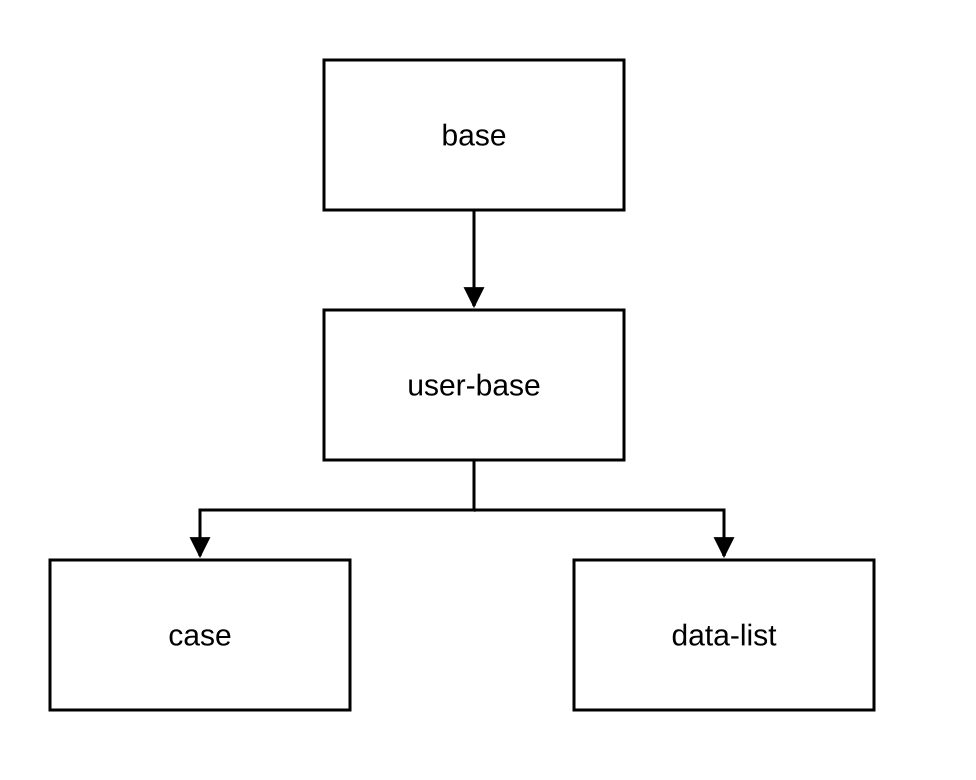
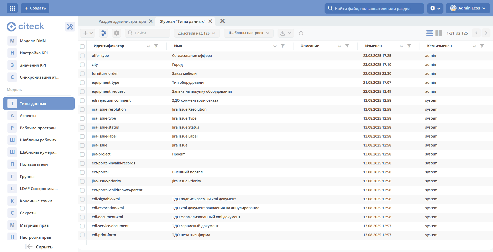
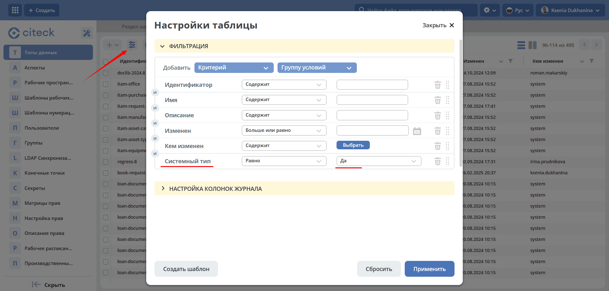
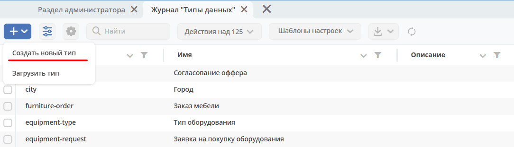
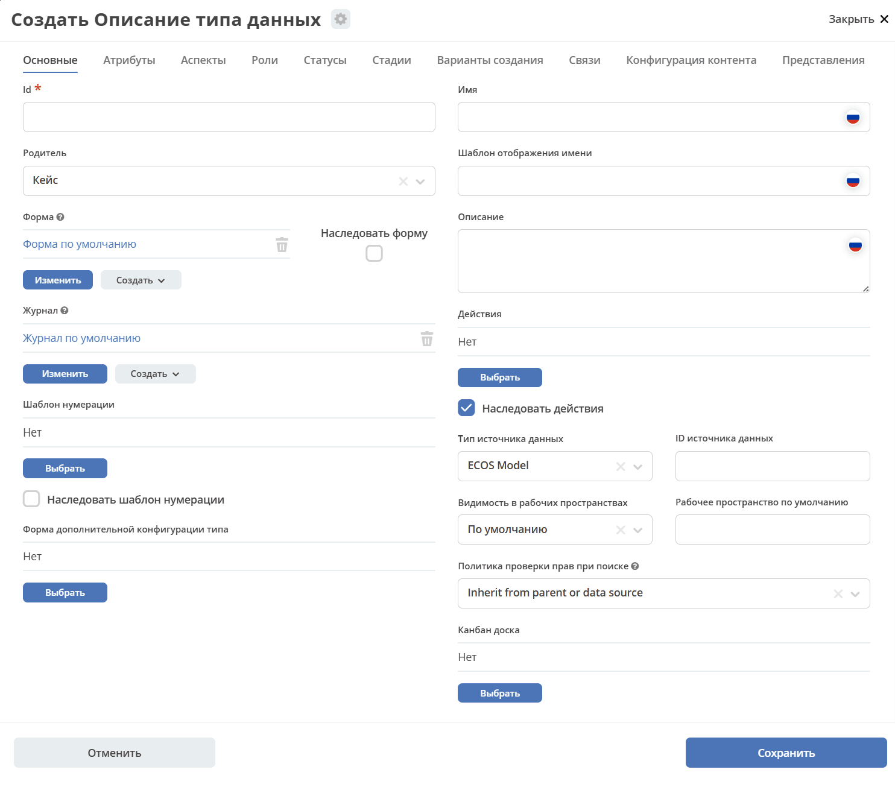
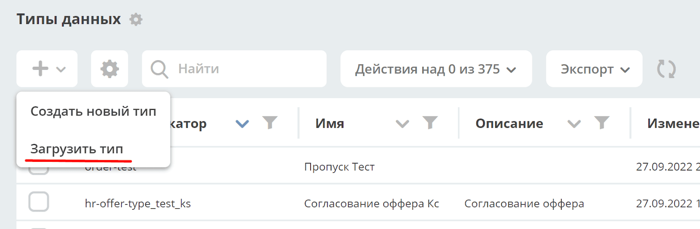
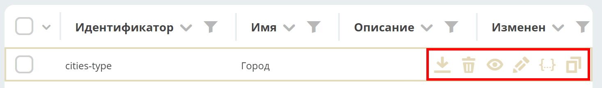

.. _data_types:

Типы данных
============

**Тип данных** — центральный артефакт модели Citeck, описывающий структуру и поведение объектов в системе. Он определяет набор атрибутов, роли, статусы жизненного цикла и связывает объект с формой и журналом. На основе типов данных строится вся логика работы с документами и бизнес-объектами — от создания до участия в бизнес-процессах.

Данный раздел описывает создание и настройку типов данных, управление их атрибутами, ролями, статусами, вариантами создания, связями и представлениями.

.. toctree::
   :maxdepth: 2

   data_types/data_types_creation
   data_types/data_types_attributes
   data_types/data_types_roles_statuses
   data_types/data_types_create_variants
   data_types/data_types_associations
   data_types/data_types_content_views
   data_types/data_types_parameters
   data_types/data_types_type_rights
   data_types/data_types_auto_journal_form

Общий обзор (Overview)
------------------------

Типы данных — артефакты с типом **model/type**.

Для работы с объектами типа данных используются:

  * :ref:`Форма <forms>`
  * :ref:`Журнал <journals>`

В настройках типа можно выбрать автоматически формируемые форму и журнал либо указать собственные артефакты. Подробнее — :ref:`auto_journal_form`.

.. _data_types_types:

Иерархия системных типов и логика их наследования
~~~~~~~~~~~~~~~~~~~~~~~~~~~~~~~~~~~~~~~~~~~~~~~~~~

Типы образуют иерархию с корневым типом ``base``. Для пользовательского типа выбирают родителя; в форме создания по умолчанию выбран ``case``. Если родитель в определении не указан, при разрешении типа используется ``base`` (кроме самого корневого типа).

Ниже показана часть иерархии базовых типов:

**Кейс (case)** — базовый тип для бизнес-объектов, с которыми работают через карточку и которые могут участвовать в бизнес-процессах. Связь с процессом настраивается по задаче; выбор родителя ``case`` сам по себе не требует прикрепления процесса.

**Элемент справочника (data-list)** — базовый тип для справочных бизнес-данных, используемых другими объектами системы. Он отличается начальными настройками действий, в том числе отсутствием перехода на карточку после создания. Его настройка не ограничена общей информацией и атрибутами: при необходимости можно задать роли, статусы и права.

В форме также доступны родители **«Документ» (document)**, **«Файл библиотеки документов» (workspace-file)**, **«Публикация» (publication)** и вариант **«Остальное»** для выбора другого существующего типа.

Родителем может быть глобальный тип или тип из того же рабочего пространства. Глобальный тип не может наследоваться от типа рабочего пространства. Циклическое наследование не допускается.

Родительские атрибуты попадают в список **наследуемых атрибутов** (:ref:`Атрибуты <ecos-model_label>`). Отдельные флаги позволяют наследовать форму, действия и шаблон нумерации. Для наследования формы или шаблона нумерации собственная ссылка должна быть пустой. При наследовании действий родительский список объединяется с собственным.

.. _data_types_admin:

Описание перехода к разделу через интерфейс
~~~~~~~~~~~~~~~~~~~~~~~~~~~~~~~~~~~~~~~~~~~~

Для просмотра существующих типов и их редактирования создан журнал **"Типы данных" (Рабочее пространство "Раздел администратора" - Модель)**:

По умолчанию в журнале не отображаются системные типы.

Для отображения **ТОЛЬКО** системных типов перейдите в настройки таблицы, выставите **Системный тип - Да**:

Создание и загрузка описания типа
~~~~~~~~~~~~~~~~~~~~~~~~~~~~~~~~~~~

Тип данных можно создать или загрузить уже созданный в систему.

Создание
"""""""""

Для создания типа данных необходимо нажать **+ - Создать новый тип**:

Откроется форма создания типа данных:

Загрузка
"""""""""

Для загрузки созданного типа данных необходимо нажать **+ - Загрузить тип**:

Файл формата **.yaml**

Пример описания типа
"""""""""""""""""""""

.. code-block:: yaml

    id: hr-offices-type
    name:
      ru: Офисы
    storageType: ECOS_MODEL
    parentRef: emodel/type@data-list
    formRef: uiserv/form@hr-offices-form
    journalRef: uiserv/journal@hr-offices-journal
    inheritActions: false
    defaultCreateVariant: true
    model:
      attributes:
        - id: officesCode
          name:
            ru: Код
        - id: officesCity
          name:
            ru: Город
        - id: officesAddress
          name:
            ru: Адрес

Форма ``hr-offices-form`` и журнал ``hr-offices-journal`` из примера должны существовать в системе. Для автоматически формируемых артефактов используйте ссылки ``uiserv/form@DEFAULT_FORM`` и ``uiserv/journal@DEFAULT_JOURNAL``.

Доступные действия с записью
-----------------------------

В журнале администратору с каждой записью доступен стандартный набор действий:

  - :ref:`редактировать права <data_type_rights>`;
  - скачать описание типа в формате YAML;
  - удалить;
  - открыть карточку в соседней вкладке;
  - открыть на редактирование;
  - редактировать JSON-представление типа;
  - копировать.

Создание нового типа
----------------------

Форма создания нового типа состоит из следующих вкладок:

* :ref:`Основной <data_types_main>` – основные характеристики типа данных.
* :ref:`Атрибуты <ecos-model_label>` – характеристика, определяющая свойства объекта.
* :ref:`Аспекты <type_aspects>` – функционал расширения типа данных без изменения самого типа.
* :ref:`Роли <roles_statuses>` – роли, которые участвуют в работе с объектом.
* :ref:`Статусы <associations>` – состояния объекта в его жизненном цикле.
* :ref:`Стадии <stages>` – этапы жизненного цикла документа.
* :ref:`Варианты создания <create>` – настройка поддержки выбора варианта создания после выбора типа.
* :ref:`Связи <datatypes_associations>` – настраиваются для отображения, добавления и удаления связанных объектов в виджете «Связи» на карточке объекта.
* :ref:`Конфигурация контента <datatypes_content>` – настройки работы с содержимым (контентом).
* :ref:`Представления <datatypes_views>` – настройки списка, плиток и библиотеки документов.
